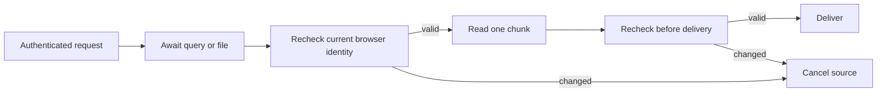

# Account changes during a response

An owner browser can change to a personal account while an earlier query,
download or sensor replay is still running. Checking only when a request or
socket first opens leaves the old request authorized for too long.

The legacy REST and both tRPC adapters now recheck current owner/browser scope
after the handler returns. Their response wrapper checks again before and after
each awaited body read. RAW downloads, database backups, archives and optional
MCP responses use the same boundary. Database downloads also recheck the
persisted household backup restriction while streaming.

Before response headers are sent, an access change returns an authentication
error. During an already-started stream, it ends the stream with an error;
consumers must treat a truncated download as incomplete. Cancellation kills an
archive producer and removes its temporary staging directory. A later exit from
that canceled producer cannot release a newer download's concurrency slot. Responses remain
private/no-store and vary by credentials.

The sensor WebSocket retains its original request identity and checks it on
each inbound message, outbound live frame, snapshot, replay and protocol reply.
An invalid identity closes the connection with policy code 1008. A 30-second
check remains for idle sockets. An asynchronous RAW seek rechecks while reading
and replaying, and closes its descriptor if access is lost. Server-side sensor
collection and local routines continue independently of browser connections.

## Scope and limits

- Already-delivered bytes cannot be recalled. The client must still clear its
  private views and caches when switching accounts.
- Withholding a response does not undo a command or database write already
  performed. Personal command/publication receipts remain necessary to reconcile
  unknown results; clients must not blindly replay a write after a 401.
- This change does not turn the legacy owner API into person-scoped access.
  A still-valid owner credential retains its existing scope. The persisted
  household privacy gate, old-client upgrade behavior, person-bound Health
  ingestion and shared telemetry consent remain separate activation requirements.
- No household flags, Pod services, device settings or home automations are
  enabled by this code. Physical acceptance and release are separate steps.

Regression coverage uses real HTTP response streams, real WebSocket connections,
persisted browser-scope rows, key rotation during awaited work, canceled archive
producers, continued valid streaming and existing replay/backpressure behavior.
