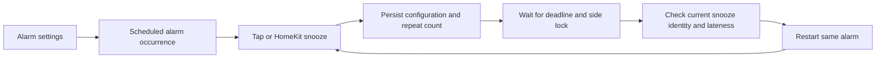

# Alarm snooze settings

Reviewed integration of upstream `5cb54f2304dd5de7ff1e732bb077d920619b0bea`,
adapted for the stable controller's tap actions and imported bedtime ownership.

Each scheduled alarm now stores `snoozeDuration` (integer seconds, 60–1800,
default 300) and `snoozeTaper` (0, 30, 40, 50 or 60 percent, default 0).
The web alarm and complete-bedtime editors read and save both fields. Grouping
and copying alarms includes them, so alarms with different snooze settings
remain distinct.

Tap snooze and HomeKit use the ringing alarm's configuration. The first snooze
uses its full duration; each subsequent snooze is shorter by the chosen
percentage, rounded to seconds with a five-second floor. For example, a
ten-minute alarm at 50% uses 600, 300 and 150 seconds. The repeat count belongs
to that alarm occurrence and resets for the next scheduled alarm. An alarm
without a saved duration uses five minutes for taps or nine minutes for HomeKit.
The legacy explicit-duration snooze API keeps its existing input contract.

## Client compatibility

Discover `features.alarmSnooze.implemented` through authenticated
`GET /api/v1/capabilities`. Do not infer support from an empty list of alarms.
This is software support; vibration routing, pattern, intensity, duration and
cancellation on the physical Pod 4 still require attended qualification.

- Calendar alarm create inputs default omitted fields; partial updates retain
  existing values. A client replacing an alarm through delete/create must send
  both fields. This legacy API has no whole-operation revision protection.
- `/api/v1/routines` includes both fields inside `draft.alarm`, when present.
  Clients must preserve them when editing, copying or moving a complete night.
  Default-only older clients remain compatible. A replacement or move which
  omits either field while touching a custom snooze returns HTTP 412 without
  changing any rows. Reload with a compatible client. Explicit removal remains
  possible.
- Complete routines retain revision checks, transaction boundaries and parent
  enablement. Changing snooze preferences does not enable a paused parent.
- Discover `features.curveLibrary` separately. The [calendar curve library](SCHEDULE_LIBRARY.md)
  preserves alarms and refuses to rewrite an imported bedtime side. Snooze
  support alone does not imply library support on an older controller.

## Upgrade and import

Generated migrations 0033/0034 add the fields and copy each side's first
configured snoozing **alarm** tap by tap count. Temperature taps with dormant
alarm fields are ignored. Values are bounded to 60–1800 seconds; no taper is
enabled automatically. The same migration updates bedtime JSON from its owned
alarm row, retaining ownership IDs and all other configuration.

The offline Free Sleep importer also maps the settings explicitly because it
inserts data after applying schema migrations. If a side had different snooze
lengths for different tap counts, its review report identifies the change to one
per-alarm duration. Review that choice before cutover. Back up the database
before upgrading; older servers cannot safely own the new schema.

## Runtime and evidence boundaries

Scheduled power-off uses the same alarm window as temperature arbitration:
warm-up begins 30 minutes before the alarm (or earlier for a longer wake
window), and the hold ends 15 minutes after its configured vibration duration.
For a 07:00 alarm lasting 30 seconds, a scheduled 07:00 or 07:05 power-off is
deferred until 07:15:30. This remains true after the recurring alarm callback
has advanced its next invocation to the following week. Disabled or cancelled
alarm jobs cannot create a new hold. Explicit power-on still invalidates a
previously deferred shutdown.

Real `node-schedule` callbacks with fake time, migrated in-memory SQLite and
mocked hardware cover both same-time registration orders, the exact hold
deadline, a later power-off, and disabled/cancelled alarm jobs. These are
software regression checks, not physical vibration or temperature evidence.
The warm-up and hold differ from Free Sleep's alarm behavior and still require
owner review before migration.

Pending snoozes retain their configuration and count through the existing
atomic alarm-state file. Persistence remains best-effort: disk-write failure is
logged, so this is not a power-loss durability claim. A restarted controller
restores a snooze at most ten minutes late; an older one is dropped. Snooze
timers leave an immediate request's expiry context because they are deliberate
future schedules, not delayed receipt replays.

All restart writes use the shared side lock. After waiting, the callback checks
that its pending snooze is still current and within the late grace period.
Cancellation or replacement while waiting invalidates it. Once a hardware
write has begun, cancelling a timer cannot retract that write; use the alarm
clear control and verify reported state. HomeKit and explicit API snooze writes
also share the side lock.

Behavioral tests cover migration of existing owned routines, offline imports,
old-client rejection without writes, grouping/copying, tapered gestures and
HomeKit, state-file reload, queue cancellation/replacement, late timers and
request-context isolation. Production browser checks use isolated SQLite
fixtures and keep the parent routine paused. They do not actuate a bed or count
as physical qualification or Preview nights.

On 2026-10-25, an offline upgrade of a new private SQLite backup of the previous
bedtime rehearsal passed integrity and real TypeScript ownership validation for
all 14 routines. The upgrade preserved every non-snooze configuration field and
row ownership ID, including one enabled power routine and zero enabled alarms.
Both source database hashes remained unchanged. The private verification record
is `~/Downloads/SleepyPod-Snooze-Rehearsal-2026-10-25/snooze-verification.json`.
No controller was started and no hardware commands were sent.
