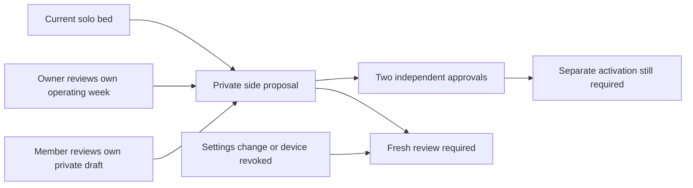

# Shared side review v1

This is a private proposal and independent approvals, **not activation**. The
current bed arrangement, schedules, controls and history attribution remain
unchanged after either or both approvals. No method in this service writes to
hardware or publishes a routine. `activateArrangement` remains false.

The separate `SLEEPYPOD_ARRANGEMENT_REVIEW=1` flag enables preparation and approval
only inside the authenticated household feature. It defaults off. No live Pod
flags or settings are changed by this implementation.

## Contract and clients

The authoritative schemas are `src/household/arrangementContract.ts`. Portable,
synthetic examples are in `src/household/fixtures/arrangement-review-v1.json`.
All requests use the existing personal device credential or personal cookie,
same-origin protection and pinned `X-Sleepypod-Sleeper-Id`. Owner connection keys
cannot approve for either person. Responses are private and no-store.

| Method | Path under `/api/v1` | Purpose |
| --- | --- | --- |
| GET | `household/arrangement` | `{ version: 1, review: null \| ownProjection }` for the latest review |
| GET | `household/arrangement/<reviewId>` | Current own projection of this household's review |
| POST | `household/arrangement` | Owner proposes `ownerSide`, explicitly preserving the operating week |
| POST | `household/arrangement/approve` | Each person acknowledges their own side, routine and separate activation |
| POST | `household/arrangement/cancel` | Either participant cancels the review |

Mutations include a UUID `requestId`, `version: 1`,
`expectedSessionRevision` and `expectedAssignmentRevision`. Approval additionally
includes `reviewId`, `issuedAt`, `expiresAt` (at most 60 seconds),
`confirmMySide: true`, `confirmMyRoutine: true`, and
`acknowledgeSeparateActivation: true`. Proposal includes `ownerSide` and
`confirmPreserveOperatingOwnerWeek: true`; cancellation includes `reviewId`.
There is no activation endpoint and no replay queue.

The projection contains only the authenticated person's preferences and full
week. For the partner it includes only display name, proposed side and approval
status. The review identifier is random, not a hash of private partner data.
`assignmentAtReview` describes the original solo/unassigned state, not a promise
about the current assignment. `canActivate` is always false and
`effect` is `review_only_bed_unchanged`.

The web workspace renders a proposed bed, the caller's complete seven-night
summary, three independent acknowledgments, refresh and cancellation. An
uncertain reply disables further review mutations until a GET reconciles the
current state. Reload also requires a GET. Private review bodies are not kept in
browser storage. Pending review actions do not block Stop controls.

## What is preserved and checked

Preparation requires an existing solo/follow household with exactly two active,
unassigned accounts: one owner and one member. Both must explicitly save their
preferences; the member must save a private routine draft. Revision-one default
preferences and an untouched empty draft cannot become an approved plan.

The owner's **actual operating source-side week** is copied, including disabled
nights, notes, every temperature phase, vibration parameters and custom snooze.
An unrelated unpublished owner draft does not replace it. The member contributes
only their own saved draft, which may explicitly contain no routines. Existing
unmanaged calendar schedules require review before proposing a side change.

A private snapshot binds both people, session/membership/assignment revisions,
the configuration and time zone, both existing operating weeks, personal
preferences and draft revisions. It is rechecked on reads and approvals.
Settings changes invalidate approval even if the visible target side is unchanged.
Approvals bind the actual authenticated device; revoking an approving device
invalidates the review. Transactions are immediate and durably committed with
SQLite `synchronous=FULL` before success is returned.

Reviews last one hour. A clock earlier than creation or at/after expiry cannot
approve. Exact proposal/approval retries return the current review; reuse with
different content conflicts. A fresh GET, not a retry, is the recommended
client recovery. Cancellation never revives a consumed review. No history or
physical assignment is inferred from a person's body position.

## Acceptance and remaining work

SQLite-backed service and authenticated HTTP tests cover source preservation,
privacy, revisions, expiry, revocation, idempotence, transaction rollback and
unchanged operating rows. Browser workspace tests cover narrow routing,
explicit acknowledgments, lost-response GET recovery, account disposal and
malformed projections. Browser UI scenarios use synthetic intercepted responses;
they do not establish hardware activation or independent physical alarms.

The activation coordinator still must quiesce **all** command sources, atomically
move assignments/routines/dated attribution, reconcile snooze and temperature
leases, and expose durable recovery. A privacy-compatible backup/rollback path,
person-scoped Health ingestion, native review interface and cross-client physical
qualification remain separate release gates. Do not enable shared operation
merely because this review has two approvals.
