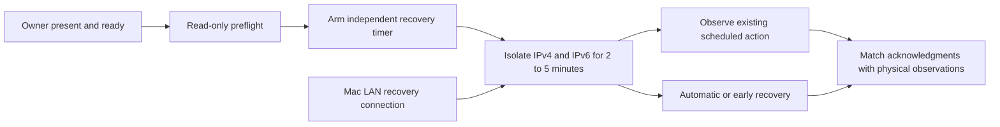

# Attended offline routine and wake check

This procedure tests the existing local schedule while the Pod cannot reach the
internet, phone, MQTT broker or home server. The controller and sensors keep
running. It does not change routines, calibration, temperature policy or the
active release. A directly connected Mac retains authenticated web and SSH access
for observations and cancellation. This is a network-outage test, not a power-loss
test or a claim that the recovery Mac was also unavailable.



## Preparation

1. Choose the existing scheduled temperature and alarm occurrences. Do not create
   a temporary routine or use a manual action as proof that scheduling worked.
   The two observations may use separate short outages within 24 hours. Preserve
   the current qualified build, calibration and enabled routine identity.
2. Confirm the owner will attend, the cover is attached, the reservoir is filled,
   no priming/base motion is running and the normal Stop control is available.
   Obtain fresh readiness before each outage. If unavailable, skip the trial and
   let the ordinary routine run. Never arm an unattended future isolation job.
3. Copy the reviewed standalone `scripts/deployment/network_trial.py` into a new
   root-owned tool directory outside the active release; make it and its parents
   non-writable by other users. Keep its content unchanged while a timer exists.
   This helper uses only Python's standard library and existing Pod binaries.
4. From the Mac's direct LAN SSH connection on port 8822, run:

   ```sh
   python3 -B /absolute/pinned/path/network_trial.py preflight --control-address MAC_LAN_IP
   python3 -B /absolute/pinned/path/network_trial.py rehearse-recovery --control-address MAC_LAN_IP
   ```

   The first command changes nothing. The second exercises a ten-second systemd
   timer and its real recovery process, without adding isolation rules. Verify
   `/run/sleepypod-network-trial/receipt.json` reaches `restored` and both firewall
   rule sets are unchanged. Save an off-host copy of the receipt.

## At the attended occurrence

Use an independent clock and begin roughly 30 seconds before the scheduled action:

```sh
python3 -B /absolute/pinned/path/network_trial.py apply --control-address MAC_LAN_IP --seconds 180 --attended
```

The helper requires the supplied address to match the current SSH peer, verifies
that its route is direct and that Core is active, then persists intent and arms
recovery **before** installing rules. It refuses missing IPv6 support, existing
trial chains, an unfinished receipt and durations outside 120–300 seconds.
It allows loopback, the Mac's existing SSH/web ports and IPv4 DHCP. Other IPv4 and
IPv6 traffic is blocked, including already-established remote sessions. It never
stops Wi-Fi, changes permanent firewall configuration, sends an actuator command
or restarts the Pod.

- Independently verify the Mac's authenticated status/Stop access remains usable.
  Verify the phone/home server cannot reach the Pod and inspect packet counters;
  a briefly cached MQTT `connected` label does not prove continued connectivity.
- Record the isolation timestamps, local scheduled acknowledgment and owner-felt
  temperature/vibration result separately. A requested 105°F wake target does not
  establish that the cover actually reached 105°F.
- Test deliberate cancellation while vibration is still active, using the normal
  Mac web control or the confirmed local gesture. Agree on the cancellation timing
  with the owner before starting. Do not count a naturally expired alarm as a
  cancellation or send an extra test vibration without an attended plan.
- Restore immediately if anything unexpected happens. The receipt contains the
  exact trial ID for:

  ```sh
  python3 -B /absolute/pinned/path/network_trial.py recover --trial-id TRIAL_ID
  ```

The independent monotonic timer attempts recovery after the chosen duration even
if SSH disconnects. A failed recovery service retries every three seconds. Recovery
removes only this trial's tagged jumps and unchanged private chains; it does not
replace unrelated firewall rules. A foreign rule inside a trial chain is detached
but preserved for inspection. If recovery reports an error, retain the receipt,
inspect the named systemd service and reconcile before starting another trial.
A reboot also discards these volatile rules, but do not restart a thermal session
as the ordinary recovery method.

## Afterward

Confirm network/MQTT recovery, unchanged controller identity and saved routines,
and no unexpected actuator activity. Save the receipt, packet observations,
temperature/alarm journal references and owner's actual response off-host before
starting another trial (the next trial replaces the current receipt).

Only then use the owner-review workflow to confirm `offline_routine`. Its server
evidence requires scheduled temperature and alarm acknowledgments within 24 hours;
the owner separately confirms the outage, physical response and cancellation.
Software/namespace tests and a successful timer rehearsal are not physical
qualification. A failed or unobserved action stays unqualified. Active comfort
still requires the separate seven reviewed, source-backed Preview nights.

## Software verification

Unit tests exercise timer-before-firewall ordering, partial IPv6 failures,
idempotent restoration, foreign-rule preservation, mismatched IDs, timer failure,
bounded durations and duplicate attempts. CI additionally creates disposable Linux
network namespaces and sends real IPv4/IPv6 TCP probes: the control peer remains
reachable, a second phone-like address and an outbound broker connection fail,
then all recover with unrelated firewall rules unchanged. The CI job never changes
the runner host's firewall.
