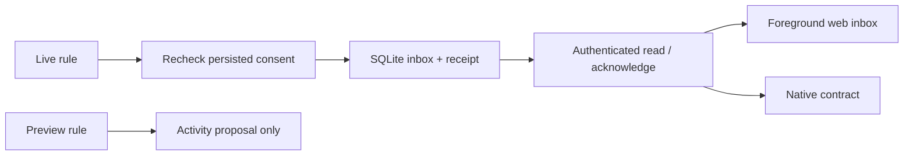

# Automation alert inbox

Live `notify` actions now persist an alert in the configuration database before
returning a receipt to the automation engine. The web app polls the authenticated
inbox while open, shows unread counts, and announces newly observed live alerts.
Opening the inbox alone does not mark anything read. Preview/dry-run actions only
produce an Activity proposal; they never publish an alert.

This is foreground delivery with durable history. It does **not** implement APNs,
Web Push, SMS, email, audio, vibration, or safety-critical alarms. A persisted
receipt is not evidence that a person saw an alert. Existing wake alarms remain
independent. Nothing in the notification store starts hardware or an engine.

## Native and web contract

All routes require the existing owner bearer token or same-origin HttpOnly browser
session. No credentials belong in URLs. REST and tRPC dispatchers enforce access
before calling the router; cross-origin cookie mutations are refused.

| Operation | REST | tRPC |
| --- | --- | --- |
| Newest page | `GET /api/v1/notifications` | `notifications.list({})` |
| Older page | `GET /api/v1/notifications?beforeId=123` | `notifications.list({ beforeId: 123 })` |
| Mark selected alerts read | `POST /api/v1/notifications/acknowledge` with `{ "ids": [123] }` | `notifications.acknowledge({ ids: [123] })` |

The read response contains:

```ts
{
  apiVersion: 1,
  generatedAt: number, // UTC Unix milliseconds, from the Pod
  newestId: number | null, // newest retained visible ID across all pages
  nextBeforeId: number | null, // null at the end; pass as beforeId
  unreadCount: number, // all retained, unacknowledged, unexpired alerts
  items: Array<{
    id: number,
    source: 'automation',
    sourceId: number, // original rule ID; rule may subsequently be deleted
    title: string, // snapshot of rule name at publication
    message: string, // plain text; never render as HTML
    createdAt: number,
    expiresAt: number,
    acknowledgedAt: number | null
  }>,
  delivery: { foregroundInbox: true, backgroundPush: false }
}
```

Pages contain at most 50 entries in descending ID order. IDs are positive safe
integers. `generatedAt` defines the server's current expiry boundary; do not assume
the phone and Pod clocks agree. Future-dated rows are hidden. An unread live alert
has `acknowledgedAt === null` and `createdAt <= generatedAt < expiresAt`.

Acknowledgment accepts 1–50 IDs, collapses duplicates, and returns
`{ generatedAt, acknowledgedIds, missingIds }`. Each row's first acknowledgment
timestamp is retained. If a response is lost, reread the inbox or safely repeat
the same IDs. The client must not claim a successful acknowledgment before a
confirmed response/read. Missing, no-longer-retained and future IDs are reported
in `missingIds`. Other, newly arriving alerts are never implicitly acknowledged.

## Delivery, expiry and restart behavior

- Alerts expire after 15 minutes. Expired unread alerts remain visible as history
  but no longer contribute to the badge or generate a foreground toast.
- Identical rule ID, title and message within 60 seconds return the original
  receipt without changing its expiry or acknowledgment, including after restart.
- History is limited to 30 days and 1,000 rows. Reads omit old rows; the next
  publication prunes them physically. No external retention service is required.
- The publisher rechecks persisted global Autopilot consent, rule enablement,
  dry-run mode and the current notification action. Storage failure records an
  automation error rather than a successful notification receipt.
- The web app polls every five seconds in the foreground. No streaming event
  contract is introduced. Initial connection/reload establishes a cursor without
  replaying historical alerts. Later polls announce only new, unexpired, unread
  items. A restored database/clock rollback cannot lower that session's high-water
  ID; lower IDs remain readable in the inbox. Reopening creates a fresh baseline.
- On network failure, retained entries are labeled as an older successful check;
  an error is never presented as an empty inbox. Query caches are discarded when
  the owner-session component unmounts. The browser stores no alerts in local storage.
- Demo mode shows an empty, unavailable live inbox and cannot acknowledge real data.

Native clients should use the same foreground polling and cursor rules, display
the capability flags honestly, and acknowledge only explicitly selected IDs.
Treat an older controller's missing endpoint as unavailable. Background iOS
delivery requires its own reviewed APNs/device-registration implementation.

## Persistence and validation

Generated migration `0038_same_charles_xavier` adds only `notification_inbox` and
its indexes. No existing routines, controls or biometrics are rewritten. Include
the configuration database in backups as usual; an older binary can ignore this
additive table. No external notification credentials or new public ports are used.

The tests exercise a real migrated SQLite database, restart, duplicate suppression,
expiry, clock rollback, bounded retention, pagination, input rejection, failed
storage, idempotent acknowledgments and current persisted rule consent. Engine
tests distinguish queued receipts from dry-run and failed publication. Component
tests cover keyboard focus, literal message rendering, network errors and lost
acknowledgment replies. The production browser suite tests actual authenticated
REST/tRPC, foreground delivery and desktop/phone layouts with synthetic alerts.
These tests do not qualify live Pod notifications or native background delivery.


