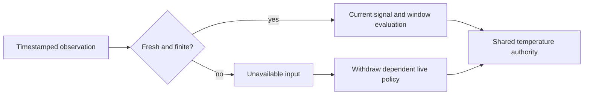

# Automation signal validity

Live automation decisions require finite, current inputs. Missing measurements
remain unavailable; they are not converted to zero or replaced with an older
row. These checks apply to the general rules engine, independently of the
personal comfort Preview's additional presence, water and artifact guards.

| Source | Maximum observation age | Additional requirement |
| --- | --- | --- |
| DAC status | Under 15 seconds | Monitor running, connected, no intervening hardware write |
| Vitals and movement | 5 minutes | Latest stored timestamp must not be in the future |
| Bed/water temperature, humidity and light | 15 minutes | Latest stored timestamp must not be in the future |
| Capacitive reducers | 30 seconds | Both firmware sample time and local receipt time must be current |
| Classified presence | Shared occupancy implementation | Supported fresh capacitance and calibration; legacy Pod 4 data is supported |

All numeric timestamps and values must be finite. Invalid fields do not hide
independent valid fields, but a bad channel invalidates that side's capacitive
reduction. A newly received old frame is still old. The latest malformed or
future-dated database row does not cause a fallback to an earlier measurement.

A window expression also requires its source to be available at evaluation
time. Retained history cannot keep a rule firing after a sensor disappears.
Windows are sampled at evaluator ticks; `count` counts those samples, not
independent hardware observations. A window is not a validated vital estimator.
Arithmetic overflow, non-finite operands and unavailable or inverted expression
clamp bounds yield an unknown result rather than a temperature command.

Live policy requests recheck their action and trigger inputs every evaluator
tick, including between the rule's trigger times. Missing inputs withdraw the
request and record `policy-input-unavailable`. Missing conditions already
withdraw policy ownership. The shared temperature controller then arbitrates
remaining requests and routine/manual ownership. An explicit one-shot retains
its resolved target until its existing bounded expiry; it is not re-evaluated
as a continuous sensor policy. Relative temperature actions continue to use
the routine baseline so they cannot compound their own previous output.

Software validation includes real in-memory SQLite queries, malformed and
future timestamps, source/receipt age, non-finite fields, window history after
sensor loss, policy withdrawal between triggers, recovery without replaying
notifications, and preservation/expiry of explicit one-shot holds. The initial
focused run passed 226 tests across 12 files. No physical sensor outage, Pod
migration or household actuator test is implied by these tests.
