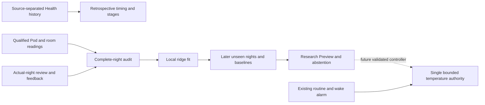

# Personal Autopilot: evidence and implementation plan

Updated 2026-11-01. Software design and evaluation plan; no claim of improved
sleep outcomes or equivalence to Eight Sleep's proprietary Autopilot.

## What the history can teach

| Evidence | Useful learning task | What it cannot establish |
| --- | --- | --- |
| Source-separated historical Health sleep intervals | Habitual timing, variability, source coverage | Missing Pod temperatures, room conditions or an ideal temperature |
| Watch stages aligned with full Pod signals | Retrospective personal stage estimation | Clinical ground truth or live stage accuracy |
| Full thermal recordings plus morning comfort feedback | Context-dependent warm/cold direction | Which minute caused discomfort or a causal sleep benefit |
| Consecutive qualified thermal observations and applied targets | Future thermal-response forecasting | Body temperature from water temperature alone |

Health samples, noon-to-noon days, bed sessions and complete training nights are
different counts. Existing aggregate Health history lacks a record of every gap;
a duration between six and twelve hours is not sufficient to certify it. Re-read
per-source intervals for any future historical training pipeline. Preserve awake
labels and naps separately, and never infer missing sleep or thermal readings.
User data and audit counts remain private, outside this repository.

## Research that informs the design

1. [Eight Sleep's current Autopilot description](https://www.eightsleep.com/autopilot/)
   names preferences, workouts, room conditions and sleep-stage signals as inputs.
   This is a vendor description, not an executable policy or published weight
   file. Our Pod 4 must advertise only measurements it actually supplies.
2. [Kim et al., 2025: adaptive thermal regulation](https://pmc.ncbi.nlm.nih.gov/articles/PMC12524338/)
   studied 25 adults under PSG with natural, constant and adaptive temperature
   conditions. It supports studying thermal timing, but its mattress temperatures,
   room conditions and staging system differ from this Pod. Its small cohort and
   baseline ordering limit direct transfer; it does not validate our 70°F routine
   or a particular automatic correction.
3. [Walch et al., 2019 dataset](https://physionet.org/content/sleep-accel/1.0.0/)
   pairs wrist acceleration and heart rate with PSG in 31 participants. Use it to
   reproduce a staging benchmark and understand evaluation, not to treat wrist
   features as interchangeable with mattress ballistocardiography.
4. [Canton et al., 2026](https://pmc.ncbi.nlm.nih.gov/articles/PMC13283449/)
   shows how dataset composition and easy-to-classify wake can inflate wearable
   classification performance. Compare simple baselines and report wake
   specificity, per-stage performance and per-night results, not accuracy alone.

These sources motivate controlled experiments. They do not establish that a
large language model should operate a heater, or that a more complex predictor
will outperform a small one on sparse personal data.

## Implemented model and data contract

`comfort-ridge-v1` is a real fitted, local ridge regression with five coefficients:
intercept, target, water-minus-target, room temperature and humidity. Fixed scales
and regularization are specified before evaluation. It predicts a morning
feedback direction from nightly medians. The fit runs in TypeScript on the Pod;
no API key, remote provider or Python model runtime is needed.

Only production Preview recordings qualify. They must have a stable hardware,
routine, calibration and room identity; fresh quiet occupied measurements; an
actual-night review bound to the exact source digest; and a morning comfort
check-in. Windows must cover 6–12 hours, at least 90% qualified thermal time,
at least six actual hours and 72 distinct five-minute buckets. Interior gaps
over ten minutes and edge gaps over 30 minutes fail. Wake warming, manual
pauses, mechanical disturbances, ambiguous sessions and targets spanning over
2°F are excluded. These are conservative engineering filters, not a definition
of normal sleep. Complete short nights currently abstain rather than being padded.

At least 20 matching nights are required. The newest quarter, minimum five,
stays out of training. Compare directional mean absolute error against holding
temperature and the training-set mean feedback. Require supported contexts,
10% improvement and 0.05 absolute improvement over the better baseline. These
sample-size/error thresholds are engineering choices, not statistically powered
clinical acceptance criteria. Repeatedly tuning to the same holdout is forbidden;
a later model version must reserve fresh evaluation nights.

The artifact includes provenance hashes, dates, coefficients, input support and
validation. It is invalidated by changed source/review data. Predictions abstain
outside supported conditions or when their magnitude does not exceed the held-out
90th percentile error. That empirical error is not a calibrated confidence
interval. Fitting and context preview never issue a hardware command. Applying
nightly-median training to a single live moment remains experimental and is
explicitly labelled in the UI.

The native stage trainer separately requires 90% matched Pod presence, heart
rate, movement and Watch labels over 6–12 hour nights. Fragments and overlaps
cannot leak across validation folds. The owner selects actual full nights after
coverage inspection; changed signals require another review. Its whole-night
normalization uses future information and must stay retrospective.

## Next model stages and acceptance

1. **Collect complete, reviewed nights.** Keep the requested routine and wake
   heating separate. Verify room publisher freshness and inspect exclusion reasons.
   Missing data must become visible before another night is lost.
2. **Fit the local feedback model.** Preserve both unsuccessful and successful
   validation outcomes. Train explicitly; never fill missing examples with an
   LLM or manufacture warm/cold labels from HR, stages or sleep duration.
3. **Learn the thermal response.** Add a causal forecast using current water,
   target, room and preceding-only windows. Split all samples by night, fit
   normalization on training nights only, compare with persistence and a simple
   physical response model, and evaluate 15/30-minute error and interval coverage.
   Exclude alarms, priming, vibration, base motion and missing presence.
4. **Combine only validated components.** A bounded optimizer may propose a
   target within the owner's range using forecast response and predicted comfort.
   The single temperature authority retains freshness, water, occupancy, alarm,
   manual-pause and maximum-rate checks. A morning directional label alone must
   not become a minute-by-minute heat command.
5. **Prospective Preview and owner review.** Run at least seven qualified nights;
   log inputs, model hash, proposed target and abstention reason. Later unseen
   nights must beat the baseline. Preview, mechanical qualification and model
   evaluation are independent gates; none substitutes for the others.
6. **Bounded attended activation, then a personal experiment.** Begin with at most
   1°F per 30 minutes inside the owner's narrow range, keeping the wake routine
   intact. Prespecify outcomes (morning comfort, awakenings, unwanted corrections)
   and compare stable baseline/model periods. Do not claim improved sleep from
   training accuracy or a single pleasant night. Expand only after review.

Health activity/workout and wrist-temperature context are later optional inputs
with source, timestamp and permission provenance. Historical wrist temperature
is not a real-time body temperature feed. Cloud/local LLMs remain report writers
and experiment assistants; deterministic code owns actuator commands.

## Verification boundaries

Unit/browser/simulator tests establish filtering, persistence, authentication and
presentation. They do not establish live Pod adoption, complete-night collection,
model improvement, physical motion/vibration or sleep benefit. Keep deployment,
TestFlight installation, attended hardware checks and overnight observations in
separate release evidence. Existing model/library counts must identify whether
they describe a stage model or a thermal comfort model.
