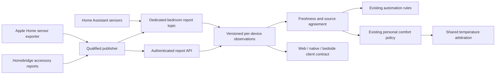

# Bedroom context

The Pod remains the sole temperature controller. External devices provide observations to the existing automation reader and personal-comfort policy; they never issue temperature commands through this feature.

## Devices and measurement provenance

Each physical device can have multiple sources, such as temperature and humidity. A physical-device/metric pair is mapped once, even if several integrations expose it. Devices have a name, model, room/left/right position, integration, external identifier, expected unit, maximum age and an explicit `useForControl` selection. New selections default to display-only. A purifier or diffuser is not assumed to contain a humidity or particulate sensor.

Supported measurements are temperature, relative humidity, PM2.5 concentration, CO₂, HomeKit air-quality category, power, fan speed and filter life. HomeKit air-quality categories (1 excellent through 5 poor) remain distinct from PM2.5 and from national AQI scales. Category zero is unknown and is rejected as a measurement.

Publishers declare the clock they have:

| `timeBasis` | Meaning | Time used for expiry |
| --- | --- | --- |
| `measurement` | The device/integration supplies the actual measurement timestamp | `measuredAt` |
| `device_read` | A successful device read, without a hardware measurement clock | `observedAt` |
| `integration_report` | A newly received, qualified integration report | `observedAt` |
| `cached` | A stored value whose physical freshness is unknown | Display-only; never used for control |

An HTTP success, a non-null cached HomeKit characteristic, or a Home Assistant entity's poll time does not establish a new physical measurement. Adapters must qualify their actual source path. Do not relabel a cached Homebridge value as `device_read`. A failed read must publish unavailable, not the previous characteristic value. The UI labels measurement and report clocks separately.

## API and MQTT

All REST/tRPC endpoints retain owner authentication and private, non-cacheable responses:

- `GET /api/v1/home/bedroom`: configuration, observations, qualified aggregates, room guidance and MQTT connection status.
- `PUT /api/v1/home/bedroom/configuration`: `{ expectedRevision, config }`. Stale writes return 409.
- `POST /api/v1/home/bedroom/reports`: `{ reports: [...] }`, at most 40. Results identify accepted/rejected sources independently.
- `GET /api/v1/home/bedroom/history`: cursor-based source observations, with the source configuration and original units retained.

A report contains `schemaVersion: 1`, the current configuration `revision`, `sourceId`, `available`, `value`, `observedAt`, nullable `measuredAt`, and `timeBasis`. Timestamps are Unix milliseconds. Configuration changes clear current readings and reject publishers still using the previous revision. Durable watermarks reject replay across process restarts; saved observations are not considered live after restart.

The existing MQTT connection also subscribes to `<prefix>/<deviceId>/bedroom/report`, carrying one report per message. Use non-retained QoS 0 messages. The broker account for a sensor publisher should only be allowed to publish this topic, with no access to actuator command topics. MQTT actuator commands need not be enabled. Broker disconnect immediately withdraws MQTT observations; independently received HTTP observations keep their own expiry. Reconnection requires new reports and does not resurrect retained or duplicate packets.

Unavailable transitions withdraw a reading immediately. Reports more than 30 seconds old or from the future are rejected. Per-source rate limiting is five seconds. Measurement leases range from 30 to 900 seconds. Raw history is bounded to 30 days and 250,000 rows; this is a retention limit, not a promise of 30 days at every publishing frequency.

## Room-informed comfort and routines

Fresh, selected physical sensors contribute once each. Climate uses the median. A temperature spread above 4°F or humidity spread above 15 percentage points withholds that aggregate. Selected air-quality sources retain the worst reported concentration/category, without converting between unlike measurements. Power, fan and filter observations remain attached to their device rather than becoming climate signals.

The opt-in `roomAware` personal-comfort setting requires both qualified temperature and humidity. Initial engineering thresholds suggest:

- −1°F when the room exceeds 75°F, or is at least 72°F with humidity above 65%.
- +1°F when the room is below 64°F.
- No additional offset otherwise.

These are bounded comfort heuristics for Preview, not validated sleep-outcome claims or a medical policy. PM2.5, CO₂ and appliance power are not substituted for thermal readings. Their observations remain available for appropriate room rules and later environmental analysis.

The room contribution shares the learner's total ±3°F offset budget. The existing one-degree step, 30-minute correction interval, limits, six-hour manual pause, calibrated occupancy, water, priming, movement and vibration checks remain authoritative. Missing/disagreeing/expired room inputs withdraw room-dependent comfort, including during cooldown. Dispatch rechecks the data after queue waits, and the application lease cannot outlive the room observation.

Saved temperature curves, bedtime, power scheduling and wake alarms are not rewritten. The final 30 minutes before a wake alarm remain reserved for scheduled warming. The temperature and schedule screens show current bedroom context alongside that baseline. Personal comfort uses the existing temperature arbiter; no second controller is added.

Preview evidence records room configuration identity and guidance. A change in source configuration requires matching new room-aware evidence; nights collected without room context cannot approve room-aware Active mode. Existing physical qualification and seven-night review requirements remain in force.

## Integration qualification and remaining deployment work

This change supplies the multi-device API, MQTT receiver, web displays, policy and evidence handling. It does **not** claim that an external device is already publishing, that native/ESP32 clients have been updated, or that physical temperature effects have passed qualification. Those require device discovery, actual source adapters, matching client releases and deployed verification.

- HomePod sensors are visible in Apple Home, but public HomeKit access must be verified on the actual native client. An Apple Home automation/Shortcut exporter is an alternative; do not remove existing pairings to make it work. Never embed the owner's general control key in a shared automation; prefer the scoped MQTT publishing path through the home server.
- The H5106 can be integrated through Homebridge or Home Assistant's official Govee BLE integration. Confirm temperature, humidity and particulate decoding, source clocks and disconnect behavior. Homebridge's [H5106 reports](https://github.com/homebridge-plugins/homebridge-govee/issues/1296) and [release history](https://github.com/homebridge-plugins/homebridge-govee/releases) document decoding/cloud-path issues. A displayed zero by itself does not establish a live zero measurement.
- Home Assistant's [Govee BLE integration](https://www.home-assistant.io/integrations/govee_ble/) requires a working local Bluetooth adapter or proxy. Preserve an existing bedside display's firmware and role when evaluating a proxy.
- Purifier/diffuser controls must reflect their actual services. No new accessory actuator actions are enabled by accepting observations.

Validation includes isolated SQLite replay/expiry/restart tests, policy/lease/activation-evidence checks, authenticated browser/API tests, and desktop/tablet rendering. Synthetic fixtures are labeled and never sent to a real Pod.
