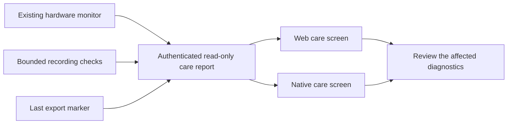

# Bed care

System → Bed care translates the existing water, priming, circulation protection,
recording, processor, storage and backup observations into practical next steps.
It keeps the technical diagnostics available without using a single health score
as evidence that the bed is safe or that a night's recording is accurate.

`GET /api/health/care` and tRPC `health.care` require the same owner authentication
and privacy boundary as the other legacy controller APIs. They do not start a
monitor, write to hardware, prime the cover, acknowledge protection, delete files
or restart a service. The existing monitor is reused; source timestamps and expiry
are retained. No current monitor and no recorded protection is unknown, not proof
that circulation is healthy. Failed requests and expired observations withdraw
current UI claims.

Source-dependent advice expires with the observation. Former refill/priming advice
is retained only inside the dated disclosure, with reconnect/recheck guidance in
the current next-step position. Complete viewport tests verify all five diagnostic
links remain clickable around the mobile navigation.

The saved pump-protection setting is read independently. Disabled protection is
explicitly shown as needing attention; an unreadable setting is unknown. An active
block remains visible even when the monitor or setting is unavailable. Reading
care never enables this opt-in protection or dismisses a recorded incident.

The `.last-backup` marker establishes only that the server generated an export.
Its filesystem timestamp can have fractional milliseconds; the contract normalizes
it to integer milliseconds. Missing or future markers remain unknown. Download
completion, off-Pod storage and successful restoration are separate observations.
The recovery walkthrough asks the owner to preserve and verify a private copy
before maintenance; it does not pretend that clicking Export performed a restore
rehearsal.

The interface links to [Eight Sleep support](https://help.eightsleep.com/) for the
exact hardware generation. Pod 4 water/insert procedures must not be replaced with
instructions for a later integrated-reservoir design. Physical wetness, leaks and
insert age are not sensed by this report. It offers no predictive maintenance or
automated factory reset.

## Validation

Behavioral tests cover independent freshness, clock reversal, failed sources, low
water during priming, active protection during a disconnected monitor, processor
failures, low storage and invalid/fractional export dates. UI tests exercise stale
and failed reads, practical links and the absence of automatic repair controls.
Browser checks cover authentication on both transports, private responses and
narrow/wide recovery layouts. Native parity and exact validation receipts are
recorded separately before release. These software checks do not qualify physical
repairs, pump flow, leaks or recovery of the user's actual installation.

Local Core validation on 10 November 2026: 36 focused evaluator, collector, UI and
API-access tests passed; TypeScript, ESLint and the production build passed. All
69 browser regressions passed, including both new care layouts. The first focused
browser run retained a strict-selector failure (two explanatory paragraphs matched);
the corrected assertion targets the recovery step explicitly. Rendered 390px and
1024px care views were inspected; the existing visual system is unchanged.

The first full push gate caught a missing `health.care` practice-mode handler
(7,237 other tests passed). The added handler uses the same pure evaluator and
synthetic demo sources; the coverage gate and direct handler regression now cover
it. Disabled/missing pump-protection settings have separate regressions.

At `0c05b29b`, all push gates passed, including 7,242 tests with 17 explicit skips.
The finish review then requested complete viewport captures, expiring advice with
its source, and a canonical product contract. The added refill/priming regressions
and all six care-view unit cases passed; full-viewport browser checks also verify
that the five links are not covered by fixed navigation. Native incident/settings
navigation is verified separately in its parity record.
