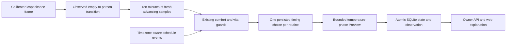

# Bed-entry timing in personal comfort Preview

Autopilot → Personal comfort → **Use Pod sensor guard in Preview**, then
**Follow earlier or later bed entry in Preview**. This is an optional proposal
mode. It does not submit leases, change schedules, power the Pod, move the base,
or vibrate. Active comfort still requires hardware qualification and reviewed
real Preview nights. It is not a sleep-onset detector.

## What changes in the proposal

- Entry must be within 90 minutes before or after the actual routine start.
  Its minute-rounded difference selects a shift of at most 30 minutes each way.
- Only intermediate temperature phases move. Power-on, power-off and alarm
  events retain their original times. A shift is reduced when necessary to keep
  every intermediate phase strictly inside its power window. A routine with no
  intermediate phases cannot produce a timing proposal.
- Example: a 22:00 routine with a 23:00 temperature phase and observed 22:20
  entry proposes that phase at 23:20. Its wake alarm and power-off stay fixed.
- The user range, one-degree step, thirty-minute correction interval, six-hour
  manual pause and all water/presence/alarm/mechanical guards still apply.
  The three-degree offset limit is measured against the **original scheduled
  baseline**, including when the shifted phase differs substantially.
- The choice is made once per routine and committed with its observation.
  Schedule, timezone, side-source or calibration changes withhold that choice;
  they do not silently select a different bedtime for the same routine.

## Evidence and restart behavior

The existing occupancy detector can use residual movement or vital evidence.
Timing instead requires a valid calibrated capacitance level plus the person
classification. Residual movement alone never establishes bed entry. Legacy
`capSense` and `capSense2` use their existing format-specific calibrations.

The tracker requires an observed absence-to-person transition, advancing
firmware measurement timestamps, and at least ten minutes of observations
without a sample or evaluation gap over 90 seconds. The input adapter also
rejects capacitance frames older than 30 seconds. Missing, future, reversed,
ambiguous or changed-source evidence and mechanical interference reset the
unfinished observation. Repeated frames cannot advance it.

Starting or restarting while someone is already in bed does not assign “now”
as their bedtime. A previously committed same-routine selection can be reused
only with matching schedule/calibration identity and fresh guarded inputs.
Stopping Preview clears unfinished evidence; stored choices and manual pauses
remain. This conservative behavior may miss entries. It does not fill gaps
with inferred sleep history.

## Additive API contract

Existing owner authentication and version 1 endpoints remain in place:

- `features.followBedtime: true` advertises this Preview adapter, independently
  of `activation.available: false`.
- Configure with `mode: "preview"`, `sensorAware: true`, `followBedtime: true`
  and the normal `minimumF`/`maximumF`. Disabling the sensor guard in the web
  UI also disables bedtime following. Off preserves both opt-in settings.
- Optional `state.bedtime` contains `session`, schedule `revision`, calibrated
  `sourceKey`, `entryAt`, `confirmedAt` (epoch milliseconds) and `shiftMinutes`.
  These describe an observed entry and a Preview choice, never an applied action.
- Optional `timing` on status and journal events reports `state`
  (`off`, `waiting`, `ready`, `withheld`), `reason`, nullable `selection`,
  `scheduledBaselineF` and `phaseBaselineF`. Current timing becomes null when
  its observation expires, inputs fail, state changes, or the service stops.
  Persisted history remains explicitly historical.
- Native clients can negotiate this capability and ignore optional fields on
  older servers. Native UI changes are maintained separately.

No SQL migration is needed: the new selection is an optional field in the
validated JSON state. **Rollback to a binary with the older strict state schema
requires restoring the pre-deployment database snapshot.** Keep that snapshot
alongside the release and restore it while the service is stopped; do not point
an older binary at state containing the new field.

## Validation boundary

Software tests replay early/late entry, repeated/missing/future/reversed frames,
source changes, restarts, atomic journal failures, manual pauses, original-target
bounds, DST events and fixed power/alarm boundaries. The authenticated browser
scenario checks opt-in persistence, prerequisite enforcement, honest missing
evidence and rejection of Active. These checks do not constitute Pod hardware
qualification, a completed Preview night or demonstrated sleep benefit.
