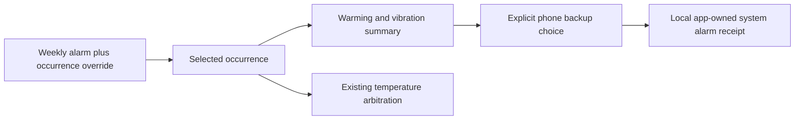

# Clear wake plans

The wake summary reads the actual next occurrence, including any one-time override.
Core now returns optional `warming` metadata from the same `alarmWarmupMinutes` and
`alarmHoldEnd` functions used by temperature arbitration. It contains absolute
start/end timestamps, the earliest movement-triggered vibration time, and the wake
target. The weekly rows and hardware scheduler are unchanged.

## Everyday controls

Wake time, selected days/side, temperature and vibration duration remain visible.
Movement windows, snooze taper and vibration style are under Advanced wake options;
opening or saving the simple form preserves the saved advanced values. Test and Stop
remain explicit actions. Firmware-dependent pattern/intensity claims are qualified.

The summary withdraws after a failed refresh, wrong-side response or a receipt older
than 90 seconds. An unavailable read never means no alarm is set. Unknown command
results require a fresh explicit read, and no network recovery replays a mutation.
Warming metadata is absent for skipped, away, conflicting or attempted occurrences.
Existing clients can ignore it; older servers remain readable but cannot supply an
exact warming claim to new clients.

## Optional system backup

The independently implemented iOS/iPadOS app uses Apple's AlarmKit for one explicitly
requested, fixed-time app-owned alarm. Permission is requested only after tapping Add.
The app keeps an encrypted receipt before scheduling, then checks the operating
system's actual alarm list. An interrupted acknowledgment is reconciled by ID, never
blindly retried. Replacing a backup cancels and verifies removal of the prior tracked
ID first; partial failures stay visible. Only this app's recorded ID is cancelled.

The phone backup is a single occurrence, not a second weekly schedule. If the Pod
plan changes, the user must review/replace the backup. Clock alarms are outside this
API, and other home routines are not claimed as synchronized. A system schedule
receipt is not evidence that a user heard an alarm. Demo never creates a real alert.

References: [Apple AlarmKit overview](https://developer.apple.com/videos/play/wwdc2025/230/)
and [scheduling documentation](https://developer.apple.com/documentation/AlarmKit/scheduling-an-alarm-with-alarmkit).

## Acceptance

Controller unit checks cover consistent warm-up arbitration, moved/skipped/restored
occurrences, extended movement windows, conflicts and Away. Browser checks exercise
the simple editor, disclosures, temperature/duration visibility, narrow layouts and
lost-response recovery. Native tests cover permission denial, expired reads, owner
changes, duplicate taps, missing/mismatched system records and cancellation failures.
Exact local and hosted results are recorded with the release. No Pod restart,
physical warming/vibration test, phone alarm or home accessory activation is implied.

Local validation on November 10: 43 focused alarm/editor tests, TypeScript, ESLint,
the production build and all 66 Playwright browser checks passed. The full related
pre-push suite passed 7,221 tests (17 skipped). Browser checks include 390px and
1024px editors, retained advanced values and lost-response recovery. No hardware
commands or saved live schedules were changed.
