# Personal comfort execution adapter

The execution adapter is wired through the owner activation service documented in
[Owner activation](COMFORT_OWNER_ACTIVATION.md). Off and Preview remain inert;
a saved Active setting alone never authorizes a command. There is no environment
variable or client-supplied qualification bypass.

```mermaid
flowchart LR
  Review[Owner qualification and seven reviewed nights] --> Admission[Revocable admission]
  Admission --> Policy[Fresh bounded comfort decision]
  Policy --> Authority[Shared temperature authority]
  Authority --> Reserve[Persist comfort reservation]
  Reserve --> Journal[Persist temperature attempt]
  Journal --> Queue[Recheck before each DAC write]
  Queue --> Receipt[Acknowledged or unknown]
  Receipt --> Cursor[Persist correction cursor]
```

## Implemented behavior

`src/comfort/application.ts` submits passive requests through
`TemperatureController.replacePolicy`. It never connects a hardware client,
turns on a side, supplies a heating duration, or overrides manual, run-once, or
higher-priority automation requests. The existing authority retains temperature
and session ownership. Withdrawing a personal proposal lets that authority
reconcile the remaining owner, including the ordinary routine.

Each proposal lasts at most ten seconds. Current global Autopilot consent,
persisted Active configuration, a matching unexpired admission revision, manual
pause, routine identity, sensor freshness, presence, water, alarm, power, base,
priming and vibration guards are checked again during selection and **before
each actual DAC FIFO write**. Monotonic expiry complements the wall clock.
These dispatch guards compose with authenticated request deadlines and close
when their operation finishes; detached scheduler work explicitly exits both
scopes. A canceled level/duration pair can be partially delivered and is not
reported as successful.

Policy application hooks are chosen by the selected request's object identity.
A rule with the same textual request ID cannot borrow another producer's hook.
Unselected proposals consume no correction interval and create no application
reservation. The existing one-degree step, three-degree offset and thirty-minute
correction interval remain in the pure policy. Empty input, an expired lease or
a changed grant requires a fresh evaluation; selection never resurrects a
revoked proposal.

`comfort_states.state.application` is optional for backward-compatible reads.
It records the policy request UUID, segment, target and preceding reported
target, reservation time, nullable completion time, outcome and shared-journal
receipt UUID. The reservation is committed with SQLite FULL synchronous durability before the shared temperature journal
or hardware call. The separate commits intentionally leave uncertainty on a
crash between them. No new SQL migration is needed for this versioned JSON field.

Only a durably acknowledged shared-journal result advances `lastAppliedAt`,
`lastTargetF` and `lastSegment`. A keepalive of the same correction does not
restart the thirty-minute interval. Acknowledgment remains **accepted, not
physically verified**. A pre-write firmware poll can briefly lag an acknowledgment;
the lease waits at most ten seconds for a newer report without retrying the
target or repeatedly extending that grace period.

An interrupted, failed, partially delivered, missing or non-durable result
persists `attempting` or `unknown`. Either withholds later personal adjustments,
including after a restart, an elapsed correction interval or a mode change.
Manual controls, shutdown and ordinary routines remain separate authorities.
There is deliberately no automatic retry or automatic clearing of uncertainty.
The owner recovery workflow archives the uncertain application, returns to Preview and persists a six-hour pause. It neither replays the command nor labels it successful.

Unexpected target changes seen during selection latch a hold in memory without
writing during a status read. The next adapter evaluation persists the six-hour
pause under the side lock before admitting another proposal. Normal explicit
manual controls continue to use the existing durable manual-pause path.

## Runtime integration

The owner service verifies source-bound qualification and seven distinct reviewed
nights before supplying `ComfortAdmission`. The runtime learns and commits its
observation inside the side lock, then reconciles the adapter outside that lock.
Stop, configuration changes and runtime teardown invalidate pending generations.
The adapter's context reader omits arbitration lookup to avoid recursive selection.
An adapter that has never published a policy does not trigger baseline reconciliation
when evaluating Preview or an unqualified saved Active state.

Bed-entry phase shifting remains Preview-only: this adapter withholds any
configuration with `followBedtime` enabled until its Active phase mapping is
implemented and qualified. No base automation, vibration effect, cloud inference,
or room-device action is enabled by this work.

## Evidence boundary

Tests use migrated SQLite databases, mocked Pod writes and explicitly synthetic
admission fixtures. They cover one-degree/cooldown behavior, ownership, two-part
writes, revocation while queued, storage failures, interruption/reopen, mode
locks, read-only selection and delayed firmware reports. A Unix-socket test also
holds a write behind a read, revokes permission, and confirms no actuator bytes
are sent. This is software validation, not an attended hardware qualification or
an overnight Preview result.
