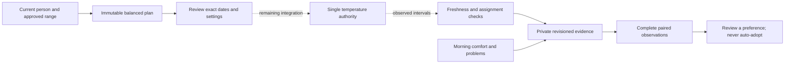

# Personal comfort experiments

This is the implemented protocol, evidence collector, durable repository,
authenticated planning API and owner/personal browser interface for approved
improvement 10. It is **planning-only, not an enabled temperature controller**.
Native screens, reviewed activation and runtime observation collection remain integration work. The
guarded execution adapter and durable attempt journal are implemented but not registered in production. No
experiment was started on Luca's Pod and no schedule, alarm or live setting was
changed by this implementation.

## Comparison protocol

`src/comfort/experiments/` compares the current baseline with one integer setting
1–2°F away, inside the existing approved overnight range. It never expands that
range. An immutable plan binds the subject, assignment, timezone, routine,
baseline, limits and wake-plan identity. The frontend proposal accepts only the
first local night date and the nearby setting; it cannot supply identity,
measurement evidence or assignment order.

New reviews use four pairs of treatment periods, sixteen **scheduled nights**
in total. Each pair contains both baseline and variant. There are exactly two
baseline-first and two variant-first pairs, shuffled with Node's cryptographic
random generator. Every one of the six balanced orderings has the same
probability. Creating another copy of the same saved plan cannot redraw its order.

Each treatment period has a settling night followed by a scored night. Settling
nights remain visible and their problems remain outcomes. Each settling/scored
period uses consecutive local dates. Gaps between periods remain visible; a
missing routine never becomes an experiment heating job. The scored night is
withheld if the preceding settling exposure was not verified. This addresses
carryover explicitly; **one settling night has not been shown to eliminate
carryover on this bed**. Calendar labels are independent of 24-hour clock
durations, including across DST. Version 2 plans retain the actual scheduler's
bounded start/end instants and leave all wake warming and vibration with the
alarm owner. Existing version 1 calendar plans remain readable and stoppable;
they are never silently upgraded into executable scheduled plans.

These choices follow the general principles of balanced randomized comparisons
in [NIST's experimental-design guidance](https://www.itl.nist.gov/div898/handbook/pri/section3/pri331.htm).
The need to consider carryover and intervention reversibility is described in
the [UK government's N-of-1 evaluation guide](https://www.gov.uk/guidance/n-of-1-study-comparative-studies)
and [AHRQ's N-of-1 design guide](https://effectivehealthcare.ahrq.gov/sites/default/files/pdf/n-1-trials_research-2014-5.pdf).
Sixteen scheduled nights, the settling interval and the numerical thresholds below are
versioned project choices, not published claims of sleep benefit.

## Scheduled dates and wake boundaries

The resolver reads only existing enabled power routines for the authenticated
person's assigned source. It searches at most nine weeks from the requested date
and selects eight two-night periods before drawing the balanced treatment order.
It requires an explicit bounded routine, at least four hours before the wake
exception, and an unambiguous session for each local date. Duplicate starts,
overlaps, unsupported/unbounded shutdowns, conflicting alarms and already-started
routines are withheld with explicit reasons. Isolated eligible nights are shown
as needing a following scheduled night. No routine, device state or alarm is
created or edited by this calculation.

For Luca's Sunday–Thursday bedtimes and Monday–Friday wakes, a Friday requested
start advances to Sunday. Friday and Saturday remain unscheduled; the unused
Thursday at the end of a four-night block is explicitly shown rather than being
paired across a weekend gap. A weekend-only Friday/Saturday routine also works,
with the comparison spanning more weeks. Every local date through the last
planned night is either included once or explained in the review.

Times use the same occurrence resolver as the controller, including the explicit
power-off weekday offset, spring gaps and the first occurrence of repeated fall
clock times. Each immutable window ends at its configured routine boundary or
the first effective wake-warming start, whichever is earlier. One-occurrence
later/skip edits and longer smart-wake lead times use the existing alarm policy.
When warming falls outside a routine, the experiment does not extend that routine.
The retained wake snapshot includes its actual time, target and vibration duration.
The 105°F wake target remains separate from the nearby overnight treatment.

Confirmation recomputes all windows under the same transaction and refuses a
changed window or a first night that began during the five-minute review. New
collector observations must cover the exact reviewed window; shortened samples
cannot turn an incomplete night into a successful comparison. Feedback is allowed
only after that window ends and within fourteen days. Physical qualification and
runtime lease admission remain required before any treatment can run.

## Observations and interpretation

The collector combines nonoverlapping sensor intervals. Device freshness expires
after fifteen seconds; presence has its own ninety-second source clock. Repeated
old measurements cannot fill a gap. Qualified exposure requires fresh occupied
readings, adequate water, power, no priming/vibration/base motion, the current
identity and routine, and the exact experiment request selected by the shared
temperature authority. A coincidentally matching manual or scheduled target does
not count as the experiment. Selection and target readback are still not proof
of physical water temperature or personal comfort.

Source hashes bind the recorded input window, ordered samples and deduplicated
command/safety events. A transient assignment, routine or wake-plan change stays
visible even if later samples return to the old state. Only the internal
collector may write exposure; user feedback has a different strict contract.
Preview observations are explicitly excluded from applied-treatment comparisons.

A scored night needs:

- At least four hours and 90% of the planned window as qualified exposure—the
  intersection of current identity, fresh presence and the selected target.
- No ambiguous sleeper, manual intervention, unconfirmed command, wake overlap,
  withdrawn source or safety interruption.
- A confirmed full-night check-in after the observation window, within fourteen
  days, with a comfort rating from 0–10 and reported unwanted adjustments/problems.
- A verified preceding settling night for the same treatment period.

Missing data stays missing. At least three complete pairs are required, and no
preference is suggested before all planned observations and check-ins arrive.
Unequal usable counts between settings withhold a recommendation. Problems,
unwanted adjustments and safety interruptions remain visible even when a night
is otherwise excluded. Those outcomes recommend retaining the current plan while
reviewing the problem.

The variant can be suggested for review only with a mean paired comfort advantage
of at least one point and a positive difference in at least 75% of usable pairs.
The result includes assignments, exclusions, usable counts, individual paired
differences and the mean. It claims neither a causal effect nor improved sleep.
No comparison automatically changes a routine or enables Autopilot.

## Persistence and remaining integration

Migration `0072_nosy_umar.sql` adds only `comfort_experiments` with a per-subject
history index and a partial unique index permitting one open plan per subject.
The API derives the repository's subject key from authenticated installation or
personal-account identity. Legacy owner records and personal records remain
separate, including after the owner creates a personal account. The existing
durable legacy privacy boundary applies to the owner routes. Personal routes
recheck the device credential, browser selection and current assignment.

Plans are immutable, updates compare revisions in an immediate transaction, and
unknown create outcomes can be recovered by reading the original plan ID. A stop
is durable, cannot be reversed by resubmitting the original plan and does not
write an old target or alarm. Storage failure leaves the previous record intact.
Collector evidence can be replaced or withdrawn with a newer observation; source
revalidation remains the collector adapter's obligation. Feedback is timestamped
on the server and can be corrected with a current revision.

## Authenticated planning API

The owner prefix is `/api/v1/comfort/experiments`; the personal prefix is
`/api/v1/me/comfort-experiments`. Both expose:

| Method and suffix | Behavior |
| --- | --- |
| `GET /` | Current planning availability and twenty records, with an `afterId` continuation when another page exists |
| `POST /preview` | Accept only `firstNightDate` and `variantF`; return the server-generated plan, exact order, hash and five-minute review expiry |
| `POST /confirm` | Accept only `reviewId` and `planHash`; recheck identity, policy, routine and wake overrides before saving the exact plan |
| `GET /{id}` | Read the saved record, evidence gaps and comparison; identify changed current context |
| `POST /{id}/stop` | Accept the current `expectedRevision`; durably stop without restoring an old target |
| `POST /{id}/feedback` | Accept `expectedRevision` and subjective `feedback`; timestamp it on the server |

`HEAD` is available for reads. Feedback contains only `nightDate`,
`confirmedFullNight`, `comfort`, `unwantedAdjustments` and `problem`. There is no
HTTP exposure-upload route, client-selected subject/side, activation action or
client-supplied measurement timestamp.

The server derives the source side from the solo-anywhere or assigned account
configuration. Planning requires an enabled overnight limit and one consistent
scheduled baseline, intersected with the adaptive policy bounds. Alarm rows and
one-time wake overrides have a separate hash; the 105°F wake target does not
expand the overnight range. Missing or corrupt policy cannot authorize a plan,
but historical reading and cancellation remain available.

Migration `0073_aspiring_brother_voodoo.sql` stores short-lived private reviews
separately from confirmed plans. There can be at most eight unexpired reviews
per person. Workers and restarts share the same exact preview until its five-minute
expiry; changed account scope or context still rejects confirmation. Confirmed
plans remain durable and can be recovered by their original ID after a lost response
or restart. Retrying confirmation cannot rerandomize or
reactivate a stopped record. Authority and writes share a database transaction with FULL synchronization for mutations,
and private response delivery rechecks authority and selected content. Input is
strict UTF-8 JSON limited to 8 KiB. Cache headers prohibit shared caching.

All responses explicitly identify execution as `planning_only`. The preview now
returns the exact scheduled windows, wake snapshots and skipped dates. The saved
version 2 plan binds them into its hash. Sixteen scheduled windows do not establish
sixteen observed or physically qualified nights.

## Remaining controller and app integration

The next implementation must connect these parts to the single controller:

1. Add matching native review and results screens, including all skipped dates,
   exact night/wake boundaries and evidence exclusions. The browser screens and
   their authenticated planning/recovery flow are implemented below.
2. Complete release and installed-app acceptance of the browser/native flow.
3. Admit only explicitly reviewed, qualified treatment leases. Pause normal
   adaptation during a comparison; preserve manual priority and the alarm window.
4. Persist live observation references and reconcile source withdrawal. On stop,
   expiry, reassignment, manual intervention or restart uncertainty, revoke the
   experiment lease. Resume only the current valid plan; never restore a stale
   saved target over a newer manual control.
5. Run prospective Preview and attended qualification before actual treatment.

The currently saved `planned`/`stopped` record states deliberately express what
this stage implements. They must not be presented as active or completed trials.

## Validation

The first focused run used the shell's Node 26 instead of the repository's
`.nvmrc` Node 24. SQLite's native ABI rejected loading; the 42 pure protocol tests
passed, but persistence did not run. Repeating under installed Node 24 loaded the
unchanged database dependency correctly. No dependency was rebuilt or replaced.

The initial schema test correctly detected the additional exported table. Its
explicit inventory and generated schema snapshot now include the new table and
both indexes. The first full run retained that inventory failure; its other
10,060 tests passed with nineteen existing skips. The final full run passes
**10,081 tests**, with nineteen existing skips and no failures. TypeScript,
full ESLint, migration validation and the production build also pass.

Focused protocol, collector, analysis, durable-storage and schema checks currently
pass 97 tests. Fixtures are synthetic, including the apparently favorable comfort
comparison; they do not establish a real personal benefit or physical behavior.
The final local logs are `/tmp/sleepypod-experiments-full-final.log`,
`/tmp/sleepypod-experiments-focused-final.log`,
`/tmp/sleepypod-experiments-types-final.log`,
`/tmp/sleepypod-experiments-lint-full.log`,
`/tmp/sleepypod-experiments-migration.log` and
`/tmp/sleepypod-experiments-build.log`. Hosted checks remain separate.

## API integration validation

Owner and personal HTTP tests exercise real migrated databases, credentials,
browser account revisions, invitation/assignment state and revoked devices.
Coverage includes exact review recovery across independent database connections,
stop/confirmation retry behavior, input limits, forged telemetry, wake/policy
changes, interrupted uploads, private response withdrawal, per-person pagination,
FULL synchronization and rollback when authorization changes.

The first API test run found a missing test-only browser signing key; the next
found a missing browser-revision header in the simulated sign-out. Both fixtures
now use the existing production authentication contract. No access checks were
relaxed. A subsequent source review identified process-local preview loss; reviews
now use migration 0073 and have independent-connection/reopen tests.

This is still software evidence. Screens, treatment execution, prospective nights
and physical qualification remain outstanding; no controller has been deployed
or actuated for these API checks.

Final local API integration validation passes **10,128 tests** with nineteen
existing skips and no failures. Full ESLint, TypeScript/production build and
Drizzle migration checks pass. The full run includes 122 experiment/API tests
and 22 schema tests. Evidence is retained in
`/tmp/sleepypod-experiment-api-full-final.log`,
`/tmp/sleepypod-experiment-api-build-final.log`,
`/tmp/sleepypod-experiment-api-lint-all.log` and
`/tmp/sleepypod-experiment-api-migration-check.log`. Hosted checks and deployment
are separate acceptance steps.

## Scheduled-window validation

The version 2 integration passes **10,149 tests**, with nineteen existing skips
and no failures in the final full run. It includes 143 experiment/API scenarios.
Full lint, production build and TypeScript checks pass. New cases cover Luca's
weekday wake pattern, weekend-only periods, skipped dates, actual DST durations,
ambiguous/spring-gap clocks, one-occurrence alarm changes, overlapping routines,
an already-started first night, exact exposure bounds and feedback deadlines.
Owner and personal HTTP fixtures use actual bounded scheduled periods. Preview
requests contain only the earliest start date and comparison setting; clients
cannot select assigned windows or supply measurement evidence. Subjective
feedback still identifies its own assigned night.

Two preceding full runs each reported a connection reset in a different existing
piezo WebSocket case. The isolated 137-case streaming suite passed unchanged.
The test connection helper now includes port and socket-reuse context on a failed
handshake, without changing any assertions, retries or timeouts. The subsequent
full run passed, but this does not establish the cause of the intermittent reset
or prove that it has been repaired. Both failure logs remain retained.

Evidence: `/tmp/sleepypod-experiment-windows-full.log`,
`/tmp/sleepypod-experiment-windows-full-final.log`,
`/tmp/sleepypod-experiment-windows-stream-check.log`,
`/tmp/sleepypod-experiment-windows-full-diagnostic.log`,
`/tmp/sleepypod-experiment-windows-build.log` and
`/tmp/sleepypod-experiment-windows-lint-all.log`. Hosted checks and physical
qualification remain separate.

## Browser planning, review and feedback

Owner Autopilot → Learning and the personal account workspace share the same
comparison renderer. They inject separate authenticated transports and scope
validators. The owner uses the existing browser session and verified installation;
the personal route derives its sleeper from the current credential and assignment.
Neither transport accepts an arbitrary URL, a client-selected sleeper, exposure
uploads or activation. Replies are size-bounded and checked for freshness,
identity, exact plan order and scheduled windows.

The compact review presents both settings, the actual date span and preserved
wake plan. The adjacent disclosure lists every settling/scored night and skipped
date. Back retains the chosen date and setting; Back and timer expiry return
keyboard focus to the proposal. Saving clearly states that overnight control has
not been activated. The detail view exposes Stop, morning feedback and the actual
comparison conclusion with readable exclusion reasons. A comfort rating alone
cannot establish treatment exposure or improved sleep.

The workspace holds private content only in memory and clears on backgrounding,
page exit, account changes, maintenance and unmount. Every request rechecks scope
before and after delivery, with periodic access checks while visible. Lost write
replies offer only a read of the original record; they never replay a mutation.

Local browser/API validation uses synthetic scoped accounts and real experiment
services over isolated migrated databases. All five browser scenarios pass at
phone/tablet sizes, including enlarged phone text, expired review, focus return,
back-navigation draft retention, saved Stop, uncertain-write recovery and personal
feedback. The focused suite passed 327 tests. The full regression run passed
10,160 tests with 19 existing skips after correcting the LearningJourney fixture's
missing temperature-unit setting. An intervening run retained an intermittent
HTTP 501 WebSocket handshake failure. The next full run passed; failure diagnostics
now include response status/headers as well as socket/port context, without any
retry or assertion changes. The intermittent cause remains unresolved.

Production build and focused lint pass. Logs are retained under
`/tmp/sleepypod-experiment-browser-*`; rendered review artifacts are in the local
`.impeccable/review/comfort-experiments/` folder. Hosted checks, deployment,
native delivery and real-night observations remain separate acceptance states.
The independent design reviewer scored both final findings resolved: focus
restoration after Back/expiry and spacing around interpolated copy. All five
browser scenarios passed again with explicit focus and readable-text assertions.
This verdict covers those fixes and the supplied planning-interface evidence,
not controller execution or physical qualification.

Core PR 128 passed all seven hosted checks and merged as
`38eef9e91bf4a941fe51df7253dfa1a48df158f0`. The merged tree
`883d452fb55e88e715caa3637aaa12d771f25d89` matches tested head
`14e01bbdfe86cd291c57a31e0a886d53a9209498`. This releases source, not a live experiment.

## Guarded execution and recovery

The internal `ExperimentApplicationAdapter` supplies a ten-second, continuously
revalidated proposal to the existing `TemperatureController`; it never opens a
hardware connection directly or powers a side on. Manual changes and run-once
wake requests retain their higher priority. Treatment ends at the exact reviewed
window boundary. Withdrawal reveals the currently valid independent plan, rather
than writing a temperature saved before a later manual adjustment.

Saving an experiment does **not** create an execution admission. A separate
reviewed admission must identify the immutable plan and authorized physical
zones; ordinary adaptive control must be suspended during the comparison. Each
lease checks current assignment, routine and wake identities, fresh device and
occupancy clocks, water, power, priming, vibration, base state and manual pause.
These checks run again after queue waits and before each actual DAC write, using
both wall and monotonic clock bounds. Legacy calendar-only plans cannot execute.

Migration `0074_majestic_liz_osborn.sql` adds a private pre-dispatch journal.
Reservation is committed with FULL synchronization before the shared temperature
journal or hardware write. An interrupted, partial or unrecorded result remains
`attempting` or `unknown`, including after process/database restart. Acknowledgment
requires the actual shared journal's matching side, request, target and timestamps;
it means acceptance, not physical temperature verification. Firmware readback has
a bounded grace period, and a contradictory fresh target withdraws the admission.

Explicit recovery requires a fresh observation after the attempt and rechecked
authority. It records a resolution but does not resurrect the old admission.
Unknown intents cannot be overwritten by a new plan. Per-side failure latches do
not silently block another independently admitted zone. Solo-anywhere coordination
and atomic multi-zone admission remain obligations of the activation host.

The exposure collector now uses the actual prefixed authority request identifier.
A matching temperature with an unsubmitted proposal ID cannot qualify exposure.
Existing recorded evidence is not rewritten or retrospectively upgraded.

The new source tests exercise real migrated SQLite stores and the real shared
controller, with synthetic grants/readings and a two-write fake DAC. They cover
scheduled wake handoff, manual Stop/override, expiry while queued, admission and
identity replacement, partial dispatch, persistence failure, reopened databases,
forged/mismatched receipts, explicit recovery and transaction rollback. Production
registration, authenticated activation/recovery screens, retained live observation
references and prospective/physical acceptance are still required. No live grant,
routine, hardware state or phone was changed for these tests.

Validation on 12 November 2026: the focused integration suite passed 331 tests,
including shared temperature arbitration and migrated storage. TypeScript,
ESLint, Drizzle consistency and the final production build passed. A new-worktree
full run initially lacked the locked Python environment; installing it with
`uv sync --project modules/piezo-processor --frozen --offline` corrected that
setup. The next unrestricted run had three Python subprocess timeouts; all 32
tests in those files passed together in isolation. A further unrestricted run
passed 10,215 tests with 19 skips but failed one owner-stream handshake assertion
(HTTP 404 instead of 101). Its cause is not established and that failure is
retained. No timeout, retry or assertion was relaxed. The full suite then passed
10,216 tests with 19 skips across 717 passing files (one skipped file), using the
existing CI settings: `VITEST_MAX_WORKERS=2`, `OPENBLAS_NUM_THREADS=1` and
`OMP_NUM_THREADS=1`. This passing run does not establish the cause of the earlier
intermittent handshake response or prove physical treatment behavior.

## Reviewed admission journal

Migration `0075_young_risque.sql` adds short-lived execution reviews, consumed
admissions and exclusive physical-zone claims. These are separate from planning
reviews. Only the trusted controller host may supply physical zones and evidence;
an HTTP client cannot manufacture a qualification or assign itself another side.

An execution review lasts one minute and binds the plan hash, current record
revision, account scope and each zone's existing thermal qualification. Admission
requires the actual attended checks and seven matching, source-backed, reviewed
Preview nights. Changed source evidence, policy, identity or an uncertain earlier
command prevents confirmation. A review cannot begin an already-started first
night or change the preserved wake plan.

Confirmation commits the admission, every zone claim and suspension of ordinary
personal adaptation together under FULL SQLite synchronization. Failure on either
half rolls the complete transaction back. The host must hold the affected side
locks in a consistent order. In-memory revocation of a queued ordinary proposal
is conservative even if the durable transaction rolls back.

A lost confirmation can read the original consumed review. It cannot create a
second admission, renew an expired one or resurrect one that was cancelled.
Stopping releases only that admission's claims and does not reactivate an older
adaptive grant. A retained, invalid claim needs explicit cancellation before a
replacement; an uncertain application needs the existing recovery process first.

The tests use real migrated stores and qualification/report machinery with
explicitly synthetic observations. They cover account isolation, expiry,
revocation, source withdrawal, atomic two-zone rollback and independent claims.
This is an internal integration stage: the production host, authenticated
activation/recovery API, retained observation collector and matching app screens
remain to be connected. No live admission, mode or hardware changed.
