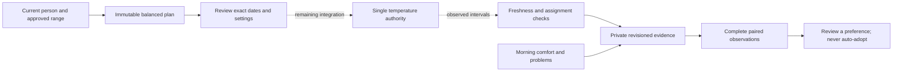

# Personal comfort experiments

This is the implemented protocol, evidence collector, durable repository and
authenticated planning API for approved improvement 10. It is **not yet an available
app feature or an enabled temperature controller**. Review screens, guarded runtime
admission and lease cancellation remain integration work. No
experiment was started on Luca's Pod and no schedule, alarm or live setting was
changed by this implementation.

## Comparison protocol

`src/comfort/experiments/` compares the current baseline with one integer setting
1–2°F away, inside the existing approved overnight range. It never expands that
range. An immutable plan binds the subject, assignment, timezone, routine,
baseline, limits and wake-plan identity. The frontend proposal accepts only the
first local night date and the nearby setting; it cannot supply identity,
measurement evidence or assignment order.

The first version uses four pairs of treatment periods, sixteen calendar nights
in total. Each pair contains both baseline and variant. There are exactly two
baseline-first and two variant-first pairs, shuffled with Node's cryptographic
random generator. Every one of the six balanced orderings has the same
probability. Creating another copy of the same saved plan cannot redraw its order.

Each treatment period has a settling night followed by a scored night. Settling
nights remain visible and their problems remain outcomes. The scored night is
withheld if the preceding settling exposure was not verified. This addresses
carryover explicitly; **one settling night has not been shown to eliminate
carryover on this bed**. Calendar labels are independent of 24-hour clock
durations, including across DST. The routine adapter must supply the actual
bounded start/end times and leave all wake warming and vibration with the alarm
owner.

These choices follow the general principles of balanced randomized comparisons
in [NIST's experimental-design guidance](https://www.itl.nist.gov/div898/handbook/pri/section3/pri331.htm).
The need to consider carryover and intervention reversibility is described in
the [UK government's N-of-1 evaluation guide](https://www.gov.uk/guidance/n-of-1-study-comparative-studies)
and [AHRQ's N-of-1 design guide](https://effectivehealthcare.ahrq.gov/sites/default/files/pdf/n-1-trials_research-2014-5.pdf).
Sixteen nights, the settling interval and the numerical thresholds below are
versioned project choices, not published claims of sleep benefit.

## Observations and interpretation

The collector combines nonoverlapping sensor intervals. Device freshness expires
after fifteen seconds; presence has its own ninety-second source clock. Repeated
old measurements cannot fill a gap. Qualified exposure requires fresh occupied
readings, adequate water, power, no priming/vibration/base motion, the current
identity and routine, and the exact experiment request selected by the shared
temperature authority. A coincidentally matching manual or scheduled target does
not count as the experiment. Selection and target readback are still not proof
of physical water temperature or personal comfort.

Source hashes bind the recorded input window, ordered samples and deduplicated
command/safety events. A transient assignment, routine or wake-plan change stays
visible even if later samples return to the old state. Only the internal
collector may write exposure; user feedback has a different strict contract.
Preview observations are explicitly excluded from applied-treatment comparisons.

A scored night needs:

- At least four hours and 90% of the planned window as qualified exposure—the
  intersection of current identity, fresh presence and the selected target.
- No ambiguous sleeper, manual intervention, unconfirmed command, wake overlap,
  withdrawn source or safety interruption.
- A confirmed full-night check-in after the observation window, within fourteen
  days, with a comfort rating from 0–10 and reported unwanted adjustments/problems.
- A verified preceding settling night for the same treatment period.

Missing data stays missing. At least three complete pairs are required, and no
preference is suggested before all planned observations and check-ins arrive.
Unequal usable counts between settings withhold a recommendation. Problems,
unwanted adjustments and safety interruptions remain visible even when a night
is otherwise excluded. Those outcomes recommend retaining the current plan while
reviewing the problem.

The variant can be suggested for review only with a mean paired comfort advantage
of at least one point and a positive difference in at least 75% of usable pairs.
The result includes assignments, exclusions, usable counts, individual paired
differences and the mean. It claims neither a causal effect nor improved sleep.
No comparison automatically changes a routine or enables Autopilot.

## Persistence and remaining integration

Migration `0072_nosy_umar.sql` adds only `comfort_experiments` with a per-subject
history index and a partial unique index permitting one open plan per subject.
The API derives the repository's subject key from authenticated installation or
personal-account identity. Legacy owner records and personal records remain
separate, including after the owner creates a personal account. The existing
durable legacy privacy boundary applies to the owner routes. Personal routes
recheck the device credential, browser selection and current assignment.

Plans are immutable, updates compare revisions in an immediate transaction, and
unknown create outcomes can be recovered by reading the original plan ID. A stop
is durable, cannot be reversed by resubmitting the original plan and does not
write an old target or alarm. Storage failure leaves the previous record intact.
Collector evidence can be replaced or withdrawn with a newer observation; source
revalidation remains the collector adapter's obligation. Feedback is timestamped
on the server and can be corrected with a current revision.

## Authenticated planning API

The owner prefix is `/api/v1/comfort/experiments`; the personal prefix is
`/api/v1/me/comfort-experiments`. Both expose:

| Method and suffix | Behavior |
| --- | --- |
| `GET /` | Current planning availability and twenty records, with an `afterId` continuation when another page exists |
| `POST /preview` | Accept only `firstNightDate` and `variantF`; return the server-generated plan, exact order, hash and five-minute review expiry |
| `POST /confirm` | Accept only `reviewId` and `planHash`; recheck identity, policy, routine and wake overrides before saving the exact plan |
| `GET /{id}` | Read the saved record, evidence gaps and comparison; identify changed current context |
| `POST /{id}/stop` | Accept the current `expectedRevision`; durably stop without restoring an old target |
| `POST /{id}/feedback` | Accept `expectedRevision` and subjective `feedback`; timestamp it on the server |

`HEAD` is available for reads. Feedback contains only `nightDate`,
`confirmedFullNight`, `comfort`, `unwantedAdjustments` and `problem`. There is no
HTTP exposure-upload route, client-selected subject/side, activation action or
client-supplied measurement timestamp.

The server derives the source side from the solo-anywhere or assigned account
configuration. Planning requires an enabled overnight limit and one consistent
scheduled baseline, intersected with the adaptive policy bounds. Alarm rows and
one-time wake overrides have a separate hash; the 105°F wake target does not
expand the overnight range. Missing or corrupt policy cannot authorize a plan,
but historical reading and cancellation remain available.

Migration `0073_aspiring_brother_voodoo.sql` stores short-lived private reviews
separately from confirmed plans. There can be at most eight unexpired reviews
per person. Workers and restarts share the same exact preview until its five-minute
expiry; changed account scope or context still rejects confirmation. Confirmed
plans remain durable and can be recovered by their original ID after a lost response
or restart. Retrying confirmation cannot rerandomize or
reactivate a stopped record. Authority and writes share a database transaction with FULL synchronization for mutations,
and private response delivery rechecks authority and selected content. Input is
strict UTF-8 JSON limited to 8 KiB. Cache headers prohibit shared caching.

All responses explicitly identify execution as `planning_only`. Sixteen calendar
dates do not establish sixteen scheduled or observed nights. The runtime adapter
must review actual eligible routine windows and surface unscheduled dates before
offering an executable comparison; it must not add weekend routines implicitly.

## Remaining controller and app integration

The next implementation must connect these parts to the single controller:

1. Resolve the real scheduled windows for the reviewed comparison, including
   unscheduled nights, overlaps and DST; preserve the existing wake plan.
2. Add matching web/native review and results screens, including all exclusions.
3. Connect authenticated planning and recovery to those screens.
4. Admit only explicitly reviewed, qualified treatment leases. Pause normal
   adaptation during a comparison; preserve manual priority and the alarm window.
5. Persist live observation references and reconcile source withdrawal. On stop,
   expiry, reassignment, manual intervention or restart uncertainty, revoke the
   experiment lease. Resume only the current valid plan; never restore a stale
   saved target over a newer manual control.
6. Run prospective Preview and attended qualification before actual treatment.

The currently saved `planned`/`stopped` record states deliberately express what
this stage implements. They must not be presented as active or completed trials.

## Validation

The first focused run used the shell's Node 26 instead of the repository's
`.nvmrc` Node 24. SQLite's native ABI rejected loading; the 42 pure protocol tests
passed, but persistence did not run. Repeating under installed Node 24 loaded the
unchanged database dependency correctly. No dependency was rebuilt or replaced.

The initial schema test correctly detected the additional exported table. Its
explicit inventory and generated schema snapshot now include the new table and
both indexes. The first full run retained that inventory failure; its other
10,060 tests passed with nineteen existing skips. The final full run passes
**10,081 tests**, with nineteen existing skips and no failures. TypeScript,
full ESLint, migration validation and the production build also pass.

Focused protocol, collector, analysis, durable-storage and schema checks currently
pass 97 tests. Fixtures are synthetic, including the apparently favorable comfort
comparison; they do not establish a real personal benefit or physical behavior.
The final local logs are `/tmp/sleepypod-experiments-full-final.log`,
`/tmp/sleepypod-experiments-focused-final.log`,
`/tmp/sleepypod-experiments-types-final.log`,
`/tmp/sleepypod-experiments-lint-full.log`,
`/tmp/sleepypod-experiments-migration.log` and
`/tmp/sleepypod-experiments-build.log`. Hosted checks remain separate.

## API integration validation

Owner and personal HTTP tests exercise real migrated databases, credentials,
browser account revisions, invitation/assignment state and revoked devices.
Coverage includes exact review recovery across independent database connections,
stop/confirmation retry behavior, input limits, forged telemetry, wake/policy
changes, interrupted uploads, private response withdrawal, per-person pagination,
FULL synchronization and rollback when authorization changes.

The first API test run found a missing test-only browser signing key; the next
found a missing browser-revision header in the simulated sign-out. Both fixtures
now use the existing production authentication contract. No access checks were
relaxed. A subsequent source review identified process-local preview loss; reviews
now use migration 0073 and have independent-connection/reopen tests.

This is still software evidence. Screens, treatment execution, prospective nights
and physical qualification remain outstanding; no controller has been deployed
or actuated for these API checks.

Final local API integration validation passes **10,128 tests** with nineteen
existing skips and no failures. Full ESLint, TypeScript/production build and
Drizzle migration checks pass. The full run includes 122 experiment/API tests
and 22 schema tests. Evidence is retained in
`/tmp/sleepypod-experiment-api-full-final.log`,
`/tmp/sleepypod-experiment-api-build-final.log`,
`/tmp/sleepypod-experiment-api-lint-all.log` and
`/tmp/sleepypod-experiment-api-migration-check.log`. Hosted checks and deployment
are separate acceptance steps.
