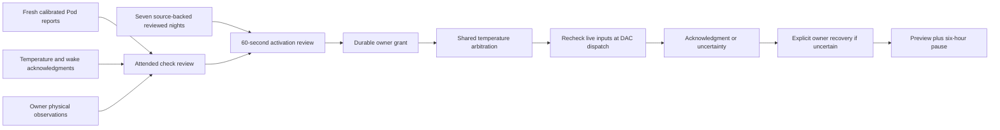

# Owner qualification and thermal activation

The personal comfort card now connects attended thermal qualification, reviewed
Preview nights and bounded Active temperature control. This implements the owner
workflow; it does **not** mean a particular Pod has passed those checks. Installation,
an old saved Active setting, elapsed time and imported sleep history cannot activate it.

## What the owner reviews

Six checks record **owner observations separately from machine evidence**:

| Check | Server evidence | Owner observation |
|---|---|---|
| Empty / occupied side | Fresh calibrated frame and classification | Whether that side was actually empty or occupied |
| Cooling / warming | Recent manual temperature acknowledgment and fresh matching powered target; warming target at least 2°F above cooling | Felt response, routing, absence of leaks or unusual noise |
| Manual stop | Fresh firmware-confirmed off state, manual pause, both thermal checks within 24 hours | Heating/cooling stopped |
| Offline routine and wake | Scheduled temperature and alarm acknowledgments within 24 hours | Internet, phone and home server were unavailable; local routine, wake alarm and cancellation worked |

Opening or confirming a check never sends a hardware command. Use the ordinary
controls for the attended test. “No confirmed power-on” is not treated as a confirmed
off report. Base idle telemetry, adequate water and inactive priming/vibration are
required. The offline failure conditions and physical results are explicitly
owner-reported; an acknowledgment alone does not prove them.

All evidence binds to a hashed embedded-storage identity, calibrated presence
source, build revision, enabled weekly routine and comfort policy. Raw hardware
identifiers and credentials are not exposed. Nonproduction hosts and missing
hardware identities cannot qualify. Existing Preview reports remain readable;
reports lacking hardware provenance cannot qualify activation.

Adaptive capacitance profiles publish a persisted `qualification_epoch`. Ordinary
15-minute baseline updates retain that epoch while the sum of absolute channel-mean
changes from its fixed anchor stays within one quarter of the entry threshold.
The anchor never follows each small update, so many small changes cannot evade the
cumulative limit. Live occupancy still uses the latest means; this does not freeze
the sensor baseline or treat an old observation as current.

The quarter-threshold limit bounds the change in summed deviation; it is an
engineering validation boundary, not a demonstrated accuracy margin. Manual
recalibration, baseline reseeding, changed thresholds/reference compensation or
excessive drift starts a new epoch. Malformed or out-of-budget epoch metadata
withholds the qualification identity. Normal state/profile restoration retains a
valid epoch across process restarts. Older producers without metadata keep strict
parameter hashing until their first epoch publication. Existing qualifications and
Preview records are never relabeled as belonging to a new epoch or build.

## Seven nights and explicit consent

Each night must already have an explicit owner review of its exact retained source
digest. Activation then requires at least four hours of **eligible observation
intervals** on the current Pod/build/calibration/routine/policy. Intervals cannot
bridge gaps over 90 seconds, process restarts, ineligible observations or missing
sensor readiness when the sensor guard is enabled. Dates and overlapping sessions
are deduplicated. These are observation intervals, not inferred sleep duration.

The server creates a review that expires after 60 seconds. Confirmation accepts
only its ID, an explicit owner acknowledgment and an optional note. It rechecks
identity, latest qualification records, original source digests, latest night
reviews, runtime and global Autopilot consent inside the final transaction. A
stale, expired, cross-side or changed review cannot activate. Repeating an already
consumed review is an inert success acknowledgment, not another activation.

The global Autopilot switch remains a separate decision: enabling it can also
enable existing rules. Personal activation never turns it on as a side effect.
Direct configure/mode requests still reject `active`; only the owner review can
create the durable grant and set Active atomically.

Once admitted, the existing policy enforces the reviewed limits (defaults 70–95°F),
at most 1°F per 30 minutes, offsets within ±3°F, occupied/fresh/water/mechanical/alarm
guards, manual priority and a six-hour manual pause. It never powers a side on.
Every hardware write rechecks the grant and live inputs; a model cannot grant consent.

Configuration edits revoke the grant. Runtime stop immediately invalidates queued
leases. Build, calibration, routine or qualification changes withhold admission;
night review replacement also withholds it. A new build currently requires matching
new Preview evidence; there is no automatic cross-build equivalence claim. The
activation snapshot retains its evidence after routine source-journal retention;
referenced owner reviews remain retained while an unrevoked grant needs them.

## Recovery and storage

Migration `0044_comfort_owner_activation.sql` adds prepared reviews, append-only
qualifications, activations and uncertainty resolutions. Existing settings and
learning cursors remain intact. Intent/reservation, completion, owner activation,
recovery and manual-pause writes use FULL-synchronous SQLite transactions. Ordinary
Preview observations keep the normal write mode.

An attempting/unknown command blocks further adaptive application. Recovery shows
the original request and fresh reported state. Explicit confirmation archives that
evidence, revokes activation and returns to Preview with a six-hour pause. It does
not relabel the old command, retry it, infer movement/vibration, or erase the separate
temperature-application journal. A stale recovery reference cannot clear a later
uncertain command.

REST endpoints under `/api/v1/comfort/owner` are `GET /`, `POST /prepare`,
`POST /confirm` and `POST /retest`; equivalent authenticated tRPC procedures are
`comfort.owner`, `prepareOwnerReview`, `confirmOwnerReview` and `retestQualification`.
Read endpoints never start hardware services. Capability discovery advertises the
review workflow separately from an actually admitted personal comfort policy.

For existing native clients, `GET /api/v1/comfort` preserves
`activation.available: false`: the legacy mode/configure endpoints still cannot
activate. The additive `activation.current` field describes an admitted owner
grant; the new owner endpoint exposes its own `active` and `canActivate` fields.
Older clients ignore these additions and can still read status, stop, configure
Off/Preview and save check-ins. The independently maintained native app can adopt
the owner review endpoints without changing this compatibility contract.

## Remaining physical and feature gates

No attended hardware test or real Preview night is established by this source
change. Bed-entry phase shifting remains Preview-only until its Active mapping
is implemented and qualified; activation rejects `followBedtime`. Automatic base
movement, experimental music vibration and house automations remain separate gates.
Clinical accuracy and improved sleep outcomes are not established by these checks.

Software tests exercise the real migrated store, source validation, review races,
durability, uncertainty recovery and the runtime-to-authority path with mocked
hardware. Browser tests exercise authenticated endpoints and honest unavailable
states with all hardware services disabled. None is physical qualification.
