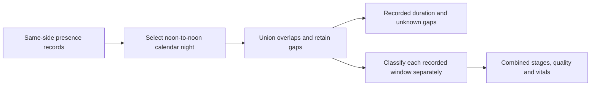

# Complete-night recording summaries

A night can contain several Pod presence records. Tonight, Night and Week
must use all records assigned to that night; a longer older record must not
replace a newer fragmented night. These are recording summaries, not proof
of uninterrupted sleep.

## Read contract

`GET /api/biometrics/sleep-stages` retains explicit `sleepRecordId` and
`startDate`/`endDate` requests. With neither, it selects the most recent
recorded night in the last seven days without a minimum segment duration.
Clients can request an evening by `nightDate=YYYY-MM-DD`. `timeZone` is an
optional validated IANA zone; otherwise the Pod's configured zone is used.
Calendar clients pass their display zone so travel does not select a different
night. Morning fragments up to local noon belong to the preceding date.
This convention groups recordings; it does not distinguish naps from sleep.

The additive `recording` object contains the selected `recordIds`, `nightDate`,
first/last timestamps, merged `durationMs`, inter-segment `gapsMs`, and exits.
Overlaps count once. A multi-record result has `sleepRecordId: null`; explicit
single-record edits still address a real record ID. An empty night returns no
coverage instead of an invented full-night interval.

`totalSleepMs` now excludes estimated awake epochs. `totalStagedMs` includes
all staged epochs, including awake. Neither includes unknown recording gaps,
and neither is interchangeable with recorded bed duration. Existing clients
that used `totalSleepMs` as total staged time should use `totalStagedMs` or sum
epoch durations. Raw records, calibration, model selection, reference data,
hardware controls and routines are unchanged.

Week vitals and quality use all merged recording windows. Classification and
smoothing cannot cross gaps between records. Month and Tonight durations use
the union of recorded windows. Tonight's read-only history remains available
while hardware status reconnects. Missing vitals still mean missing stages;
these changes do not repair sensor presence gaps or validate sleep stages.
The heart-rate chart uses actual elapsed time and separate unfilled paths for
contiguous readings; hovering an unknown interval reports no reading.
The bounded record limit is 1,000 and movement limit is 10,000 so fragmented
months and overnight week inputs are not truncated at the old small limits.

## Validation and release

Regression coverage includes fragmented newest nights versus older long
records, overlaps, unknown gaps, local-noon/DST grouping, browser/Pod timezone
differences, full-night vital aggregation, all-awake output, request limits,
and compatibility with demo and explicit-record/range requests.

Before a separately authorized Pod deployment, preserve the current release
and database backups. After release, compare known multi-record nights across
Tonight and Sleep, verify record IDs/duration against the unchanged database,
check gap-free epoch boundaries, and confirm the native explicit-record client
still works. Retain the previous app release for rollback. Merging this source
change is not evidence of deployment, physical sleep accuracy or model quality.

The generated sensor services use `PartOf=sleepypod.service` and
`BindsTo=sleepypod.service`; the existing upgrade helper also stops the full
service group. A normal controller restart therefore cannot promise uninterrupted
sensor processes. Verify the installed dependency graph and plan an attended
restart accordingly; do not silently detach sensor services to deploy this fix.
