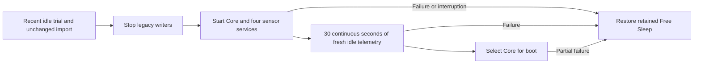

# Controlled first-installation handoff

The unified installation keeps Free Sleep's code, data, Python environment,
Node runtime, service definitions and dedicated SSH in place. The upstream
installer and purge are not part of this path. Core uses separate directories
under `/persistent/sleepypod-unified/` and its pinned private Node runtime.


## Prepare before any service action

1. Complete the [offline runtime and dependency probes](OFFLINE_POD_STAGING.md).
   Verify every release file against its bundle manifest after transfer. Keep
   the exact source archive and source commit with the release. The service
   tool does not repeat full bundle verification.
2. Before stopping writers, run the importer's `--check-timezone` for the source
   settings timezone in its locked migration environment (see
   [offline migration](FREE_SLEEP_MIGRATION.md)). Then take the reviewed quiesced
   migration backup and import it into a new data directory. The
   [quiesced preparation command](QUIESCED_IMPORT.md) restores Free Sleep before
   importing into a separate review folder and retains every translation warning.
   Review routines, current temporary overrides and alarm behavior.
   Promote all three databases, the migration report and its preserved `legacy/`
   data together. The imported history snapshot is required for activation.
   Keep Core's adaptive comfort Off or Preview and house/base automations off.
   Imported calibration remains pending actual empty/occupied qualification.
3. Put the already-probed Python modules and environments in their own directory.
   Ensure their project/lock/source identities match the reviewed release.
   These templates are specifically for a **verified NATS installation**. They
   run the four NATS-capable processors. The RAW-only cover-buttons observer is
   not started or claimed to work on that feed.
4. Give `dac` read/execute access to the release and Python directories and
   ownership of the separate data directory. Preserve root ownership of code;
   do not recursively change the retained Free Sleep installation. Keep the
   owner environment root-owned, mode 0600, outside the data/source directories.
5. Record the working Free Sleep authenticated status, service identities,
   filesystem permissions and private recovery artifacts. Keep a second SSH
   session available for the attended trial. Review the exact services first.

The services run as the existing `dac` user. Sensor writers can write only the
new data directory; the controller also needs its inspected DAC directory.
System maintenance, firewall changes and privileged self-updates are not granted
by these templates. Those operations need their own reviewed integration.
The Python services do not receive the controller's credential environment.

Example configuration (replace revision and paths with the verified artifacts):

```json
{
  "release": "/persistent/sleepypod-unified/releases/REVIEWED_REVISION",
  "modules": "/persistent/sleepypod-unified/sensors/REVIEWED_REVISION/modules",
  "data": "/persistent/sleepypod-unified/data",
  "environment": "/persistent/sleepypod-unified/controller.env",
  "dacSocket": "/persistent/deviceinfo/dac.sock",
  "rawData": "/persistent"
}
```

`controller.env` contains an unquoted, securely random URL-safe
`SLEEPYPOD_AUTH_TOKEN` of at least 32 characters and the reviewed host/HTTPS
settings from [owner access](OWNER_ACCESS.md). Never put the key in the plan,
command line, source, report or screenshots. The service manager loads it for
the controller; the handoff tool reads it only for a loopback HTTP request.

## Render and install without starting

```sh
python3 scripts/deployment/service_plan.py \
  --config /private/reviewed-paths.json --output /private/new-service-plan
```

This command only writes a new private plan directory. It validates canonical
paths and separates source, modules, data and credentials. Review its five unit
files and transfer the plan privately to the Pod. As root on the Pod:

```sh
python3 handoff.py install --plan /private/new-service-plan
```

Installation refuses existing units, unit aliases and a previous journal. It
records original unit/drop-in hashes and enablement, writes only absent Core
units and reloads systemd. It **does not start or enable anything**. A partial
installation leaves a journal and never silently overwrites or deletes files;
inspect its recorded creations before recovery. Keep `handoff.py`,
`service_plan.py`, `prepare_offline.py`, `maintenance_status.py` and
`recovery_privacy.py` together, from the reviewed commit. Initial handoff and
retained-Free-Sleep rollback are held if personal household records exist;
see the [personal recovery boundary](PERSONAL_RECOVERY_BOUNDARY.md).

## Replace an inactive release plan

For a newer verified release after a stopped trial, render a **new** plan with
the same data, credential, socket and RAW paths, then replace only the managed
unit files:

```sh
python3 scripts/deployment/replace_plan.py \
  --previous-plan /private/previous-service-plan --plan /private/new-service-plan
```

Both plans are locked against concurrent handoffs. Core must be stopped and
disabled and Free Sleep active and enabled. Original unit hashes and settings
are checked before replacement. A partial write failure restores the previous
unit files; unrelated edits require review. Neither installation is started or
enabled by this command. Keep both plans and immutable release directories.

## Bounded attended trial and rollback

```sh
python3 handoff.py trial --plan /private/new-service-plan --seconds 120 \
  --settle-seconds 30 --require-idle
```

The trial requires both original services active/enabled and every Core service
stopped/disabled. It verifies the installed templates and rejects new drop-ins
or changed legacy units. It stops the original writers, confirms their main
processes exited, then starts Core. Conflicts and ordering also enforce ownership
inside systemd; stopping Core stops its related sensor services.

The tool waits **up to** the deadline for authenticated capabilities to identify
the exact staged build and a fresh device report. The optional settling period
requires consecutive fresh observations; stale/failed reads reset that period.
`--require-idle` checks the legacy API before stopping services, raw Core heating
countdowns during the trial, and the restored legacy API afterward. Priming or
nonzero/unavailable countdowns reject the trial; a post-restoration mismatch
revokes success. These checks report drift and do not issue corrective actuator
commands. They do not establish physical thermal or vibration behavior.
The tool then stops all Core units
and restores Free Sleep, including on startup failure, stale telemetry or an
ordinary interruption. It never changes boot enablement. A machine power loss
therefore still boots the original enabled services. A process kill that cannot
be caught, changed unit definitions or an OS/service-manager failure can still
require manual recovery; the durable journal records the last completed phase.

```sh
python3 handoff.py status --plan /private/new-service-plan
python3 handoff.py rollback --plan /private/new-service-plan
```

Rollback stops verified Core units before starting the unchanged original
services. It refuses to operate on an unrelated replacement unit. If original
configuration changed, it stops the verified Core processes and leaves a clear
error instead of overwriting that change. No databases are copied over active
writers. Follow recovery with authenticated Free Sleep status and the attended
physical checks; an active process alone does not prove restored thermal control.

`handoff.json` distinguishes trial success, restoration and physical verification.
It contains no owner key or health measurements. A trial establishes neither
permanent migration nor seven Preview nights. Permanent activation, private proxy,
sensor calibration, base/Stop, vibration/cancellation and overnight acceptance
remain separate work.

## Permanent activation after a successful idle trial

`activate.py` is a separate, explicit step. It requires a successful
`--settle-seconds 30 --require-idle` trial of the exact release within the last
24 hours, including verified idle Free Sleep restoration. Repeat the trial if
the receipt is missing, stale, from another release, or only checked API startup.

Before activation, review imported routines and alarm semantics, source archive
and release checksums, current water/cover connections, and the next scheduled
events. Keep a second SSH session available. Run during an attended idle period
with no impending routine or alarm. Both temperature-control countdowns and
priming must be inactive. This tool never cancels an active user session to
make the bed pass its checks.

```sh
python3 activate.py activate --plan /private/new-service-plan \
  --legacy-data /persistent/free-sleep-data --seconds 120
```

The read-only gates compare the retained settings, routines, calibration,
comfort history and feedback files with the import's `legacy/` copies. They run
again after stopping the legacy writers. Changed files or additions require a
fresh reviewed import; activation does not overwrite them. Live metric databases
are retained in Free Sleep's directory and are not compared byte-for-byte while
its stream is writing. Take an updated quiesced archive if metrics accumulated
since the original backup must also be included in the migration archive.

All three databases must pass integrity and foreign-key checks. The separate
`free-sleep-history.db` must match its import checksum, contain the report's
exact history metadata, and refer to the preserved `legacy/free-sleep.db`
checksum. It must be a standalone snapshot without SQLite sidecars. Missing,
changed or partial history copies fail before stopping Free Sleep; older reports
without history evidence require a new import. These checks only read the
candidate and never repair or synthesize missing history.

Initial activation requires Off/Preview personal comfort, disabled general automation,
base schedules, HomeKit/MQTT, presence-based power, always-on behavior, active
run-once sessions, automatic priming/reboot and unqualified pump stall protection
and recovery. Review and
enable qualified integrations separately after activation. Imported ordinary
temperature/power/alarm routines remain intact and will run at their scheduled
times; activation does not qualify their physical behavior.



Core's five processes must be active and both Free Sleep processes stopped
throughout settling. Failed/stale telemetry resets the window; a nonzero heating
countdown or priming fails immediately. Only after that window does activation
disable the two original boot entries and enable `sleepypod.service`. Sensor
services remain individually disabled and start through Core's `Wants=` links.
Exact service definitions and final boot/process ownership are checked again.

`activation.json` is a private, durable phase journal, without the bearer key.
Ordinary startup failures, partial boot-selection failures and interruptions
restore the original services and enablement. Unexpected heat during a failed
idle activation is reported as `recovery_required`; the tool does not issue
actuator commands or claim physical recovery. Inspect authenticated firmware
status and the bed before resuming use.

```sh
python3 activate.py status --plan /private/new-service-plan
python3 activate.py rollback --plan /private/new-service-plan
```

After activation, use **this rollback command**, not `handoff.py rollback`.
The trial tool refuses plans with an activation journal. Rollback stops verified
Core services, restores Free Sleep boot entries, and restarts its writers.
Neither controller's databases are overwritten. An ordinary rollback after
successful activation permits an existing heating session and does not cancel
it. Changed unit definitions require review before starting any replacement.
Reusing an activation journal for another activation is refused; keep it as
evidence, render a new plan, and use the stopped-plan replacement workflow.

Boot-selection changes are **not atomic across machine power loss**. A hard
kill, power loss, or service-manager failure between writes can require SSH
recovery with the journal and this rollback command. A completed activation
does not establish restart recovery, physical control, sensor accuracy, private
remote access or seven actual Preview nights; verify those gates independently.
Keep `activate.py`, `activation_checks.py` and the handoff modules together from
the reviewed commit. These activation checks have software-test coverage; no
live activation is asserted by this document.

## Validation

The deployment test suite exercises unsafe paths, altered/rehashed plans,
existing units, service-stop and startup failures, stale observations,
interruptions, secret-file permissions, changed units and journal recovery.
It verifies that no outgoing process can remain when the other controller
starts and that trials never change boot selection. Run:

```sh
python3 -m unittest discover -s scripts/deployment -p 'test_*.py' -v
```

On 25 October 2026, a separate live sensor-only probe used fresh isolated
databases and the four NATS processors for 90 seconds. All four remained alive
and exited cleanly; both databases passed integrity checks and the original
Free Sleep/stream/firmware process IDs stayed unchanged. Sensor rows were
produced, but occupancy labels and vital accuracy were not independently
verified. This sensor evidence does not substitute for the controller trial.
