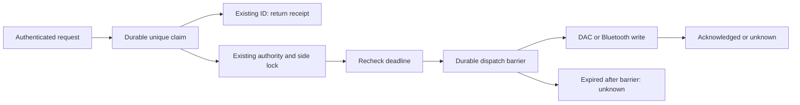

# Versioned control requests

`POST /api/v1/controls` and `GET /api/v1/controls/{requestId}` add durable
duplicate protection and dispatch deadlines to immediate manual controls.
Their tRPC equivalents are `controls.submit` and `controls.get`. Both transports
use the existing owner authentication boundary. Demo calls cannot actuate hardware.

Clients must discover `endpoints.controls` and
`controlSemantics.receiptScope = "versioned_controls_only"` from
`GET /api/v1/capabilities`. Legacy device/base routes remain compatible, but
**do not provide receipt or expiry guarantees**. This endpoint does not grant
an LLM, MQTT sender, or house automation unrestricted actuator access.

## Request contract

```json
{
  "requestId": "18af1f91-5728-4f16-8e99-c091239c9e14",
  "issuedAt": 1793000000000,
  "expiresAt": 1793000030000,
  "action": { "kind": "temperature", "side": "left", "temperature": 75 }
}
```

Times are Unix **milliseconds**. Create a fresh UUID for a deliberate new action;
retain that exact ID, payload and timestamps when checking an uncertain submission.
The example timestamps are illustrative and must not be reused. The lifetime
must be greater than zero and at most 60 seconds. Future-issued requests are
rejected; expired requests are recorded without execution. Synchronize clocks;
do not renew an old request's deadline to get it accepted.

| Action | Fields | Scope |
| --- | --- | --- |
| `temperature` | `side`, integer `temperature` 55–110°F, optional `holdMinutes` 1–1440 | Existing manual temperature owner, safety checks and adaptive pause |
| `power` | `side`, `powered`, optional integer `temperature` 55–110°F | Existing manual power behavior |
| `vibration` | `side`, `intensity` 1–100, `pattern` `rise`/`double`, `duration` 10–180 seconds | Requested protocol values; physical behavior remains unqualified |
| `vibration.clear` | `side` | Cancel that side's vibration |
| `base.position` | integer `head` 0–60°, `feet` 0–45°, optional `feedRate` 30–100 (default 50) | Whole bed; existing connection, freshness and busy checks |
| `base.stop` | none | Stop remains available without fresh position telemetry |

Snooze, scheduled actions, priming, music and raw hardware commands are excluded
from this immediate-action contract. Schedule the future through the schedule
APIs rather than retaining a control envelope for later delivery.

## What a receipt means

| State | Meaning | Client response |
| --- | --- | --- |
| `executing` | Claimed by this process; operation is still running | Poll the same ID |
| `acknowledged` | The existing hardware operation completed after at least one dispatch barrier | Display acknowledged, with separate reported measurements |
| `not_dispatched` | Handler completed without sending a hardware command, such as a superseded dial update | Refresh state; do not claim an adjustment occurred |
| `rejected` | Invalid timing or another rejection before any dispatch | Show rejection and refresh state |
| `expired` | Deadline prevented dispatch before any command was sent | Show expiry; require a deliberate new action |
| `unknown` | A possible write lost its outcome, a partial operation failed, or execution was interrupted | Show uncertainty; inspect reported state and do not replay |

`physicalVerification` is always `unverified`; `replayAllowed` is always `false`.
`dispatchCount` counts **durably recorded dispatch attempts**, not confirmed
physical effects. A barrier may be persisted immediately before expiry or a
socket failure prevents the write. `finishedAt` is null for an interrupted
execution whose completion could not be recorded. An acknowledgment can arrive
after expiry if every write began before the deadline: expiry limits dispatch,
not the duration of a physical effect or the response time.

Repeated identical submissions return the existing receipt and never re-execute.
An ID reused with a changed normalized payload or lifetime returns HTTP 409.
Missing receipts return 404. A storage failure can return 500: query the same ID
before any further action. Do not translate an unknown result into success merely
because the latest temperature or base position happens to match the request.



## Implementation and recovery boundaries

- SQLite claims, dispatch barriers and completion updates use independent
  `synchronous=FULL` immediate transactions. Ordinary application writes retain
  their existing setting. This follows SQLite's documented WAL durability model;
  actual power-loss durability still depends on the filesystem/storage honoring
  synchronization. See [SQLite synchronous](https://www.sqlite.org/pragma.html#pragma_synchronous).
- The DAC guard runs **inside** the sequential transport queue, just before
  socket write. Hello and status reads are excluded. The Bluetooth guard runs
  immediately before GATT WriteValue. Guards use wall and monotonic time and
  fail closed on rollback, deadline expiry or a closed request context.
- Multi-command actions are not atomic on hardware. For example, a head command
  can be sent before the feet command expires. Such a result is `unknown`.
- Hardware write callbacks are never automatically retried after socket errors,
  including through legacy routes. Only callbacks explicitly marked read-only
  can reconnect and retry once. Periodic temperature arbitration and other
  independent owners remain separate actions, not receipt replays.
- Per-side vibration start/clear now use the shared side lock. Clear also checks
  the firmware response. Long-lived scheduler initialization explicitly leaves
  the caller's request context, so future alarms do not inherit an old deadline.
- No pending command queue is persisted. After restart, an unfinished receipt
  is reported as unknown without resuming it. Receipts are retained in
  `sleepypod.db` and must be included in backups. Do not prune them or restore an
  older configuration database during active use without invalidating outstanding
  client requests and verifying the controller clock. Storage exhaustion blocks
  new recorded controls; legacy Stop remains callable independently.

## Validation evidence

Local tests use real migrated SQLite files, fake clocks, simulated Unix sockets
and a fake BlueZ bus. They exercise duplicate delivery, ID conflicts, expiry
behind queues, clock rollback, partial dispatch, failed persistence, a database
reopen, scheduler isolation, rejected firmware replies and the no-retry rule.
The production browser test exercises authenticated REST/OpenAPI and rejects
anonymous REST/tRPC; it submits only expired requests, never live commands.

This is software evidence. Pod restart/power-loss behavior, base movement/Stop,
vibration, native adoption of this endpoint and the seven-night Preview remain
separate acceptance steps.
