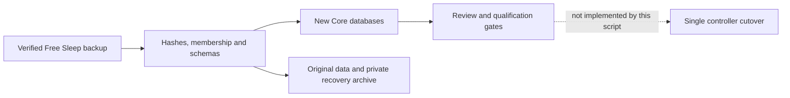

# Offline Free Sleep migration

This importer builds a **review candidate**, not an installation. It never
contacts the Pod, changes services or sends hardware commands. Keep the working
Free Sleep installation and SSH service. Do not run the upstream purge as part
of this workflow. Core cutover and rollback tooling remain separate work.



## Run

Requires Python 3.10+ and the locked `scripts/migration` uv environment. Its
`tzdata` dependency supplies IANA timezone data on Pods whose operating system
omits it. This is a separate tooling environment; sensor dependency locks and
the Pod's global Python installation are unchanged.

Before stopping any service, check the **actual source settings timezone** with
the same interpreter/environment that will perform the import. For example:

```sh
uv run --project scripts/migration --frozen python scripts/migration/free_sleep.py \
  --check-timezone America/Los_Angeles
```

Run from this repository with its checked-in control and biometric migrations:

```sh
uv run --project scripts/migration --frozen python scripts/migration/free_sleep.py \
  --backup /absolute/path/to/free-sleep-backup \
  --output /absolute/path/to/new-review-directory
```

For an offline Pod, prefetch the hash-verified `tzdata` wheel identified by
`scripts/migration/uv.lock`, install it into a separate uv-created environment
with `--no-index --no-deps`, and run that environment's Python for both commands.
Do not change the source timezone or replace it with UTC to hide missing data.
Timezone validation also runs before either candidate database is created.

The backup must use `free-sleep-migration/1` from the companion Free Sleep
`scripts/migration/backup.py`, including `manifest.json`, `data.tar.gz` and
`private.tar.gz`. Output must be a new directory outside the source backup;
its parent must exist. Existing destinations are never replaced. Invalid input
removes temporary staging and leaves the source unchanged. Archive links,
traversal, duplicate/noncanonical members, missing members and checksum changes
are rejected. Directories/files are owner-only (0700/0600).

The backup format contains transactional SQLite snapshots and independently
copied settings. It does not guarantee one transaction across all stores. Take
a fresh, quiesced snapshot at eventual cutover and preserve the installation,
service units, stream configuration, SSH and firewall recovery materials too.

Output contains:

- `sleepypod.db` and `biometrics.db`, created using the checked-in Drizzle SQL
  and migration ledgers; the ordinary Drizzle migrator can subsequently resume.
- `free-sleep-history.db`, a separate indexed read-only query snapshot of
  supported original measurements. Allow additional disk space for its data
  and indices; its checksum and source metadata are included in the report.
- `legacy/`, with every original data file, including the legacy biometric DB,
  routines, journal and full learning history.
- `source/`, with exact copies of all three backup files. Credentials remain
  inside the private archive and are not loaded into Core settings or reports.
- `migration-report.json`, with counts, checksums, unresolved translations and
  `readyForCutover: false`. Do not point a running controller at this candidate.

## Translation contract

| Source | Candidate behavior |
| --- | --- |
| Timezone, units, side names, away mode | Validated and copied. Core-specific automatic presence controls remain at disabled defaults. |
| Daily prime/reboot | Preserve effective behavior: Free Sleep registers reboot only when daily priming is enabled, one hour before the priming clock. A requested but inactive reboot remains disabled and is reported. |
| Bedtime ownership | Preserve one complete routine per starting weekday in `bedtime_routines`, with exact ownership of its compiled scheduler rows. Edit it through `/api/v1/routines`; calendar mutations cannot sever it. |
| Power | Preserve enabled state and on-target. `offDayOffset=1` only if OFF precedes ON by clock time; otherwise `0`. Equal enabled boundaries are rejected. `endAction=turn_off`. |
| Temperature phases | Earlier clocks move to the next calendar weekday. Only phases strictly inside an enabled power window are enabled. Out-of-window points are retained disabled and reported. |
| Alarms | Earlier clocks move to the next calendar weekday; disabled when the parent routine is disabled. Preserve intensity/pattern and Free Sleep's effective minimum ten-second duration. Core's wake window starts disabled. Per-alarm snooze duration comes from the side's first configured snoozing alarm tap; differing tap durations are flagged for review. Snooze taper starts off. See [snooze compatibility](ALARM_SNOOZE.md). |
| Tap gestures | Translate temperature and alarm actions; unrepresentable values fail rather than round silently. |
| Personal comfort | Preserve learned offset, consumed-feedback/session cursors, manual pause and last request fields. Start Off; unsupported vital/bedtime adapters remain disabled. Preserve full original activity and timing-learning fields under `legacy/`. |
| Journal | Import complete check-ins into revision-checked `journal_entries` and synchronize comfort feedback; retain the original file under `legacy/`. Preserve the source date zone and unknown creation times. Import time is bookkeeping, not an observed sleep night. See [Morning journal](MORNING_JOURNAL.md). |
| Biometrics | Verify original SQLite integrity and table columns; retain it byte-for-byte. Build a separate source-labelled query snapshot for Sleep → History and `/api/v1/history`. Do **not** merge old five-minute interval-start HR/HRV/respiration averages into Core's live metrics under different definitions. See [Imported history](IMPORTED_HISTORY.md). |
| Legacy capacitance | Preserve channel means/std as **pending** profiles. Free Sleep used summed standardized deviations; Core uses a raw-unit threshold. No threshold/quality score is guessed. Tagged newer formats require a separate adapter. |
| Transient overrides | Retain originals and report unexpired overrides; no equivalent Core override is invented. |
| Credentials/integrations | Retain privately for recovery; do not provision owner access, MQTT or HomeKit from the archive. Their Core integrations start disabled. |

## Gates that still prevent cutover

1. Qualify attended operational rollback while retaining the working
   installation and service/SSH/network configuration. The companion Free Sleep
   recovery tool now has an off-host file-restoration rehearsal for 45,126
   installation entries and 70 Bluetooth-state entries, with unchanged running
   service process IDs. That is not proof of runtime recovery or a boot image.
   See the [recovery runbook](https://github.com/lucaandrea/free-sleep/blob/b46582a/scripts/migration/RECOVERY.md).
2. Qualify overnight editing in native clients against the versioned bedtime
   contract below. The web editor now preserves the complete starting-night
   routine, including independent power times and power-only routines. Existing
   calendar-only sides retain the original curve editor. A mixed calendar/bedtime
   side fails closed for review; the app does not guess ownership or convert it.
   Missing offsets on legacy calendar APIs retain their calendar-day default.
3. Review enabled alarm behavior: Core adds temperature warm-up and a
   post-alarm hold that Free Sleep's alarm executor does not provide. The
   importer reports this difference; it does not claim behavioral equivalence.
4. Resolve active temporary overrides, intersecting routines and historical
   API compatibility using the preserved source data. Recheck current settings
   at cutover; this candidate is not a synchronized live replica.
5. Validate legacy occupancy against actual empty/occupied readings, then
   qualify thermal operation, attended base/Stop and vibration/cancel.
6. Run and review at least seven actual Preview nights before bounded active
   personal comfort. Imported records and synthetic tests do not count.

## Versioned bedtime API

Authenticated `GET /api/v1/routines?side=left` returns `version: 1`, `side`,
`canCreate`, and `routines`. Each routine contains its starting `dayOfWeek`,
opaque `revision`, and complete `draft`:

```json
{
  "power": { "onTime": "22:00", "offTime": "07:00", "onTemperature": 75,
    "enabled": false, "endAction": "turn_off" },
  "temperatures": [],
  "alarm": null,
  "notes": ""
}
```

`POST /api/v1/routines` accepts `{side, changes}`. Every change has
`dayOfWeek`, `expectedRevision` (the loaded revision, or `null` for an empty
night), and `replacement` (a complete draft, or `null` to delete). A move sends
both the original-night deletion and destination-night replacement in one
request. Every selected original is compared **before any write**; a conflict
returns HTTP 409 and rolls back all changes. Clients must keep the original
revision with the draft rather than replacing it on background refetch.

The transaction validates the resulting week, rejects overlapping enabled
power windows and duplicate events, and compiles following-morning phases and
alarms to the next calendar day. Enabled phases must be strictly inside the
power window. The parent power toggle gates its phases and alarm while retaining
their individual preferences. New web routines start paused. Explicit wake
windows, intensity, pattern, duration and alarm temperature remain reviewable;
firmware acknowledgments do not prove that vibration occurred.

The response separates committed data from `schedulerApplied`. If registration
fails, the save remains committed and clients must show that condition rather
than retry with stale revisions. A successful response is not evidence of a
physical hardware action. Existing controller diagnostics/reload handle job
reconciliation. During initialization, an older save cannot register rows
already replaced by a newer transaction. Existing calendar writers check
ownership inside their own transaction and reject partial routine changes with
HTTP 412. Direct out-of-band row changes are detected on the next routine read.

This contract is additive. Native and ESP32 owners should use it for imported
bedtime routines; the old calendar mutation API intentionally refuses those
rows. Native history contract adoption, actual Pod qualification
and seven Preview nights remain separate gates.

## Verification

```sh
uv run --project scripts/migration --frozen python -m unittest discover -s scripts/migration -p 'test_*.py' -v
```

The suite uses synthetic temporary backups and the installed Node/Drizzle
runtime. It checks overnight/week-wrap mapping, disabled events, learning
cursors/manual pause, original journal/metric preservation, private archive
handling, unsafe/corrupt input, existing-target protection, cleanup, migration
ledger resumption and the default for existing Core rows. The suite runs in
CI's Unit Tests job and the pre-push hook. Core behavioral tests additionally
cover scheduler cron registration, DST Preview boundaries, individual/batch
API preservation and demo parity.

An initial 25 October 2026 offline rehearsal against the owner's saved backup
produced 14 power rows, 14 alarm rows, zero temperature phases, six tap gestures,
two default-Off comfort states and zero check-ins. All power/alarm rows remained
disabled. The source snapshot contained zero vitals/movement/sleep records;
this says nothing about later or Apple Health history. Both legacy baselines
were preserved as pending. The source archives matched their manifest hashes;
no Pod service or hardware setting changed.

A later rehearsal of the installation-recovery snapshot used the new bedtime
contract and verified all 14 complete routines against their source preferences.
That newer source contained **one enabled power routine**, zero temperature
phases and zero enabled alarms. The candidate preserved those values exactly;
it was never started as a controller. Both sides passed ownership verification
and SQLite integrity passed. This is separate from the earlier all-disabled
snapshot and does not change the live Pod.

The bedtime feature passed 16 synthetic importer tests (including the actual
TypeScript ownership reader), transactional/router and editor regressions, and
an isolated production-browser workflow with authentication, persisted moves,
concurrent-edit rejection and a 390-pixel layout. The browser uses disabled
synthetic routines, not the owner's candidate.
