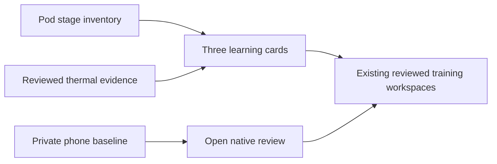

# Guided learning journey

Approved improvement 07 adds three distinct learning paths to Autopilot → Learning.
Opening the page performs authenticated model-inventory reads. It cannot train,
select or activate a model, send Health history, or issue a hardware command.

## Evidence semantics

- Sleep stages distinguish absent models, saved candidates and a selected Pod
  estimator. A trained artifact does not establish accuracy or better sleep.
- The personal night baseline remains on the iPhone. This web page does not infer
  its presence, verification, counts or source from Pod records.
- Temperature progress uses the existing count of qualified complete, reviewed
  nights. Readiness to fit, a held-out feedback comparison and activation remain
  separate. Historical Health nights cannot replace missing bed temperatures.
- Failed, pending, future-dated, wrong-side or older-than-five-minute responses
  withdraw their progress instead of presenting cached readiness as current.
- The selected bed side follows the user into the temperature review. Stage
  settings currently require selecting that side explicitly, so the link says so.

The matching native journey links to stage review, the private baseline and the
temperature workspace. It keeps the usual side for Watch-based stage training
distinct from the physical side selected for Pod inventory. No baseline Health
query starts merely by opening the overview.

## Validation — November 10, 2026

Fourteen focused unit/component tests passed, along with TypeScript, focused lint
and the production build. Three browser checks passed against an isolated Core
database: mobile and desktop layouts, selected-side navigation, no training or
configuration requests, and withdrawal after a failed refresh. Both layouts were
visually reviewed. Native validation is recorded with its release separately.

These checks do not demonstrate model accuracy, physical sleep improvement or live
deployment. Existing qualification and reviewed-night activation gates are intact.
