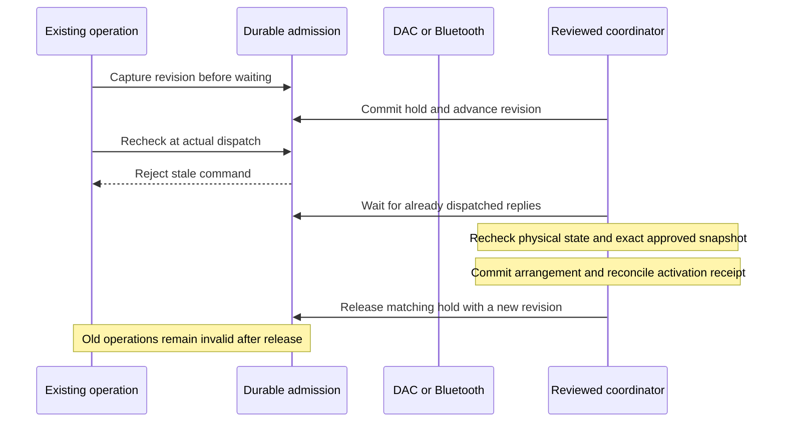

# Hardware admission during a reviewed household transition

This is the dispatch boundary for a future arrangement coordinator. It does not
activate a shared arrangement, change a routine, issue a hardware command or expose
an endpoint that pauses/resumes the bed. Current solo use remains unchanged.

## Why this boundary exists

A per-side lock serializes writers, but it cannot invalidate a command already
waiting for a firmware connection, a FIFO response, or the delay between the base's
head and feet commands. Moving side ownership while one of those commands waits
could otherwise send the old sleeper's command to the new sleeper's physical side.

`hardware_admission` contains one migration-seeded row. Holding and releasing use
independent SQLite transactions with `synchronous=FULL`. A missing table/row,
malformed state, unavailable database, or uninitialized runtime blocks new changes.
Startup installs the source after migrations and before hardware, alarm restoration,
schedulers and keepalives. Repeated initialization keeps the original authority.
Startup never clears an unresolved hold or recreates a missing row.
An in-process restore to an older observed revision cannot revive a queued command.

The original revision travels through side locks, accepted control requests,
multi-command temperature/power operations, raw connection waits and delayed base
movement. Both actual production write boundaries check it: the shared DAC FIFO
and acknowledged BlueZ GATT writes. Request bookkeeping and mechanical-context
recording run before a final check immediately preceding the bytes.

Read-only HELLO and DEVICE_STATUS remain available. Explicit cancellation is limited
to exact wire forms: zero heating duration, per-side alarm clear, and the exact
checksum-bearing base Stop packet. **Temperature level zero is not power-off:**
it can mean an 82.5°F target with a positive duration. The typed power-off operation
first requires the zero-duration acknowledgment, then tolerates a blocked optional
neutral-target reset. A rejected zero-duration command still fails.

Drain tracks dispatched writes through completion/error of their corresponding
reply. A deadline or newly in-flight Stop leaves the hold closed. Drain does not
prove that circulation, vibration or base motion physically stopped. No timeout,
storage error or process restart automatically releases admission.

## Coordinator obligations still outstanding

- Bind the hold ID to a durable activation receipt and the exact independently
  approved owner/member snapshot; recheck identity and revisions after each wait.
- Obtain fresh empty/off/non-priming/non-vibrating/non-moving observations and an
  attended activation window. A successful protocol reply is not physical proof.
- Atomically move the owner's operating week, publish the partner's reviewed week,
  change assignments, retire old holds/one-time alarms and personal adaptation, and
  transition immutable recording-attribution epochs.
- Reconcile any interrupted transition before releasing its matching hold. The
  internal `release` primitive is not a recovery decision or public control.
- Rebuild scheduled work from current persisted state; do not replay held commands.

The admission boundary does not grant a device permission, supersede request
deadlines, or bypass existing thermal, water, occupancy or base guards. Explicit
Stop remains subject to the originating request's authentication and expiration.

## Validation

Tests exercise real migrated SQLite databases, close/reopen recovery, failed writes,
missing/corrupt state, revision overflow, exact hold identity, real Unix-socket FIFO
ordering, rejected and delayed replies, typed power-off, raw neutral-level rejection,
BlueZ write acknowledgment, head/feet delay cancellation, side-lock queueing,
bookkeeping races, startup order, and scheduler-context isolation.

Local validation and hosted release receipts are recorded in the implementation
ledger. No live Pod maintenance, home automation or physical movement is performed
by these software checks.

Final local source validation on 11 November 2026: **9,266 tests passed, 19 existing
skips**, TypeScript, complete ESLint, migration validation and the production build
passed. The first full run retained one `ECONNRESET` in the existing streaming
handshake test; the entire streaming suite plus final focused hardware checks
passed (273 tests), followed by the clean full run. No assertions or timeouts were
weakened. Hosted checks and live deployment remain separate acceptance steps.
