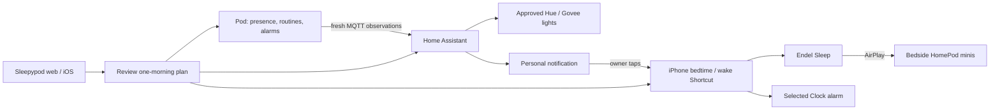
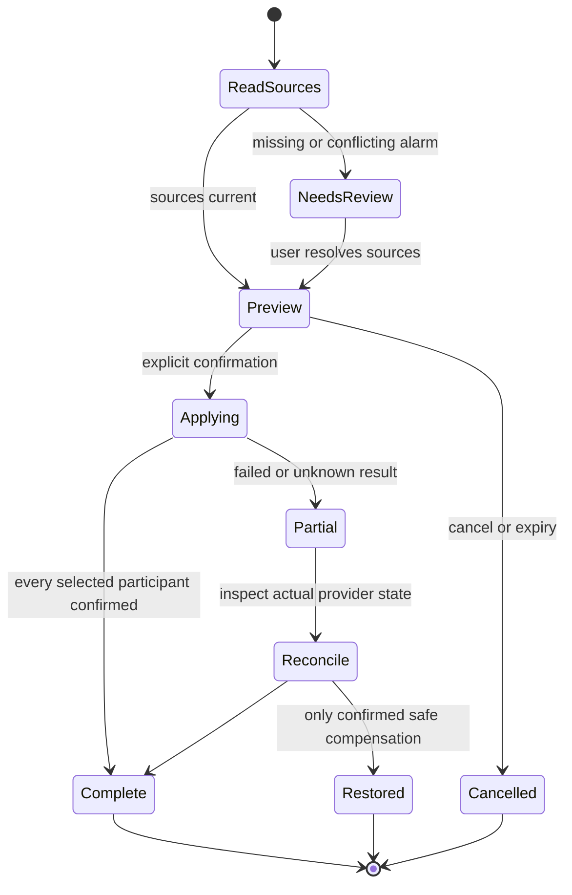

# Sleepypod + House Control: personal nights, coordinated mornings

Research and implementation plan — October 29, 2026. No new house action in this
document has been enabled. Proposed defaults below are design choices, not claims
about currently installed automations or measured sleep benefit.

## What stays in charge

The Pod owns temperature, local routines and wake vibration. Home Assistant on the
Lenovo coordinates household devices. A personal iPhone Shortcut handles actions
that belong to that phone, such as Endel and selected Clock alarms. The web/iOS
app shows one reviewable plan, with separate acknowledgments for each participant.

The LLM may explain a night or suggest an experiment. It does not bypass identity,
freshness, manual pauses, water/priming guards or the temperature controller. A
room sensor is additional context, not a second controller writing temperatures.

## Current baseline and the important gaps

- Luca is currently the only sleeper. Both thermal zones follow his logical Left routine;
  the solo sensor mode combines zones into a single logical recording. This is
  not biometric identification and does not yet prove side/middle accuracy.
- His saved routine is Sunday–Thursday bedtime at 22:00, overnight target 70°F,
  Monday–Friday warming toward 105°F from 06:30 and vibration for 20 seconds at
  07:00. These are Luca's preferences, not defaults for Marissa.
- The existing scheduled vibration command still targets **Left**. Temperature
  following does not mirror wake vibration. Feeling the alarm from Right or the
  middle has not been qualified; preserve the current ordinary wake and check
  routing separately before promising wake coverage across the bed.
- The Pod's saved weekend alarms are **disabled**. Luca's usual 08:00 weekend
  alarm may be in Clock or a light app; its actual source must be inventoried.
- MQTT has been connected and publishing. Pod actuator commands over MQTT remain
  disabled. New automations need a current entity/freshness check before activation.
- Personal adaptation remains Preview. The solo arrangement needs its own physical
  qualification and reviewed nights; prior observations were not relabeled.
- Marissa is not an active sleeper. In roughly six weeks, an explicit reviewed
  transition will put her on Left and Luca on Right. The date alone changes nothing.
- Homebridge and Apple Home pairings stay intact. A device is exposed through one
  chosen bridge to avoid duplicate accessories and competing automations.

## What the platforms actually support

| Piece | Verified documentation | What still needs an on-device check |
|---|---|---|
| Dim lights | Home Assistant light actions accept brightness and transition. | Which of the home's lights are reachable and brightness-capable; 10% may be represented differently by hardware. |
| Endel Sleep | Endel documents Siri Shortcuts and AirPlay playback. | Exact installed Sleep action, lock-state behavior, subscription availability and selected speaker route. |
| Launch a personal Shortcut from HA | The Companion app supports a notification which opens a Shortcut **when tapped**. | Whether a supported personal trigger on this iPhone can make the chosen flow hands-free. MQTT occupancy alone is not such proof. |
| Ask a spoken question | A user-invoked personal Shortcut can combine voice/output and input actions. | Where voice plays, whether the phone must unlock, and interruption/cancellation behavior. A server cannot arbitrarily summon Siri into a conversation. |
| Read/edit existing Clock alarms | Apple's Shortcuts release notes document Find Alarm, Delete Alarms and skip/unskip of the next Sleep alarm. | The exact available actions for the chosen regular alarm versus Health Sleep Schedule, and reversible one-morning edits. |
| App-owned alarms | AlarmKit lists alarms belonging to its current client. | It does **not** grant access to every alarm already in Apple's Clock app. |
| Hue | HA imports Hue scenes; V2 bridges push local state changes. | Whether the specific existing wake automation can be read/changed through the bridge. Scene activation is not schedule editing. |
| Govee | The public API controls reported device capabilities. | No verified general endpoint here edits arbitrary Govee Home schedules. Device brightness access does not establish wake-automation access. |

Sources: [HA light actions](https://www.home-assistant.io/integrations/light/),
[Endel settings and Siri Shortcuts](https://endel.zendesk.com/hc/en-us/articles/360014879579-Settings-What-s-Inside),
[Endel AirPlay/background playback](https://endel.zendesk.com/hc/en-us/articles/8084345471900-How-to-listen-to-Endel-simultaneously-with-other-audio-applications),
[HA personal Shortcut handoff](https://companion.home-assistant.io/docs/integrations/siri-shortcuts/),
[Apple Clock actions](https://support.apple.com/en-gu/111098),
[AlarmKit ownership](https://developer.apple.com/documentation/alarmkit/alarmmanager/alarms),
[Hue integration](https://www.home-assistant.io/integrations/hue/),
[Govee device capabilities](https://developer.govee.com/reference/control-you-devices).

## Flow 1: “I'm in bed” after 10 p.m.

### Trigger and permission

Use fresh, qualified occupancy continuously present for a proposed two minutes in
the 22:00–04:00 night window. This delay reduces a quick sit-down becoming bedtime.
If someone is already in bed at 22:00, evaluate the same conditions at that boundary.
Do not treat broker reconnect, retained MQTT packets, unknown/offline state or a
server restart as a new arrival. Persist the night's execution marker so restarts
cannot repeat the scene.

In solo mode, an occupied zone means “someone in Luca's bed,” not a proven identity.
Only apply Luca's opted-in personal flow while this sole-sleeper arrangement is
valid. After Marissa joins, shared audio/all-house lighting requires a jointly
approved scene and protection for someone still awake. A bedside action or phone
confirmation disambiguates who wants a personal flow.

### Exact proposed sequence

1. Snapshot the approved light entity IDs, availability, on/off state, brightness
   and revision/last-change time. Include lights currently on; exclude off,
   unavailable and non-dimmable lights. Do not use a scene that turns other lights on.
2. Fade selected lights to 10% over about 15 seconds. Proposed comfort exception:
   leave a light already below 10% at its lower brightness. Recheck each target
   immediately before writing; a lamp switched off during the fade stays off.
3. Leave manual adjustments alone afterward. Do not keep forcing brightness back
   to 10%. Provide “Undo bedtime lights” for a short window, restoring only targets
   still at the values this scene set. Do not restore over a person's later change.
4. Send Luca a “Start bedtime audio” notification tied to this specific night.
   Tapping launches the personal Shortcut. The notification expires, rather than
   replaying tomorrow when the phone reconnects.
5. The Shortcut selects the tested bedside AirPlay destination, sets that route's
   media volume to 35%, then starts Endel's Sleep soundscape. Confirm route and
   volume; do not accidentally change ringtone/alarm volume. If the route cannot
   be confirmed, stop and show a message instead of playing loudly on the phone.
6. Show separate results: lights applied/skipped, audio started/awaiting tap/failed.
   The notification being delivered is not proof that Endel is playing.

If the two HomePod minis form a stereo pair, use that named pair. If they are
separate AirPlay destinations, validate multi-speaker selection and volume before
promising both. Endel's optional background mode changes lock-screen controls and
can keep audio playing alongside calls; leave it off unless that behavior is wanted.
Endel albums on Apple Music are a possible alternate scene, but are prerecorded
and do not replace the requested adaptive Endel app session. [Endel explanation](https://endel.zendesk.com/hc/en-us/articles/4940341254290-What-is-the-difference-between-the-soundscapes-in-the-app-and-Endel-albums-on-the-streaming-platforms)

### Acceptance

Test ten representative lights before expanding to 40–50. Test an off lamp, a
lamp below 10%, an unreachable lamp, a physical switch during the fade, repeated
occupancy, HA restart and MQTT reconnect. Verify the actual speakers and volume
with Luca present. Test locked/unlocked iPhone, a phone call, failed AirPlay and
cancelled Shortcut. Nothing should repeat or turn itself back on afterward.

## Flow 2: Friday/Saturday “What time am I waking up?”

### Trigger

Use a bedtime-night identifier in the Pod's timezone: Friday night remains Friday
for a 01:30 Saturday arrival; Saturday night includes early Sunday. Proposed late
window: 23:00–04:00. Use one fresh, sustained occupancy event per bedtime night,
with an “Ask again” action. A general calendar-day check would incorrectly miss
or misclassify these arrivals.

Until hands-free personal execution is proven, deliver a notification opening
“Review tomorrow's alarms.” Also expose a Siri phrase and bedside NFC/button as
optional explicit entry points. No microphone should listen continuously for this.

### Review and voice

The Shortcut obtains a fresh, exact next occurrence from the Pod and reads only
Clock alarms the user selected during setup. Distinguish regular Clock alarms
from a Health Sleep Schedule wake-up. If there are several alarms, enumerate them
instead of silently choosing the first. Missing access is “not checked,” never
“no alarm.” Share wake times aloud only with that person's consent.

Example when sources really report these values:

> “Your bed has no alarm tomorrow. Your selected iPhone alarm is at eight. Your
> wake-up lights still need checking. Keep these, or choose a different time?”

Offer Keep, 30 minutes later, 60 minutes later, Choose time and Cancel. Read back
the actual date/timezone and every affected participant before confirmation.
Do not invent an 08:00 Pod alarm based on a general preference.

### One-morning transaction

Use the existing Pod exact-occurrence override/skip/restore API. Store a new
coordinator record with household/account/sleeper IDs, assignment revision, wake
date, desired time, request ID, expiry and per-provider original state/revision.
The coordinator does not own the underlying recurring weekly routines.

- **Pod:** shift warm-up with the chosen wake occurrence, preserving the selected
  lead time and vibration settings; protect manual pause and stale assignment.
  If the reviewed wake date has no enabled Pod alarm, offer “keep the bed alarm
  off” or an explicitly reviewed one-time alarm for that date. Do not move the
  following Monday's alarm into Saturday, enable a dormant weekend routine, or
  present the next-occurrence edit API as a one-time alarm creator. A new dated
  alarm needs its own durable creation/cancellation API and acceptance tests;
  keep that choice unavailable until those exist.
- **Clock:** use a proven Shortcut action for the selected alarm. If regular Clock
  lacks a reversible one-occurrence time change, preview a temporary one-shot
  alarm plus suppression/restoration of the original only after that sequence is
  tested. For a Health Sleep Schedule, do not assume skip/unskip also changes time.
  A manual Clock step remains visible until verified, never silently “completed.”
- **Hue/Govee:** identify each actual wake automation first. If its scheduler is not
  accessible, either leave a manual checklist or explicitly migrate that one wake
  routine into HA, with original settings backed up and duplicate behavior disabled
  only after the replacement is verified. Do not delete all vendor automations.
- **Failures:** retain durable per-provider planned/applied/failed/unknown/reverted
  receipts. Reconcile unknown results before retrying. Do not roll back someone
  else's newer manual edit. Explain partial success immediately and at wake-up.
- **Afterward:** expire the override and restore only the reviewed original state.
  Recovery must survive phone/HA restarts. Never rely on a long in-memory delay for
  restoring a recurring alarm. [HA execution/restart semantics](https://www.home-assistant.io/docs/automation/which-tool-to-use/)

### Acceptance

Test Friday 23:30, Saturday 01:30, Saturday 23:30 and Sunday 01:30; a DST transition;
an empty weekend Pod schedule; multiple Clock alarms; cancelled voice input; phone
locked/offline; provider response lost after success; partial Hue/Govee failures;
and a manual change during recovery. Confirm each provider's next occurrence and
the following week's original routine after the test.

## Original requests plus an expanded automation library

All new entries start disabled or in Preview. Each card shows its owner, trigger,
affected people/devices, data freshness, explanation, last outcome and a Stop/undo
path where applicable.

| Priority | Automation / Shortcut | Trigger and useful behavior | Guard or dependency |
|---|---|---|---|
| 1 | Bedtime lights | After 22:00 sustained presence; dim only currently-on approved lights. | Manual changes win; partner/guest protection; once per night. |
| 1 | Endel bedtime audio | Start tested Sleep action, bedside AirPlay at 35%. | Personal Shortcut; route confirmed; tap fallback. |
| 1 | Review tomorrow | Late Friday/Saturday arrival; announce actual selected alarm sources and ask. | Personal consent; distinguish disabled/unknown; date-aware. |
| 1 | Sleep in once | One-morning Pod/Clock/wake-light plan with preview and receipts. | Per-provider capability check; no silent partial success. |
| 1 | My side off / I'm too warm | Explicit button or Siri phrase stops/cools the authenticated person's assigned zone. | Resolve “my” at execution; no hard-coded Left after side swap. |
| 1 | Morning check-in | After waking, ask warm/cold/comfortable and optional rested feeling. | Personal record; no fabricated sleep stages or clinical claim. |
| 2 | Wind down | Optional pre-bed reminder and approved bedroom shade/light scene. | Respect guests, manual shade settings and household quiet preferences. |
| 2 | Nighttime path | Bed exit plus hallway motion creates a dim path to the bathroom. | Low light, limited area; do not turn the whole house on; cancel if returned. |
| 2 | Coordinated waking | Existing Pod wake occurrence optionally fades selected lights and opens approved shades. | No duplicate vendor wake routines; do not disturb sleeping partner without consent. |
| 2 | Empty-bed response | Sustained absence suppresses dependent room actions and follows the approved Pod absence policy. | Absence is not proof of waking; brief bathroom trips do not reset the night. |
| 2 | Room-aware comfort | Fresh bedroom temperature/humidity informs bounded comfort proposals. | Existing Pod arbitration only; stale data withdraws the input. |
| 2 | Humidity support | Sustained validated room readings prompt or control an eligible humidifier. | Confirm model capabilities, water state and owner-selected bounds; power-only devices cannot promise humidity targets. |
| 2 | Quiet air cleaning | Use supported purifier fan settings before bedtime; quiet mode during occupied sleep. | Read actual discrete levels; manual preference and unavailable air-quality sensors respected. |
| 2 | Quiet house / partner asleep | Protect shared audio, bright lights and whole-bed motion when the other sleeper is resting. | Presence is not identity; explicit profile/side assumptions and shared consent. |
| 2 | Morning room report | Combine overnight room conditions, measured/estimated sleep and personal feedback. | Keep sources separate; no causal claim from correlation. |
| 3 | Travel / away | Pause the person's approved routines and remind them to restore before return. | Never infer both people away from one phone leaving. |
| 3 | Data stopped arriving | Notify once when a mapped sensor/publisher goes stale; explain withdrawn features. | Avoid repeated alerts; restore only after fresh readings. |
| 3 | Low water / maintenance | Surface actual Pod water/priming issues, with manual maintenance help. | No automatic priming while someone is sleeping. |
| 3 | Base presets | Explicit personal request for a qualified whole-bed preset. | Attended head/feet/Stop qualification, both sleepers affected. |
| Research | Snoring elevation | A trusted snoring signal may propose a small head adjustment. | Snoring signal and movement/Stop not yet qualified; unavailable until both pass. |
| Research | Named vibration alerts | Distinguishable approved wake/notification cues with expiry. | Actual Pod 4 pattern/intensity/cancellation tests; wake priority over alerts. |
| Research | Music vibration | User-started local audio experiment with bounded slow cues. | Firmware timing must be measured; not promised beat-sync or HomePod audio capture. |

## Two-person behavior and privacy

Create separate personal credentials and persistent sleeper IDs. Preferences,
history, Health consent, learning and private notifications follow the person, not
the side label. Marissa gets no inherited 105°F preference or Luca history. Changing
sides closes the old dated assignment before opening a new one; mixed intervals
stay ambiguous. Local device/account changes cancel background imports and clear
visible caches. Shared wake announcements and room actions require separate opt-in.

The Pod cannot recognize faces or infer which partner is present from occupancy
alone. In two-person mode, assigned zones are a declared attribution assumption.
Temporary side swaps/guests must be explicit and must suppress unreliable personal
training/Health export. Whole-bed base movement stays a shared control.

## Delivery order and checks

1. **Inventory and preserve:** read the actual HA entities, phone actions, selected
   Clock/Sleep alarms, Hue schedules and Govee automations. Export originals and
   record ownership. Do not scan or export secrets into the plan.
2. **Identity first:** finish private account/device flows and dated person-to-side
   assignments. Keep solo mode until Marissa explicitly joins and activation is
   reviewed. Test cross-account access, revocation, stale requests and side moves.
3. **Dry-run house rules:** replay occupancy/time/light snapshots and display the
   exact proposed targets. Add persistent once-per-night markers and expiry.
4. **One explicit bedtime Shortcut:** prove Endel, AirPlay, 35% media volume and
   cancellation with the actual phone/speakers. Only then connect its notification.
5. **One-morning wake review:** read sources first; build the confirmation screen,
   provider adapters and durable compensation. Test with temporary alarms before
   using the real next morning. Keep unknown provider support visibly unavailable.
6. **Incremental activation:** approve lights first, then audio, then one-morning
   coordination. Record physical results. Add room/partner automations individually.
7. **Failure rehearsal:** disconnect phone, MQTT, internet and Lenovo separately in
   a separately agreed attended window. Pod schedules remain local. Do not change
   tomorrow's normal wake-up to conduct this test.

Tomorrow, Friday October 30, the check-in is **after waking**. The prepared 07:15
follow-up reviews the ordinary night and wake logs. No pre-wake network isolation
or extra vibration is scheduled, and ordinary success will not be recorded as an
offline/cancellation qualification.
