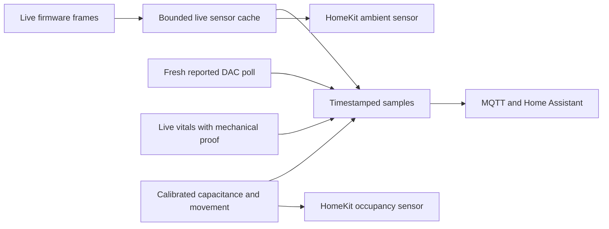

# Qualified home telemetry

Home integrations must distinguish an unavailable sensor from a measured zero,
an empty bed, or a healthy device. `src/telemetry/` reads existing sources only;
it never starts a controller or sends hardware commands.

## Measurement contract

MQTT JSON state payloads carry `schemaVersion: 1`, `ts` (source epoch ms),
`expiresAt` (epoch ms), `source`, `available`, and `reason`. Unavailable values
are null; reasons are `missing`, `stale`, or `unqualified`. A fresh packet can
still contain a null field for a sensor that particular firmware does not supply.
Consumers must require availability, a non-null field and unexpired time.

| Source | Expiry | Meaning |
| --- | --- | --- |
| DAC status | 15 seconds | Successful poll start time; connected monitor, healthy poll and no intervening write required |
| Ambient temperature / humidity | 120 seconds | Live bedTemp or bedTemp2 event time; legacy units converted |
| Pump RPM / loop temperature | 30 seconds | Live frzHealth event time; missing branches remain null |
| Occupancy | 30 seconds | Fresh calibrated capacitance plus shared movement logic; occupancy is not sleep |
| Vitals | At most 5 minutes, further limited by current mechanical context | Qualified live processing run with firmware-event time and full quiet-window proof |
| Pump stall warning | 15 seconds | Current software notice presence, not measured pump health or a leak diagnosis |

Startup backlog, future records and old/duplicate environmental or pump records
cannot refresh the live cache. Shutdown clears live observations. Historical
SQLite readings are retained for analysis but are not promoted to fresh home
telemetry. Unknown or unconfigured base telemetry currently withholds new
mechanically qualified live vitals, including on this owner's unqualified base.

Beat-interval variability retains the existing `hrv` field/entity identifier for
compatibility, with `variabilityMetric: window_ibi_variability_v1` and a clearer
entity name. It is not Apple Watch RMSSD. DAC temperatures are reported firmware
level-derived values, not independently measured cover temperature. The climate
`heat` mode means active thermal control (which may cool); it preserves the
existing MQTT command contract. Null off-state temperatures are never replaced
with a neutral number. No vibration or movement is claimed physically verified.

## MQTT and Home Assistant

State publishes every five seconds and on device-status events. Device-status
notifications trigger a fresh source read; optimistic WebSocket overlays are
never forwarded. Measurement payloads and execution receipts are non-retained.
Availability and discovery remain retained. Reconnect clears old retained state
while offline before publishing online and current measurements. Unsupported
clog discovery and retained state are explicitly removed.

Discovery combines broker availability with per-field source freshness. Sensors
and binary sensors expire after 15 seconds without a publication. Climate does
not support `expire_after`: its source availability is reevaluated on publication,
and a lost MQTT connection is subject to the broker's keepalive/LWT delay (client
keepalive 30 seconds). These entities are not safety interlocks. A Home Assistant
restart waits for the next live publication rather than replaying retained data.

See the official [MQTT sensor](https://www.home-assistant.io/integrations/sensor.mqtt/)
and [MQTT climate](https://www.home-assistant.io/integrations/climate.mqtt/)
availability and null-value contracts. Generic consumers of the former raw
`pump/<side>/stall` string must migrate to the JSON `active` boolean. The removed
clog detector had no implementation; no absence-of-clog claim replaces it.

## HomeKit and acceptance

The ambient accessory uses the same live cache. Missing, invalid or expired
readings return HAP communication failure and StatusFault, rather than an invented
20°C or an indefinitely cached value. Occupancy also faults when calibration or
fresh data is unavailable. Stable accessory names and subtypes are preserved.
Thermostats now also enforce [fresh reported state](HOMEKIT_REPORTED_STATE.md),
with explicit staged targets kept separate and independent fault contributions.
Actual Apple Home pairing, presentation and controls still need end-to-end qualification.

Tests cover actual streaming dispatch/backlog/shutdown, both environmental wire
formats, finite/sentinel/missing fields, source expiry, calibrated occupancy,
real migrated SQLite mechanical proofs and invalidation, real HAP reads/faults,
and MQTT lifecycle/retained-state cleanup. Local automated checks do not qualify
physical sensors, Apple Home pairing, a live broker or household automations.
All of those deployment gates remain pending; no home automation is enabled by
this source change.
