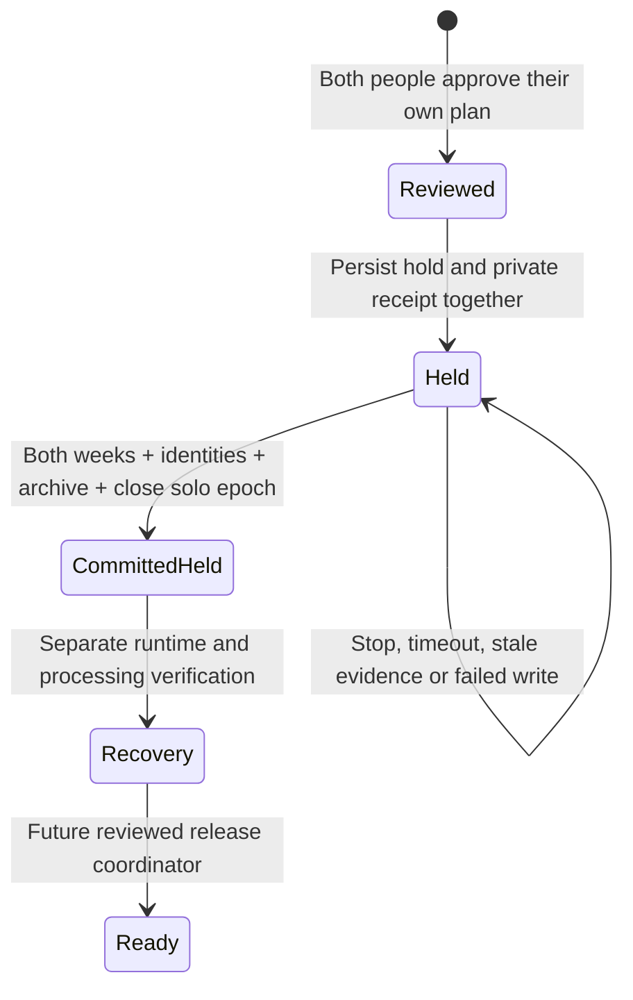

# Atomic shared-arrangement storage

This is the storage boundary for the reviewed move from solo-anywhere to two
assigned sleepers. `ArrangementTransitionStore` is **internal and not registered
on HTTP/tRPC or startup**. Public `activateArrangement` and `canActivate` remain
false. This source change does not alter an installation, its feature flags,
people, schedules, hardware, or reviewed history.

## Transaction and interruption behavior

`begin` requires an enabled internal coordinator, an authenticated owner device,
a fresh attended request, the current independently approved review, and an
already reviewed recording source with one open solo attribution epoch. It never
creates a missing source, epoch, or orphaned hold receipt. Request IDs are
idempotent and bound to the same account/device and exact request content.

The receipt and admission hold use one SQLite IMMEDIATE transaction with FULL
synchronous durability. Receipt failure rolls back the new hold. Admission stays
closed across process interruption and restart; it has no automatic expiry.

Before `commit`, a coordinator must drain in-flight DAC and base writes. The
transaction rechecks that drain, the exact hold revision, current runtime,
account/device, both approvals, current routines/preferences, policy digest,
source identity and attribution revision. Presence, thermal, alarm and base
observations have independent freshness checks (at most five seconds; never
future timestamps). Empty/unknown, off/unknown, stationary/unknown and stopped
vibration are not interchangeable. The request's attended confirmation does not
replace server observations.

The single commit:

- consumes the reviewed arrangement;
- replaces **both complete weeks** with the owner's reviewed operating week and
  the joining person's reviewed private week, using normal routine validation;
- preserves the owner's unpublished private draft and both people's preferences;
- updates both side assignments and session, household and assignment revisions;
- moves the owner's automatic comfort limit to the owner's new side; the new
  person's reviewed routine runs without inheriting the prior person's limit;
- archives replaced control state, clears temporary holds/cooling/wake overrides,
  cancels active one-off sessions, and revokes existing personal-control leases;
- leaves personal learning off, side-specific stage models inactive, shared
  reactive automation off and base schedules disabled pending household review;
- preserves prior algorithm revisions and publishes fresh default generations
  for both assigned sides, with the exact expected processing intent in the receipt;
- preserves model/history tables, device credentials, pairings and sensor
  calibration; it does not turn a network acknowledgment into physical proof;
- closes the solo attribution epoch and saves a committed-state fingerprint.

No hardware write occurs in this transaction. Failed writes at receipt, routine,
identity, or final-receipt stages roll back the whole transaction, leaving the
original arrangement and durable hold available for recovery.

## Recording boundary

The new assigned epoch **does not begin at the database commit**. The sensor
pipeline may still have the old solo/merged configuration in memory. The period
between closing the solo epoch and a separately verified runtime cutover remains
unassigned. Importing a row that crosses the boundary cannot move an old personal
record or silently attribute merged output to the joining sleeper.

Existing private copies retain their sleeper IDs. The bounded importer continues
to withhold intervals without exactly one eligible reviewed epoch. A later
recovery coordinator must explicitly append the assigned epoch after verifying
both the live pipeline configuration and physical arrangement.

### Processing acknowledgments

The committed intent identifies the reviewed dataset, assignment revision,
operation, commit time and both expected algorithm generations/hashes. Each live
Python consumer reads the current configuration from a single read-only SQLite
snapshot. An absent intent is compatible only with an unassigned legacy/solo
installation; an assigned installation with absent, malformed or changed intent
cannot silently continue as legacy processing.

The sleep detector closes existing sessions at their last observed presence,
retains completed rows and physical baselines, and persists a new routing marker
before accepting new samples. A matching checkpoint can resume the same
arrangement after restart. Failed session writes or checkpoint writes cannot
produce an adoption acknowledgment.

The piezo processor finishes queued candidates with their original provenance,
clears unfinished numerical windows and installs both exact requested profiles.
It cannot acknowledge an old restored generation or only one installed side.
Each consumer records its own process identity and fresh firmware sample boundary
only after actually processing usable input. Both current receipts, the exact
intent hash and unchanged source identity are required. Receipt/source reads do
not create history epochs or reopen hardware admission.

Old merged output and restart/reload gaps remain unassigned. The later of the two
observed sample boundaries is only an earliest possible boundary for the future
release coordinator; it is not permission to assign records crossing that gap.
Ordinary solo processing, stored calibration and historical model artifacts are
preserved. No existing installation is changed by generating the migrations.
The biometric source manifest and generated browser-worker identity change with
this code. Prior profile artifacts stay retained; existing compatibility checks
must still pass before an artifact can be used with the changed engine.

## Recovery integration still required

A committed storage transaction is **not completed physical activation**. Before
exposing activation in either app, implement and test:

1. Shared native/web review of maintenance effects, private plans and limits.
2. Cancellation/recovery receipts and a separately attended recheck, including
   restart before commit and failure after commit.
3. Producer shutdown/reload: scheduler, keepalives, auto-on/off, temperature
   requests, comfort leases, reactive rules, base queues and alarm restoration.
   Old callbacks must not capture fresh admission using stale in-memory policy.
4. Reconcile the actual processing receipts with the committed fingerprint and
   review any later personal-profile migration. The implemented default reset and
   sample-boundary acknowledgments are prerequisites, not completed activation.
5. Exact committed-state reconciliation, fresh independent observations, a new
   reviewed assigned recording epoch, and a durable release receipt coupled to
   admission reopening. Neither time passing nor drain completion releases it.

There is no public API that can invoke these incomplete recovery steps today.

## Validation

Behavioral tests use isolated migrated SQLite databases and synthetic observation
fixtures, not the user's Pod. They cover both-person approval, private response
projection, exact request replay, revoked credentials, changed plans/source,
independent stale/future observations, in-flight Stop, SQL failure rollback,
orphaned/corrupt receipts, database reopening and unassigned reload intervals.

The original atomic-storage release passed **9,328 tests, 19 existing skips**; 409 focused
household/admission cases and 44 post-archive checks passed. TypeScript, full
ESLint, both migration checks and production build passed. The first full run
caught two omitted schema-contract updates for the new table; the original
failure receipt is retained and the complete final suite passed afterward.
Hosted promotion is tracked separately. No physical operation, actual overnight
improvement or live activation is established by these tests.

The processing-boundary follow-up passes **9,342 Core tests, 19 existing skips**,
plus **477 shared Python tests (5 existing skips), 225 piezo tests and 141
sleep-detector tests**, using the modules' locked dependencies. It includes real
SQLite publication/rollback and the actual piezo main loop, both-profile adoption,
old-session closure, failed checkpoint/receipt writes, malformed/future/stale
samples, source replacement, restart receipts, and Swift's uppercase UUIDs.
TypeScript, full ESLint, both generated migration checks and the production build pass.

Retained intermediate failures caught the stale numerical source manifest and
its generated browser-worker fingerprint. A later run hit four five-second
timeouts in unchanged diagnostic/updater tests under full concurrency. The final
complete run used six workers and preserved every timeout and assertion; it
passed. An in-progress four-worker run was interrupted to fix the UUID contract
mismatch before starting that final run. No failed or interrupted run is counted
as a passing validation.
