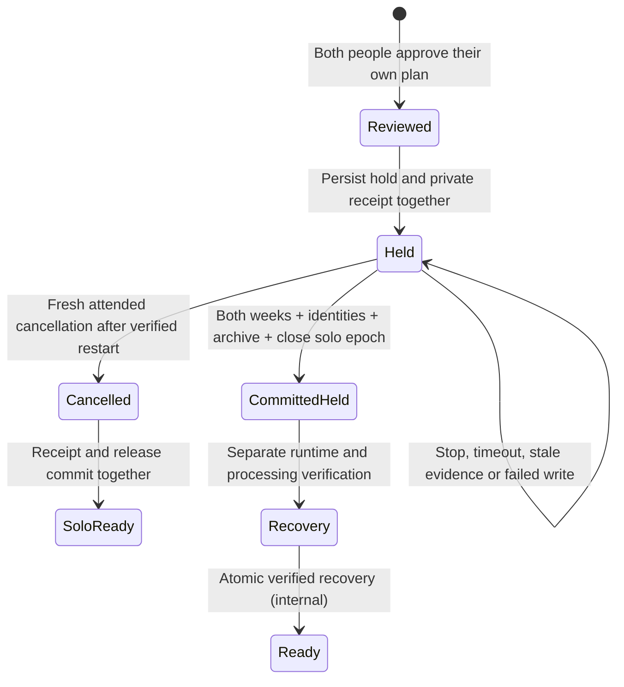

# Atomic shared-arrangement storage

This is the storage boundary for the reviewed move from solo-anywhere to two
assigned sleepers. `ArrangementTransitionStore` is **internal and not registered
on HTTP/tRPC or startup**. Public `activateArrangement` and `canActivate` remain
false. This source change does not alter an installation, its feature flags,
people, schedules, hardware, or reviewed history.

## Internal runtime coordinator

`ArrangementCoordinator` connects the transaction, recovery and cancellation
stores to a serialized runtime operation. It remains internal: no route,
startup activation or public capability is enabled by this implementation.
Duplicate module instances share the operation exclusion for the same database.

The coordinator reads evidence before placing a hold, suspends and drains
automatic producers, waits for base writes and DAC replies, then reads every
source again before committing. Expiry or failure leaves the durable hold in
place. It never restarts the process itself. Separate attended recovery still
requires a verified new controller generation and both processing receipts.
Recovery and cancellation resume automatic services only after the release
transaction succeeds. An exact historical replay does not read sensors, stop
services, restart producers or repeat saved actions.

The production evidence reader inspects existing occupancy, DAC, persisted
device-state, alarm and base readers. It does not initialize Bluetooth or send
commands. Original measurement clocks must be within five seconds and cannot
be renewed by polling. Both zones must be calibrated and empty, both thermal
channels off, water adequate, priming stopped and the connected base freshly
stationary. Unconfigured or missing base telemetry is unknown, not evidence of
an unsupported base. Supporting an independently verified base-free installation
is separate capability work.

The firmware does not expose physical vibration status. Alarm evidence therefore
means quiet saved and in-memory controller records plus inactive managed alarms
and snoozes; it is never proof that vibration physically stopped. Missing,
oversized or corrupt alarm persistence cannot become an empty record. The
attended confirmation remains required.

A failed automatic restart is returned separately from the successful durable
release receipt. The coordinator drains the partial runtime. If that drain also
fails, admission rejects both old and new non-Stop commands until runtime
replacement; Stop remains available. Replaying the release cannot retry startup.

Behavioral tests use real migrated configuration and biometric stores with
simulated external observations. They cover drain ordering, failure and expiry,
duplicate coordinators, replay, original-owner authorization, processing
acknowledgments, cancellation and failed startup. These are source checks, not
physical household qualification. Runtime registration, maintenance routes and
the attended web/native workflow remain pending.

## Transaction and interruption behavior

`begin` requires an enabled internal coordinator, an authenticated owner device,
a fresh attended request, the current independently approved review, and an
already reviewed recording source with one open solo attribution epoch. It never
creates a missing source, epoch, or orphaned hold receipt. Request IDs are
idempotent and bound to the same account/device and exact request content.

The receipt and admission hold use one SQLite IMMEDIATE transaction with FULL
synchronous durability. Receipt failure rolls back the new hold. Admission stays
closed across process interruption and restart; it has no automatic expiry.

Before `commit`, a coordinator must drain in-flight DAC and base writes. The
transaction rechecks that drain, the exact hold revision, current runtime,
account/device, both approvals, current routines/preferences, policy digest,
source identity and attribution revision. Presence, thermal, alarm and base
observations have independent freshness checks (at most five seconds; never
future timestamps). Empty/unknown, off/unknown, stationary/unknown and stopped
vibration are not interchangeable. The request's attended confirmation does not
replace server observations.

The single commit:

- consumes the reviewed arrangement;
- replaces **both complete weeks** with the owner's reviewed operating week and
  the joining person's reviewed private week, using normal routine validation;
- preserves the owner's unpublished private draft and both people's preferences;
- updates both side assignments and session, household and assignment revisions;
- moves the owner's automatic comfort limit to the owner's new side; the new
  person's reviewed routine runs without inheriting the prior person's limit;
- archives replaced control state, clears temporary holds/cooling/wake overrides,
  cancels active one-off sessions, and revokes existing personal-control leases;
- leaves personal learning off, side-specific stage models inactive, shared
  reactive automation off and base schedules disabled pending household review;
- preserves prior algorithm revisions and publishes fresh default generations
  for both assigned sides, with the exact expected processing intent in the receipt;
- preserves model/history tables, device credentials, pairings and sensor
  calibration; it does not turn a network acknowledgment into physical proof;
- closes the solo attribution epoch and saves a committed-state fingerprint.

No hardware write occurs in this transaction. Failed writes at receipt, routine,
identity, or final-receipt stages roll back the whole transaction, leaving the
original arrangement and durable hold available for recovery.

## Recording boundary

The new assigned epoch **does not begin at the database commit**. The sensor
pipeline may still have the old solo/merged configuration in memory. The period
between closing the solo epoch and a separately verified runtime cutover remains
unassigned. Importing a row that crosses the boundary cannot move an old personal
record or silently attribute merged output to the joining sleeper.

Existing private copies retain their sleeper IDs. The bounded importer continues
to withhold intervals without exactly one eligible reviewed epoch. The internal
recovery store explicitly appends the assigned epoch only after verifying the
live pipeline configuration and fresh independent physical observations. Runtime
wiring and the attended app flow remain separate work.

### Processing acknowledgments

The committed intent identifies the reviewed dataset, assignment revision,
operation, commit time and both expected algorithm generations/hashes. Each live
Python consumer reads the current configuration from a single read-only SQLite
snapshot. An absent intent is compatible only with an unassigned legacy/solo
installation; an assigned installation with absent, malformed or changed intent
cannot silently continue as legacy processing.

The sleep detector closes existing sessions at their last observed presence,
retains completed rows and physical baselines, and persists a new routing marker
before accepting new samples. A matching checkpoint can resume the same
arrangement after restart. Failed session writes or checkpoint writes cannot
produce an adoption acknowledgment.

The piezo processor finishes queued candidates with their original provenance,
clears unfinished numerical windows and installs both exact requested profiles.
It cannot acknowledge an old restored generation or only one installed side.
Each consumer records its own process identity and fresh firmware sample boundary
only after actually processing usable input. Both current receipts, the exact
intent hash and unchanged source identity are required. Receipt/source reads do
not create history epochs or reopen hardware admission.

Old merged output and restart/reload gaps remain unassigned. The later of the two
observed sample boundaries is only an earliest possible boundary for the future
release coordinator; it is not permission to assign records crossing that gap.
Ordinary solo processing, stored calibration and historical model artifacts are
preserved. No existing installation is changed by generating the migrations.
The biometric source manifest and generated browser-worker identity change with
this code. Prior profile artifacts stay retained; existing compatibility checks
must still pass before an artifact can be used with the changed engine.

## Verified recovery storage

A read-only Linux service-generation reader verifies the current process against
systemd's active MainPID and invocation, the kernel boot identity and `/proc`
process-start counter. It rechecks service properties after reading process
identity, bounds reads, and rejects stale or future observations. Within the same
boot, recovery requires both a new invocation and a strictly later process start;
an application UUID, changed environment value or reused PID alone is insufficient.

`HardwareAdmissionStore.releaseWithReceipt` can save the coordinator's synchronous
reconciliation and release in one FULL-durability transaction. Wrong revisions,
failed receipt writes, failed admission writes and callback changes to the hold
roll back together. `ArrangementRecoveryStore` now uses this internal primitive;
neither store is registered on an HTTP route or called automatically at startup.

The initial hold stores the verified service generation, and commit rejects a
changed process even if an application run ID was reused. After the committed
arrangement survives a real restart, recovery requires a new attended request
from the same current owner device, current session/assignment revisions, the
exact committed settings, still-valid approving devices, an unchanged reviewed
recording source, both fresh processing receipts and fresh empty/off/stationary
observations. A Stop awaiting its acknowledgment prevents release.

Recovery reserves the biometric source against concurrent writes while the FULL
configuration transaction opens the assigned attribution epoch, saves the
private recovery evidence and advances admission to its open revision. It
rechecks runtime evidence and drain again before release. Failed epoch, receipt
or release writes roll back all three changes. The new epoch starts at the
verified recovery time; earlier processing samples do not retroactively claim
the reload gap.

The exact saved request can replay its historical receipt after a lost response,
expiry or later hold without performing any write. Changed request contents,
revoked credentials and malformed saved evidence cannot replay. Client receipts
contain no other person's preferences, algorithm data or process identifiers.
They acknowledge admission release and explicitly state that physical movement
was not requested; they do not claim a bed-movement test.

## Cancellation before commit

`ArrangementCancellationStore` is an internal exit from an uncommitted hold. It
does not undo a committed two-person arrangement. The current original owner
device must request a fresh preview and confirm keeping the solo arrangement,
the empty attended bed, and that saved routines may resume. A verified new Linux
controller generation, independently fresh empty/off/stationary observations,
unchanged solo attribution and drained writes are required before release.

The preview binds the current operating controls, including routines, temporary
actions, automation rules and relevant device settings. If those change, a fresh
preview is required; cancellation never restores an outdated copy. Unpublished
personal drafts and preferences, credentials and live telemetry are excluded
from that digest and remain untouched. A partner may cancel their arrangement
review without trapping the owner in the hold.

With a reserved biometric source and a FULL-durability configuration transaction,
cancellation marks the review and transition cancelled, saves its exact request
and receipt, and releases admission together. It preserves all routine, profile,
calibration, personal-history and attribution data. Receipt/write failures,
expiry, source changes or a pending Stop roll back the release. Replaying the
same saved request can return its historical result after expiry or a later hold;
it cannot release that later hold or restart the cancelled arrangement.

Migration 0066 adds only a nullable cancellation receipt. Its upgrade test checks
existing held and committed records, private account data and the active hold
remain unchanged, including a repeated migration and foreign-key integrity.
Focused tests cover cancellation/recovery/transition compatibility, partial
writes, changed controls, independent freshness, Stop, source reservations and
durable reopening. No live cancellation, service restart or bed action was run.

## Automatic-service suspension and recovery

`suspendAutomaticServices()` is an internal lifecycle operation to call after
persisting the hardware hold. It pauses initialization, cancels the scheduler's
clock wait, and drains scheduled work, automation evaluation, temperature
reconciliation, keepalives and occupancy-triggered power changes. Diagnostic
connections, MQTT and HomeKit remain available for reads and explicit Stop.

The lifecycle and its keepalive/occupancy producers share process-global state
across Next.js module instances. Replacing or stopping a keepalive cancels a
refresh still waiting for its side lock, while shutdown waits for a refresh
already dispatched. New timers cannot start during shutdown. Old temperature
loops and keepalives retain their original admission revision and cannot resume
merely because a later household hold is released.

Suspension cancels snooze timers before draining both side-operation queues,
including state updates after a hardware reply. Only then does it clear active
alarm timers and wait for already-running alarm publications. This prevents an
old snooze callback from installing another timer after suspension completes.
Persisted alarm state remains available for verified restoration.

`resumeAutomaticServices()` requires released admission, successful suspension
and a fresh startup. It waits for background initialization and reports failures;
a partial resume is suspended again. Startup under an existing durable hold
starts observability without restoring alarms or automatic command producers.

These functions are not a public activation API. The coordinator must still
verify current processing and service-generation evidence before releasing a
hold and requesting a resume. No live Pod, routine or household assignment was
changed by this implementation.

## Runtime integration still required

A committed storage transaction is **not completed physical activation**. Before
exposing activation in either app, implement and test:

1. Shared native/web review of maintenance effects, private plans and limits.
2. Wire the implemented cancellation/recovery receipts to a separately attended
   recheck, including restart before commit and failure after commit.
3. Connect the implemented automatic-service suspension/resume to the coordinator
   and verify it together with base queues and actual processing acknowledgments.
   Old callbacks must not capture fresh admission using stale in-memory policy.
4. Reconcile the actual processing receipts with the committed fingerprint and
   review any later personal-profile migration. The implemented default reset and
   sample-boundary acknowledgments are prerequisites, not completed activation.
5. Connect the implemented reconciliation/epoch/release transaction to the
   coordinator and the separate attended recovery flow. Neither time passing,
   an accepted restart request nor drain completion may trigger automatic release.

There is no public API that can invoke these incomplete recovery steps today.

## Validation

Behavioral tests use isolated migrated SQLite databases and synthetic observation
fixtures, not the user's Pod. They cover both-person approval, private response
projection, exact request replay, revoked credentials, changed plans/source,
independent stale/future observations, in-flight Stop, SQL failure rollback,
orphaned/corrupt receipts, database reopening and unassigned reload intervals.

The original atomic-storage release passed **9,328 tests, 19 existing skips**; 409 focused
household/admission cases and 44 post-archive checks passed. TypeScript, full
ESLint, both migration checks and production build passed. The first full run
caught two omitted schema-contract updates for the new table; the original
failure receipt is retained and the complete final suite passed afterward.
Hosted promotion is tracked separately. No physical operation, actual overnight
improvement or live activation is established by these tests.

The processing-boundary follow-up passes **9,342 Core tests, 19 existing skips**,
plus **477 shared Python tests (5 existing skips), 225 piezo tests and 141
sleep-detector tests**, using the modules' locked dependencies. It includes real
SQLite publication/rollback and the actual piezo main loop, both-profile adoption,
old-session closure, failed checkpoint/receipt writes, malformed/future/stale
samples, source replacement, restart receipts, and Swift's uppercase UUIDs.
TypeScript, full ESLint, both generated migration checks and the production build pass.

Retained intermediate failures caught the stale numerical source manifest and
its generated browser-worker fingerprint. A later run hit four five-second
timeouts in unchanged diagnostic/updater tests under full concurrency. The final
complete run used six workers and preserved every timeout and assertion; it
passed. An in-progress four-worker run was interrupted to fix the UUID contract
mismatch before starting that final run. No failed or interrupted run is counted
as a passing validation.

The service-generation and atomic-release prerequisites pass **9,373 Core tests,
19 existing skips**, including 42 focused cases for identity verification,
replay rejection and release rollback. Production build, TypeScript and full
ESLint pass. These tests mock Linux service/proc observations; they do not prove
the reader works on a particular installed Pod.

An initial full run exceeded the unchanged five-second diagnostic bundle guard
under parallel worker load. The two real-shell integration files now run
sequentially after the other suites, preserving all assertions and timeouts.
Discovery verified the same 671 files exactly once; all 57 shell cases and the
complete final suite passed. An overlapping build/typecheck removed generated
Next type files during that check; the retained failure was followed by a clean
typecheck after the production build completed.

The verified recovery storage follow-up passes **9,426 Core tests, 19 existing
skips**. Focused transition/recovery checks cover generation changes, original
and recovery request expiry, revoked credentials, missing/stale processing,
changed settings/source, database reopen, whole-interval attribution, exact
replay and receipt corruption. SQL fault injection proves epoch/receipt/release
rollback; a second connection proves the biometric source stays reserved until
the configuration commit finishes. A Stop injected at the final receipt write
also rolls back the operation. TypeScript, full ESLint, both migration checks,
the generated schema contract and the production build pass. The generated snapshot changes only
the nullable recovery column and migration identity.

The first recovery fixture omitted the independently saved personal preferences
required by the existing review contract; correcting the fixture preserved that
requirement. A full run passed before two final commit-boundary guards were
added. The next full run had one connection reset in the unchanged WebSocket
replay test (9,425 passed); all 137 streaming tests passed in isolation and the
complete final suite then passed. The failed run remains in the evidence record;
neither the streaming code nor its assertions/timeouts were changed.

Automatic-service lifecycle validation passes **9,501 tests, 19 existing skips**,
including 344 focused startup, suspension, cross-module timer, queued-operation,
alarm-publication and explicit-resume checks. TypeScript, full ESLint and the
production build pass. An earlier full run had one HTTP 501 WebSocket handshake
failure; the isolated 137-case streaming suite and final complete run both passed.
That failure is retained as a transient observation, not claimed as a fixed
streaming defect. No live household transition was attempted.

The first hosted run passed the browser, build, type and lint checks but exceeded
the unchanged 30-second thermal-forecast audit guard (9,500 tests passed). A CPU
profile found repeated ICU timezone formatter construction in source-day conversion
and timezone validation. A bounded shared cache now reuses those immutable
formatters, including invalid-zone results; recording audits and time-dependent
evidence are still rechecked. The fixture, assertions, coverage and timeout are
unchanged. Comparable local coverage runs measured 9.0 seconds before and 3.2
seconds after; the final full suite measured 2.7 seconds for that test.

The corrected full suite passes **9,512 tests, 19 existing skips**, including 11
new timezone/DST/eviction checks. TypeScript, focused ESLint and the production
build pass. These local results do not replace final hosted or live acceptance.
