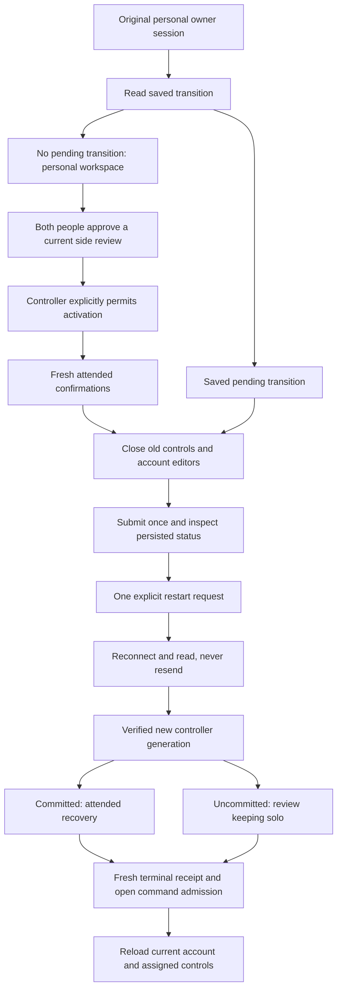

# Attended side-change workspace

The personal browser workspace can now follow a saved household transition through
restart, recovery or cancellation. The maintenance API is integrated in main by
PR 107 (`d7a4440b`), with the same tree as its tested head `6310d9bc`.

This is the client workflow for platform improvement 16. Public activation remains
unavailable until private learning migration and the complete native workflow are
ready. The browser does not infer activation support from an account invitation,
an approved proposal or the presence of maintenance endpoints.

## Identity and lifecycle

- `arrangementMaintenance` is an optional owner capability. Older controllers and
  member accounts keep their existing workspace. Owners can inspect a previously
  saved operation even when new activation/review flags have been disabled.
- A capable owner checks for a held or committed transition before the ordinary
  React bed controls or account editors become available. A failed check leaves
  editors hidden and inert; sign-out remains available. Entering maintenance disposes their old controls and
  history view, hides and disables account editors, clears invitation text and
  aborts pending outer-editor requests. Sign-out remains available.
- Maintenance alone can reacquire assignment/session revisions for the same Pod,
  household, account and sleeper. The server additionally enforces the original
  owner device. Ordinary requests retain their strict assignment binding.
- Terminal recovery/cancellation does not automatically reopen controls. The
  explicit return action reads a fresh terminal status with open command admission,
  then reloads account settings and mounts the current assignment. Old controls
  are never retargeted in place.
- Backgrounding clears private status, cancellation previews and checked
  confirmations. An account-change event withdraws the complete view; late
  responses cannot restore it.

## Requests and presentation

Every action rechecks the personal session and current operation. A side change
requires the same current approved proposal, activation capability and all four
attended acknowledgments. Restart, recovery and cancellation have separate forms
whose confirmations begin unchecked. A refresh starts a new observed step.

A restart receipt prevents a second restart submission. A lost response asks for
a status read; there is no retry queue. Recovery requires a committed operation
and a verified new controller generation. Cancellation requires an uncommitted
hold, a verified restart and a fresh digest-bound preview of the retained solo
configuration. Both outcomes distinguish a saved receipt from confirmed routine
service startup and from physical bed behavior.

The exact-path browser transport accepts no side/account selectors for maintenance.
Contract schemas are browser-safe: Linux process inspection stays outside the
personal bundle. Its build-time dependency check continues to reject hardware,
database, streaming and server-runtime imports.

## Validation

The focused client, contract and HTTP suite passes 171 tests. All 18 production
browser scenarios pass across maintenance, side reviews, private controls and
personal history. They intercept device APIs and use an isolated local database;
they do not operate a real Pod.

Maintenance cases cover restored pending transitions, a lost restart response,
reload without replay, four-confirmation activation, new-generation recovery,
digest-bound cancellation, unconfirmed service startup, fresh assigned-side
controls, backgrounding, account invalidation and delayed replies. Desktop and
390px dark/reduced-motion captures at enlarged text were inspected for readability
and horizontal overflow.

Full local regression validation passed 9,620 tests with 19 existing skips across
680 passing files (one skipped), with 92.76% statement and 86.42% branch coverage.
The final browser entry change separately passed the production build, TypeScript
and all 18 browser scenarios. Hosted checks still need to verify the committed head.

The first browser run retained two failures: one fixture mixed different sleeper
IDs and one test enumerated checkboxes before the refreshed form existed. The
fixtures now bind the current sleeper and wait for all four confirmations. No
application check or assertion was weakened.

A subsequent regression reproduced visible account editors while the initial
transition read was pending. The entry lifecycle now keeps them hidden and inert
until that read establishes an ordinary workspace; the new case passes and checks
that the read itself sends no mutation.

The first hosted full browser run also exposed account-save feedback being
overwritten by the asynchronous maintenance-ready callback. Loading feedback now
stays in the maintenance panel, preserving the account action's result. The real
two-account scenario selects that result explicitly rather than assuming the
whole page has only one live status region.

After that correction, the rebuilt app passed the complete local browser suite:
99 scenarios, including the real two-account API flow. The earlier hosted failure
is retained as evidence. All hosted checks subsequently passed on final head
`d31f28352a8ad2155545fd6308ad4cd2d9e1cce0`. PR 108 merged as
`80f2ac344de52d376c1d297bd99e6df2711ce533`; both have tree
`3774264489b7df27a742b64bff7d4be85d269c4c`.

No live controller was restarted, no side assignment or routine was changed, and
no physical activation or native delivery is established by these checks.
