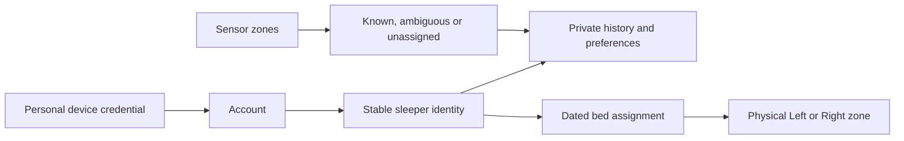

# Household accounts and person-owned sleep data

Status: preparation v1 is implemented for validation; the later assignment and
personal-history sections remain the target contract, not deployed support.
The installed owner-only connection flow remains available while this feature is
built. Never invite a second person by sharing the owner's connection key.

## Required behavior

Luca is the sole current sleeper. The existing `solo-left` setting identifies the
logical source routine; it does not assert that his body stays on the left.
Both sensor zones feed that one sleeper's recording, and `unusedZoneMode=follow`
makes the other thermal zone follow the same routine. This live configuration was
explicitly requested on October 29. It does not establish new physical accuracy or
transfer old qualification records to the changed arrangement.
Temperature following does not copy scheduled vibration to the other zone: the
current alarm dispatcher targets the routine's source side. Right/middle wake
coverage remains unqualified and must not be inferred from thermal authority.

See [the dated readiness record](HOUSEHOLD_READINESS_2026-10-29.md) for merged,
deployed and remaining release gates. The guide is a practice document, not a
claim that a second sleeper can already use live personal controls.

Marissa is a planned future sleeper, not an active account or occupant. In roughly
six weeks, she accepts her own invitation and chooses her own settings. A separate
reviewed assignment transition places Marissa on Left and Luca on Right. There is
no automatic date-based switch and no copy of Luca's private data to Marissa.

## Identity and access

- Stable identifiers distinguish Pod, household, account, sleeper and device.
  Names and selected sides are display/configuration values, never authentication.
- Each device receives a revocable personal connection credential. The server
  stores a digest, not the reusable credential. A short-lived, single-use household
  invitation pairs a new device/account; no new cloud account is required.
- The existing owner key maps only to the existing owner's account. It cannot be
  used as Marissa's invitation. An accepted member may prepare preferences before
  receiving an active bed assignment, but cannot control an unassigned zone.
- Household administration and private Health access are separate capabilities.
  Partner membership does not grant raw Health, exports, model training or private
  history belonging to another sleeper. Shared wake-time announcements are opt-in.
- Member credentials are rejected by every legacy REST, tRPC, raw stream, archive,
  model and backup surface. New person endpoints resolve `self` from credentials.
  A persisted [personal privacy boundary](PERSONAL_PRIVACY_BOUNDARY.md) restricts
  legacy owner paths once physical assignment or shared attribution is committed; old side-only clients must receive an explicit upgrade requirement
  rather than expose the new occupant's history.
- Logout/account change cancels background work and clears visible caches. Every
  import page/write batch rechecks account, sleeper, session and consent revisions.

## Additive versioned API

Advertise `householdIdentity.version = 1` through capabilities only when the
server implementation and route protection are ready. Preserve existing v1 shapes.
Preparation response/error schemas are frozen in `src/household/contract.ts`, with
`src/household/fixtures/preparation-v1.json` shared by web and native tests.

### Preparation v1 shipping boundary

`SLEEPYPOD_HOUSEHOLD_PREPARATION=1` enables this namespace; it defaults off. The
existing owner capabilities advertise `features.householdPreparation` with reason
`personal_workspace_drafts_only` when enabled. This is not the future
`householdIdentity` live-control capability. The current implementation includes:

- Owner-reviewed setup against an already configured solo/follow bed, with stable
  Pod/account/sleeper/device IDs. It does not change the physical configuration or
  associate historical records automatically.
- Separate new-person or own-device invitations, expiring in 5–1440 minutes;
  clients default to 30 minutes. A member can invite only their own devices. The
  owner cannot issue an invitation into the other member's existing account.
- Revocable devices, account-derived personal preferences, and private weekly
  routine drafts. Two active accounts maximum for this two-zone bed.
- Personal HTTP credentials are rejected by legacy APIs/streams; household rows
  are excluded from legacy database browsing. Whole-database HTTP downloads are
  disabled when preparation is enabled or household data exists; encrypted
  administrator backups remain a separate operational responsibility.
- `activateArrangement`, `healthImport` and `cloudAnalysis` remain false.
  `personalHistory` remains false unless its separately gated read API below is
  enabled. `personalControls` remains false unless the separately gated
  [personal runtime](PERSONAL_CONTROL_API_V1.md) is enabled and the current
  arrangement is consistent. Preferences and drafts are not sent to hardware.
- A separate optional `personalRoutinePublication` capability enables reviewed
  publication through [the personal routine API](PERSONAL_ROUTINE_API_V1.md).
  It defaults off and does not change the existing draft-save semantics.
- Separately gated [private recording history](PERSONAL_HISTORY_API_V1.md) reads
  only already-attributed person records. `SLEEPYPOD_PERSONAL_HISTORY` defaults
  off; it does not enable continuous ingestion, Health import or legacy claims.

The web preparation document is `/household/index.html`; the standalone interactive
tutorial is `/guide/marissa.html`. These are static documents outside the owner
React shell. A successful personal browser connection clears the legacy owner
cookie and notifies other tabs to unmount private owner views/subscriptions.

### Frozen preparation transport

All responses are private/no-store. Native requests use `Authorization: Bearer`
with their personal key, except explicit owner setup, which uses the existing
owner key. A personal key is never an owner-API fallback. Browser writes require
same-origin protection; browser sessions contain a signed expiring device ID and
resolve device revocation on every request.
Cookie-authenticated preference, routine, invitation and device mutations also
require `X-Sleepypod-Sleeper-Id` matching the current session. This prevents an old
tab from writing into a newly selected account even when both revision numbers
coincidentally match. Reads may provide the same header to detect account changes.
The personal cookie covers `/` so legacy browser routes can suppress delayed
owner login responses until an explicit owner reconnection. A persisted browser
scope stores only hashes of the browser identifier and current signed session.
Both personal and owner cookies must match it. Response reordering, including a
delayed explicit owner reconnection, cannot revive a superseded session. Logout
invalidates the persisted scope before clearing cookies; browser scope storage
failures deny access. Native Bearer credentials do not share browser state.
Browser setup/join/login/logout first reads `/api/auth/session` and sends the
returned `browserScopeRevision` in `X-Sleepypod-Browser-Revision` when present.
This compare-and-swap also rejects requests that arrive after a newer account
change. Newly scoped owner cookies carry a signed v2 discriminator and cannot
authenticate without their browser marker. Enabling household preparation requires
old unscoped owner browser sessions to reconnect; owner native Bearer is unchanged.

| Route | Method | Input → response |
|---|---|---|
| `/api/v1/household/setup` | POST | `householdSetupSchema` → `householdSessionSchema` |
| `/api/v1/household/join` | POST | `householdJoinSchema` → `householdSessionSchema` |
| `/api/v1/household/session` | GET | personal credential → `householdSessionSchema` |
| same | POST | same-origin `{token}` → session + HttpOnly cookie |
| same | DELETE | same-origin browser logout → 204; native signs out locally |
| `/api/v1/household/invitations` | GET | `invitationsResponseSchema`, self-issued only |
| same | POST | `householdInvitationSchema` → `invitationResponseSchema` |
| same | DELETE | `revokeInvitationSchema` → `{revoked:true}` |
| `/api/v1/household/devices` | GET | `deviceResponseSchema`, self-owned only |
| same | DELETE | `revokeDeviceSchema` → `{revoked:true}` |
| `/api/v1/me/preferences` | GET / PUT | response / `updatePreferencesSchema` → `personalPreferencesResponseSchema` |
| `/api/v1/me/routines` | GET / PUT | response / `updateRoutinesSchema` → `personalRoutinesResponseSchema`, `draft_only` |

Generate invitation and device secrets with a cryptographic RNG: 32 random bytes,
base64url without padding. The browser uses `getRandomValues` (including HTTP LAN
origins); native stores retained keys/attempts in Keychain. Invitations travel in
URL fragments, not query strings, and are removed from the address on opening.
The server stores only digests. Never log a request body or secret.

Retain the exact setup/join request and generated device key until the outcome is
known. After a lost response, `GET session` with that same key reconciles success;
exact setup/join replay is safe. An already-claimed invite cannot pair a different
device. Invitation creation likewise takes a client-generated secret and request
ID, so retry can return the same still-pending invitation without storing its
reusable secret. Profile/draft writes have durable idempotency receipts and CAS.
Unknown results are not a reason to generate a different account or key.
The browser requires the user to save its generated personal key privately before
submitting setup/join; native retains it in Keychain first. Browser scope admission
and identity creation share one SQLite transaction, so a stale-scope conflict
cannot consume an invitation or leave an orphan account/device behind.

The new session response includes:

| Field | Meaning |
|---|---|
| `apiVersion`, `featureVersion` | Transport and household contract versions |
| `podId`, `householdId` | Stable connection destination |
| `accountId`, `selfSleeperId` | Credential-derived identity |
| `role`, `membership` | Household role and active/revoked state |
| `sessionRevision` | Invalidates stale account/credential contexts |
| `householdRevision`, `assignmentRevision` | Compare-and-swap boundaries |
| `capabilities` | Explicit allowed operations |
| `arrangement` | `solo-anywhere` or `assigned`, with effective time |
| `self` | Display name and current authorized physical zones |

Full target routes (the table above identifies the implemented preparation subset):

- `/api/v1/household/session`: current authenticated account/context.
- `/api/v1/household/setup`: owner-reviewed association of the existing installation.
- `/api/v1/household/invitations`: owner creates/revokes an expiring invitation.
- `/api/v1/household/join`: single-use claim; does not activate the two-sleeper bed.
- `/api/v1/household/devices`: list/revoke personal device credentials.
- `/api/v1/household/arrangement`, `/<reviewId>`, `/approve` and `/cancel`:
  separately gated private proposal and independent approvals. See
  [Shared side review v1](ARRANGEMENT_REVIEW_API_V1.md). These do not change the bed.
- A future activation coordinator must atomically change dated assignments,
  routine ownership and actual zone configuration after quiescing command sources.
  There is no public activation endpoint yet.
- `/api/v1/me/preferences`, `/routines`, `/sleep`, `/watch-references`, `/comfort`
  and `/wake/next`: person-owned data. These full routes share the `/api/v1/me`
  prefix. Read responses echo `sleeperId` and applicable revisions.
- `/api/v1/me/controls`: resolve authorized zones at execution, with existing
  durable command receipts. Explicit physical targeting remains distinct from
  “my” commands. Stop remains prominent.

Mutations include a unique `requestId`, expected session/assignment revisions and
the resource's expected revision. A stale assignment fails with 409; a revoked or
unauthorized credential fails with 401/403. No silent redirect to another sleeper.
Preparation grants no authority to execute a stale action later.

## Data, migration and learning

- Person-owned preferences, feedback, routines, alarms, Health references and
  models use immutable `sleeperId`. Dated assignments describe how physical-zone
  recordings may be attributed. Moving sides never changes historical ownership.
- Preserve existing data and import identifiers. Legacy records remain explicitly
  legacy/unassigned until the owner association is reviewed; never infer ownership
  from a human-readable name or bulk relabel them for a new account.
- Raw zone observations remain separate from personal attribution. Solo-middle
  occupancy must not double duration. Mixed/ambiguous readings are excluded from
  personal Health export and model labels until their attribution is supported.
  Sensors do not identify a person merely because a particular side is occupied.
- Person scope is enforced in queries, exports, comparisons, imports and training,
  not just in navigation. Per-device local caches/models/receipts are namespaced
  by household, account and sleeper.
- Imported Watch records remain with the phone owner's sleeper across side moves.
  Preserve stable source-record deduplication and report inserted/unchanged/rejected
  counts. Cloud-sharing consent remains per person and per destination.
- Changing assignment or sensor interpretation withholds incompatible adaptation
  and qualification. Do not silently reuse Luca's learned policy for Marissa.

## Dated attribution foundation (internal, not activated)

### Personal command boundary (implemented, disabled by default)

The public bed, command and receipt routes now use fresh database authority and
browser-scope validation. Their frozen contracts, synthetic fixtures, lifecycle
rules and remaining release gates are in [Personal control API v1](PERSONAL_CONTROL_API_V1.md).
They remain disabled on the live Pod. The reviewed assignment coordinator,
personal routine publication and complete legacy/shared privacy boundary are
still required before activating two-person operation. There is no shipping
endpoint to assign Marissa or move Luca automatically.

### Dated observations

`src/household/personHistory.ts` supplies the durable ownership boundary.
The separately gated [personal history API](PERSONAL_HISTORY_API_V1.md) exposes
its credential-scoped reads. Signup does not create attribution, and continuous
source ingestion and the assignment coordinator are still absent. This is tested
storage and read transport, not a claim that two-sleeper operation is ready.

- A reviewed epoch binds a stable source dataset and half-open UTC interval to
  distinct sleeper identities and recorded zones. `solo_merged` admits only the
  logical merged source; an empty-side duplicate cannot add another night's time.
- Separate owner-reviewed legacy intervals preserve original recorded sides.
  Signup never claims the earlier records. A new member cannot inherit them.
- Transitions close the preceding epoch and insert its replacement in one
  transaction. Compare-and-swap revisions and retained review receipts reject
  stale or changed retries. No admitted record may be moved across the boundary.
- Complete observations must fit wholly within one epoch. Gaps, overlapping
  epochs, transition-spanning measurements, future/open records and unknown zones
  are withheld. Attribution means reviewed arrangement, not biometric identity.
- Immutable minimal record snapshots keep stable person-record UUIDs across side
  moves. A changed source is quarantined rather than silently relabelled or
  overwritten. Overlapping presence records cannot double the person's duration.
- Reads derive self from the current personal credential, including device
  revocation checks. Household owner status grants no partner-history access.
  Bounded, signed cursors bind identity, revisions, filters and an ingestion
  watermark. New records wait for refresh; corrections invalidate prior pages.
  Cursors expire on the history singleton's restart. Results sort by observation
  time, so a late legacy import does not displace newer nights.
- Presence, movement and Pod vitals retain distinct semantics. Presence is not
  estimated sleep; the Pod variability metric is not Watch HRV. No Health import,
  model training, raw export or cloud analysis is enabled by this layer.

Before enabling the complete personal release, implement the reviewed assignment coordinator and source
adapters with stable dataset identities, explicit timestamp conversion and full
measurement-window provenance. Bind consent and current physical configuration
to the review receipt; never expose `appendReviewedEpoch` directly as an HTTP
mutation. Finish personal HTTP/native views and legacy-owner privacy gates before
dual activation. Invalidated source corrections need a separate reviewed repair
flow; this implementation deliberately cannot reclaim reserved source intervals.

## One-morning wake coordination

Reuse the existing exact-occurrence Pod override, skip and restore semantics.
A new coordinator previews the actual wake date/timezone, Pod warm-up/vibration,
selected Clock alarm and selected Hue/Govee wake occurrences. Confirmation applies
only the reviewed morning. Weekly plans remain unchanged.

Every participant has its own `planned`, `applied`, `failed`, `unknown` or `reverted`
receipt. Reconcile an unknown outcome before retrying; partial success is visible.
Clock/Endel/audio routing is a separately tested personal iPhone Shortcut bridge.
AlarmKit only exposes alarms owned by its current app client; it is not a bridge
to existing Clock alarms. A Home automation is not proof that a personal iPhone
Shortcut can run unattended.

## Acceptance gates

1. Two personal tokens cannot read/import/export/train on each other's data through
   either legacy or new routes, streams, archives or model endpoints.
2. Expired/replayed/revoked invites and device revocation during an import fail
   without duplicate data or implicit scope fallback.
3. Marissa remains unassigned until explicit acceptance and reviewed activation.
4. Luca's Left-to-Right move preserves his history/preferences and gives Marissa
   none of his old private history. Rollback retains original data and assignments.
5. Solo-middle and side-crossing sessions do not double duration; ambiguous data
   stays visibly unassigned. Thermal-zone configuration is independently tested.
6. Stale account/assignment revisions reject commands and writes. Switching account
   clears visible data and stops background imports/model work.
7. A one-morning change handles Friday/Saturday nights crossing midnight, DST,
   disconnects, partial failures and restoration of the recurring plan.
8. Web/iOS account flows are tested independently; TestFlight installation and
   physical bed acceptance are separate from software and fixture checks.

## References checked October 29, 2026

- [AlarmKit](https://developer.apple.com/documentation/alarmkit)
- [AlarmManager.alarms: current client ownership](https://developer.apple.com/documentation/alarmkit/alarmmanager/alarms)
- [Apple Home automations](https://support.apple.com/guide/shortcuts/create-a-new-home-automation-apd2a290f633/ios)
- [Clock actions in Shortcuts](https://support.apple.com/en-gu/111098)
- [Home Assistant notification commands by platform](https://companion.home-assistant.io/docs/notifications/notification-commands/)
