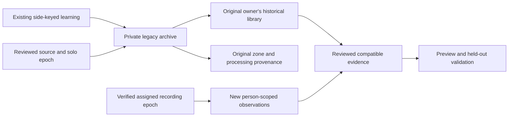

# Personal learning across a side change

This records the preservation/read implementation and the remaining private-learning
work in improvement 16. Atomic archive capture and account-scoped reads merged in
Core PR 109; public arrangement activation stays unavailable. The attended web workflow
is merged in PR 108; the native workflow is tested locally and under review in iOS
PR 70. Source validation does not establish a live household migration.

## What the current source does

`arrangementTransition.ts` atomically commits the reviewed weeks and identities,
closes the solo recording epoch, and resets control state. Its
`resetArrangementControls` helper leaves both comfort policies off, revokes prior
activations, disables side-stage selections and supplies fresh default processing
generations. The original learning tables remain in the database.

The original tables are still keyed by physical side. Comfort feedback and journal dates
do not become Marissa's records because she takes Left; models trained on Left do
not become qualified Right-side models because Luca moves. Merely moving rows or
changing a `side` column would conflate personal ownership and sensor provenance.

The one-way `legacyPrivacyState` boundary already blocks shared-key data access
after personal membership begins. Keep it in force. Public arrangement activation
must remain unavailable until the new person-scoped read/training paths are ready.

## Preserve ownership and provenance separately

The archive records the original operator account and source metadata. Custody of
a legacy artifact is distinct from a claim that every training interval belongs
to that sleeper. Retain unknown or mixed provenance as unreviewed; it cannot enter
training merely because the archive belongs to the owner. The joining account
starts with its own settings and an empty personal learning library.

Personal comfort feedback, journal entries and model artifacts need separate
handling from physical water-response models and sensor calibration. Preserve the
original side, source identifier, algorithm generation, model hash and training
provenance. No imported artifact becomes an active model as part of the side change.

## Storage and transaction boundary

- Add an operation-bound private archive manifest and per-record payload storage.
  Generate the SQLite migrations with Drizzle; do not edit its journal by hand.
- Bind the manifest to the original owner account, household, reviewed source,
  solo epoch and transition operation. It must not be possible to change custody
  during a repeated request or to resolve ownership from a current side lookup.
- Use a fixed internal table allowlist and streaming row reads, with per-record
  and total-size limits. Avoid building a bulk history object in memory. An
  unsupported or oversized archive must leave the existing records and durable
  transition hold intact, with a specific preparation error.
- Capture preservation records inside the arrangement transaction before resetting
  controls. A failure must roll back the archive, weeks, identities and processing
  intent together. Do not copy account credentials or invitation secrets into it.
- Keep an integrity manifest over the source records and original hashes. Verify
  its binding during recovery. Exact request replay returns the original receipt;
  it must not append a second archive or copy newly arriving data into an old one.
- Preserve ownership metadata immutably, while supporting explicit personal data
  deletion. A later journal deletion must not silently reappear from an archive.
  Redaction needs an auditable tombstone, rather than silently accepting changed
  payload bytes as the original snapshot.

## Reading and training

The implemented read-only endpoints are:

- `GET /api/v1/me/learning/archives?before=<archive UUID>&limit=20`
- `GET /api/v1/me/learning/records?archiveId=<archive UUID>&after=0&limit=20`
- `GET /api/v1/me/learning/records/<record UUID>`

They use the current personal credential, require a pinned sleeper for browser
reads, and resolve ownership by original household/account/sleeper rather than
today's bed side. Page sizes are limited to 50 even for direct store callers;
unknown, duplicate and noncanonical selectors are rejected. List pages contain
metadata only. Detail keeps the exact SQLite source JSON as a string, preserving
integer source identifiers that JavaScript cannot represent exactly. Responses
carry the identity/revision scope and `historical_custody_not_training_approval`.
Access and selected data are checked again when response bytes are consumed.

Capture bounds are 8 MiB per source record, 128 MiB total and 100,000 records.
Keyset reads close before each write on the same SQLite connection, avoiding both
a bulk in-memory history and better-sqlite3's active-iterator write restriction.
The generated migration is `0068_household_learning_archives.sql`. Archive hashes
join the committed arrangement fingerprint; missing or corrupt archives prevent
recovery from releasing the transition hold. Credentials are not in the fixed
source-table allowlist. Legacy model activation flags and original payloads are
preserved as historical evidence before current selections are disabled.

New transition contexts record preservation format 1. An older held operation gains
that format and its archive in the same commit. A transition already committed by
the previous release still verifies its original fingerprint during recovery; no
archive is invented after the fact. Removing a new archive or its format marker
cannot downgrade a new receipt into that legacy recovery path.

The `personalLearningArchive` capability follows the existing preparation and
personal-history feature gates. It only offers the above reads; it does not enable
training, deletion, controls, or the public arrangement-activation capability.

The new API must authorize the current personal credential on every page and
resolve the original archive account independently of today's side. Use bounded
pages and immutable record identifiers. Never return a partner's notes, model
payloads or unscoped side history through a controller-status endpoint.

Current collection resumes only in the verified assigned recording epoch, not at
the earlier database commit. Intervals crossing maintenance remain unattributed.
Personal models bind to the sleeper, dataset and eligible periods; physical models
also bind to zone, calibration and hardware generation. Stale or incompatible
artifacts stay available as historical evidence without being offered for activation.

The existing native Health baseline is a separate device-private artifact. Its
enrollment must explicitly bind the local Health owner to the selected personal
account; neither an invitation nor a bed-side change establishes that relationship.
Account changes must withdraw prior local reports and training context. Cloud
sharing consent remains separate.

## Remaining implementation

- An explicit deletion flow must reconcile preserved copies, original personal
  records and affected derived models. The storage format reserves verified
  redaction tombstones; no deletion endpoint is exposed by this change.
- New feedback, journal and training paths must use verified person attribution
  and compatible physical-zone provenance. The archive is never a ready-made
  training dataset.
- The web library is implemented below. Native library screens and explicit local
  Health-owner enrollment remain.
- Public activation, installed-device verification and the attended migration
  remain separate from this source change.

## Local validation

The focused real-migration/contract suites pass 173 tests across four files. They
cover partial-write rollback, SQLite reopen, oversized payloads, exact large
integer identifiers, replay, preserved deleted journal revisions, corruption,
two-account access after reassignment, bounded pagination, invalid selectors and
revocation/feature withdrawal while a response is pending. Additional cases verify
older held/committed operation recovery, reject a downgraded archive receipt, and
withdraw browser output after an account switch or aborted request. The initial failed run
exposed a SQLite iterator/write conflict; the keyset implementation and subsequent
passing runs retain that failure as diagnostic evidence. The final full suite passes
9,685 tests with 19 existing skips. The production build, full lint, focused final
lint and both database-migration checks pass. Browser and hosted release status are
recorded below.

### Preservation release

Core PR 109 merged as `e76d920db808a221198db0e2131ef3d086602e4d` after all seven
hosted checks succeeded. Its tree matches tested head
`24e3ee5b2aa7077155837998d1af69039b38d8a4`. The full browser suite passed 99 cases;
the normal pre-push suite passed 8,029 cases with 17 existing skips. This is source
integration, not a live arrangement transition or deployment.

## Personal browser library

The personal workspace now offers **Your saved learning**. Opening it fetches one
bounded archive page; selecting an archive fetches one metadata page. Known journal
and comfort records show their original calendar date and readable fields. Unknown
model formats remain exact downloadable JSON; the browser never rewrites large
integer source identifiers. Reading a historical model cannot train or activate it.

Each response is checked against the personal session before and after reading,
the selected archive hash, page selectors and immutable record identity. Hidden
tabs, identity/revision changes, feature withdrawal and failed reads discard the
visible private records. Only one page and selected detail stay in memory. The
library has its own client, so a pending download cannot block temperature Stop.
An empty library explains that current sleep recordings are a separate collection.

Metadata optionally includes the validated original calendar date for journal
and comfort entries; old responses without that field remain compatible. The
browser admits only validated learning GET paths. Only single-record reads receive
the larger bounded response allowance, matching the server's maximum encoding size.

The focused browser-state, transport and real migrated-store tests pass 128 cases.
The full local suite passes 9,702 cases with 19 existing skips. TypeScript, focused
lint and the production build pass. Three focused browser scenarios verify readable
notes, exact original-file downloads, keyboard focus, 390-pixel large-text dark
layout, tablet light layout, empty/error states, visibility withdrawal and an
independent Stop request. These fixtures do not establish physical Stop behavior.
The final full browser suite passes all 102 scenarios on the rebuilt package.
The initial browser timing/capture failures and a stale standalone-asset failure
are retained separately from the passing rebuilt-package results.

The independent Impeccable finish review returned **ship** for this incumbent
extension, with no material fixes. It inspected the light tablet, dark large-text
phone, expanded source/download, empty and error views, plus surrounding page
context. Two detector warnings refer to unchanged surrounding accent borders;
the new library styles do not introduce that treatment. This review does not
cover native delivery or actual two-person hardware operation.

## Required evidence before enabling the complete household transition

1. Real migrated SQLite tests for atomic capture, repeated requests, source changes,
   corrupt/oversized records, interruption and restoration.
2. Two-account read tests across side reassignment, revocation, backgrounding,
   pagination, deletion and a restored older database.
3. Training tests proving that the joining sleeper cannot inherit legacy feedback,
   that the owner's compatible history stays available, and that zone-specific
   models cannot silently move to another sensor configuration.
4. Web/native library and enrollment flows, plus exact-head hosted checks.
5. A separately attended live migration and rollback window. Neither this document
   nor simulator success changes the working solo installation.
