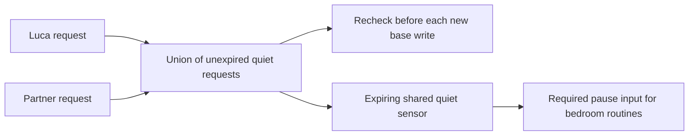

# Shared bedroom quiet

Either authenticated person can request quiet until a chosen absolute time, at
most 24 hours away. Each person owns their request. Clearing or shortening one
request preserves the other person's request; shared quiet ends when all requests
expire or their authors clear them. This does not assign a side or infer identity
from occupancy. A prepared member can request quiet before moving in.

## Request and privacy contract

- `GET /api/v1/me/quiet` returns the authenticated person's revision/end and the
  shared paused/end state. It does not expose who else requested quiet.
- `POST /api/v1/me/quiet` accepts the usual personal request/session/assignment
  identifiers, `expectedRevision`, `issuedAt`, `expiresAt`, and `until`.
  `until: null` clears only the caller's request. Requests expire within one
  minute, so disconnected clients cannot queue a future change.
- `GET /api/v1/me/quiet/requests/<UUID>` reconciles a possibly lost reply. Only
  the requesting account can read its receipt. Reusing the same request returns
  its original receipt without changing the current state, even after expiry.
- Browser reads and writes require the pinned sleeper header and current personal
  browser session. An installation owner key is not a personal identity.

Requests and metadata receipts commit atomically in SQLite. Independent authors
do not overwrite one another; a same-person stale editor must reload. Expiry is
an absolute instant, independent of daylight-saving calendar changes. A revoked
device cannot change its request; the existing bounded quiet interval remains.
Unavailable or malformed persisted state withdraws permission for shared actions.

Quiet does not change personal preferences, wake alarms, water targets, household
assignments, learning, or saved routines. It does not claim a sleeper is asleep.
Guest attribution and temporary side swaps are separate unfinished work.

## Hardware and home behavior

The base checks quiet before starting a movement and again immediately before
each queued head/feet packet. A quiet rejection preserves the Bluetooth connection
and the Stop action. This prevents new requests; **use Stop for movement already
underway**. A software acknowledgment never proves physical motion stopped.

MQTT publishes `<prefix>/<device>/state/household/quiet` every five seconds while
connected, without retaining it. Discovery exposes **Shared bedroom quiet** as a
binary sensor. Its observation expires after 15 seconds and broker disconnect
makes it unavailable. Only a shared boolean and planned end are published, with
no account identifiers, names, individual requests or Health records. This is
available even when MQTT actuator commands are disabled.

The bedtime-light, shade and purifier blueprints require selecting this Core
sensor. `on`, missing and unavailable all withhold requests. Light and shade
routines recheck it for each accessory. Purifier response also requires the
sensor to have remained off throughout its two-minute decision window. Updating
an existing blueprint requires selecting this new input; no automation is enabled
by the update. Additional optional pause helpers remain supported.

The signal takes up to one publication interval to reach Home Assistant; it is
not an emergency stop. Quiet does not reverse an earlier light change, stop a
moving shade, cancel a wake alarm, or mute a currently playing audio session.
Endel/audio integration and the native quiet controls remain to be completed.

## Personal browser controls

The personal workspace includes **Someone is resting**, after Tonight. A person
can start or update a 30-minute, one-hour, two-hour or eight-hour request, and end
only their own request. The shared end and their personal end remain separate.
Times are displayed in the browser's time zone. This does not modify the Pod's
routine time zone, temperature schedule, or alarm.

The panel refreshes while visible, withdraws expired observations, and checks
the authenticated person and household revisions around reads and writes. It
clears displayed state when backgrounded and is disposed on account replacement
or entry into arrangement maintenance. A lost reply retains a read-only receipt
check. Neither polling nor reconnect resends the mutation. If no receipt exists,
the result stays uncertain until a fresh controller response is beyond the
original request's expiry; a new change then needs another explicit action.

## Verification and remaining delivery

### Shared audio handoff reads

Installation clients can read `GET /api/v1/household/shared-quiet` with their
existing owner connection. Personal accounts continue to use `GET /api/v1/me/quiet`.
The installation response contains only version, generated/expiry timestamps and
the union of requests (`shared.paused`, `shared.until`). It contains no account
names, identifiers, individual quiet requests or biometric data. It cannot change
quiet time and does not accept query selectors.

The response expires after 15 seconds. Authorization, shared state and clocks are
rechecked when the body is delivered, so a delayed response cannot clear a newer
request. Unavailable storage withholds the reading. Native audio handoffs must
also bind it to their current account and foreground operation; this endpoint
does not itself launch, stop or claim to observe Endel or HomePod audio.

The addition passes 41 focused HTTP/store tests over real migrated SQLite,
including missing/personal credentials, owner-key rotation, changes before
delivery, expiry, reversed clocks, damaged storage and rejected writes.

Regression tests use migrated isolated SQLite databases, simulated base transport,
MQTT publication fixtures, and Home Assistant's real script engine with stubbed
accessory services. They exercise independent requests, revision conflicts,
lost replies, expiry, revoked access, response-delivery changes, failed storage,
per-packet checks and unchanged personal routines. No real bed or house action
is issued by these tests. Device deployment, native controls and attended
qualification remain separate work; this does not complete platform item 17.

The focused validation passes 187 Core cases, all 76 Home Assistant script/schema
cases, and a production-server HTTP exercise using two synthetic accounts. The
production build and focused TypeScript/lint checks pass. Initial fixture failures
(the new dependency mock, missing browser Origin, and a shifted test clock) are
retained with their corrected reruns. Full pre-push and hosted results are recorded
with the release PR; these counts are not physical qualification.

The initial broad pre-push run exposed two omitted schema expectations and a
room-transport fixture missing the new quiet dependency. After correction, the
same pre-push checks pass **8,376 tests with 17 existing skips**, including the
real MQTT transport. Browser controls add **27 passing workspace/transport tests**
and **four passing Playwright flows** covering partner-request preservation,
lost replies, unavailable readings and keyboard use at desktop, phone, tablet
and enlarged text sizes. The final production build passes, followed by **nine integrated browser checks**
including the real personal API and existing account-workspace flows. Independent
visual review inspected all 11 desktop, phone, tablet, enlarged-text, keyboard,
uncertain and unavailable-state captures and found no material fixes. These are
local synthetic-account results; hosted checks, deployment and physical acceptance
are not inferred from them.
