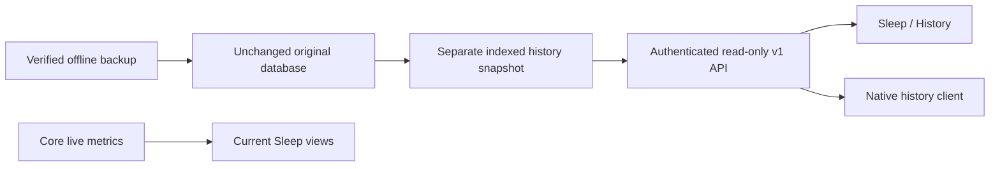

# Imported Free Sleep history

Sleep → History displays earlier Free Sleep observations without inserting them
into Core's live measurements, Apple Watch references, personal baseline or
Preview-night evidence. Both historical sides remain selectable even if one
side is currently away. Current occupant names are not retroactively assigned.

The importer preserves `legacy/free-sleep.db` byte-for-byte and creates a
separate `free-sleep-history.db` next to `sleepypod.db`. Only the supported
columns from `vitals`, `movement` and `sleep_records` are copied, with indices
for bounded pagination. Extra source tables are not exposed. Metadata records
the source SHA-256, original settings timezone, import time, per-side counts
and readable timestamp bounds. Invalid identities/timestamps and unknown
sides remain in the preserved files; they do not become valid API records.

## Contract for web and native clients

All routes use existing owner Bearer authentication or the browser session,
and private, no-store responses. They are also tRPC queries under
`importedHistory`. There are no mutations or hardware calls in this subsystem.
Discover `features.importedHistory` and `endpoints.importedHistory` through
capabilities. A ready software capability does **not** establish that records
have been imported; read status first.

| REST route | Query | Result |
| --- | --- | --- |
| `GET /api/v1/history` | None | `apiVersion:1`, `status`, `snapshot`, `message`, `semantics` |
| `GET /api/v1/history/records` | `snapshotId`, `side`, `kind`, `startTime`, `endTime`, optional `cursor`, `limit` | Newest-first records, nullable `nextCursor`, source identity and semantics |
| `GET /api/v1/history/presence` | `snapshotId`, `side`, `id` | One presence record, normalized present/absent intervals and bounded original interval JSON |

Status is `ready`, `not_imported` or `unavailable`. Only ready status has a
snapshot. A missing or unreadable snapshot must not render an empty successful
night, zero vitals or a fabricated score. The snapshot ID binds the source
checksum, format and timezone. Import time is bookkeeping, not a sleep event.

`side` is `left` or `right`; `kind` is `presence`, `vitals` or `movement`.
Date bounds are ISO timestamps with an explicit UTC offset. Windows are
half-open, positive and at most 90 × 24 hours. The web picker uses inclusive
calendar dates in the source timezone and converts the following midnight to
the exclusive bound, including 23/25-hour DST days. An overnight presence
record is included whenever its window overlaps the requested range. Vitals
and movement use their recorded timestamp, not the presence window.

`limit` defaults to 100 and may be 1–500. Ordering is descending timestamp,
then descending original ID. Pass `nextCursor` unchanged with the same
snapshot, side, kind and range. Never reuse it after changing filters. A
replacement snapshot returns HTTP 409; reload status and restart pagination.
Invalid cursor scope/input returns 400, unavailable snapshots 412, and a
missing or other-side presence ID 404. Reads are transactionally consistent
within each request; this is not a live replica of a still-running Free Sleep.

### Measurement meaning

Record IDs are original positive integer IDs. Record timestamps and interval
endpoints are **Unix seconds**. `snapshot.importedAt` is **Unix milliseconds**.
The source timezone is for display and range selection, not a timestamp offset
to add to the stored epoch.

- **Presence:** `enteredBedAt`, `leftBedAt`, `reportedDurationSeconds`, `exits`.
  This is bed occupancy, not measured sleep or sleep stages. The raw reported
  duration is retained separately from occupied time computed from intervals.
- **Vitals:** `timestamp`, `heartRateBpm`, `hrvEstimateMs`,
  `breathingRatePerMinute`. These are the legacy five-minute averages stamped
  at the interval start. Missing/nonfinite values become null. There is no
  retroactively verified signal quality, mechanical-artifact exclusion or
  HRV estimator definition. Do not combine these with Watch SDNN or current
  Core HRV as if their measurement definitions were identical.
- **Movement:** `timestamp`, `totalMovement`, preserving the original aggregate
  rather than inventing a normalized activity or sleep-stage value.

Presence details clip and union source intervals inside the record window,
so overlap does not double-count occupancy. Present and absent intervals are
independent source claims; contradictions are not silently repaired. Empty,
missing, invalid or entirely out-of-window intervals have unknown duration,
not zero. Fields over 256 KiB, arrays over 10,000 intervals and windows over
72 hours are not interpreted. A status explains why; excessive raw payloads
are omitted. No interval reconstruction or sleep staging is performed.

Every response includes `quality:legacy_unqualified`, `access:read_only`,
`purpose:history_only`, `previewEvidence:false` and `automationInput:false`.
These limitations should remain visible in native clients and any analysis
that explicitly imports this source. This change does not send health data to
an LLM, write Apple Health samples or influence comfort control.

## Storage and migration

The new file is a derived query snapshot, not a replacement for the original.
Allow extra disk space for its supported rows and indices before importing.
The importer builds it inside private staging, records its checksum in
`migration-report.json` and removes failed staging as a whole. The original
source archives and byte-preserved database remain the recovery authority.

The derived file uses DELETE journal mode. The reader checks its SQLite header
before opening with `readonly` and `fileMustExist`, rejects symlinks/WAL-mode
files, and sets query-only/trusted-schema restrictions. This avoids treating a
WAL snapshot as a writable auxiliary-file location; SQLite documents the
special requirements for [read-only WAL databases](https://www.sqlite.org/wal.html#read_only_databases).
The API path is fixed beside `DATABASE_URL`; clients cannot choose filenames.
Rebuild an unavailable derived snapshot offline from its verified source.
Do not attach the API directly to the running Free Sleep database or overwrite
the only rollback copy. Existing candidates without this file honestly report
`not_imported`; generate a fresh candidate before the eventual cutover.

The existing two-database download covers current Core configuration and
biometrics. Retain the original migration `source/` archives in the off-host
recovery set as well; they preserve imported history and can rebuild this
derived snapshot. A current-Core database download alone is not a complete
backup of the legacy installation.

## Native compatibility boundaries

This direct v1 API replaces the need to read old biometric observations through
Free Sleep's analytics endpoints. It does **not** install a blanket
`/api/native/v1` proxy; `nativeCompatibility` remains null.

| Original capability | Core/native integration direction |
| --- | --- |
| Historical bed episodes, vitals and movement | Adopt this API and keep provenance/units/unknown values intact. Current Core nights remain a separate source. |
| Apple Health history and export | Native HealthKit retains its consent, source identities, duplicate prevention and accessible historical queries. These history GETs do not authorize Health writes; no legacy `health/export` route is supplied. |
| AI coaching | Native local/cloud model selection and explicit sharing remain the intended path. No legacy `ai/coach` forwarding route is supplied. Reports must label imported observations and their limitations. |
| Morning journal | Full restfulness, comfort, habits and notes now have a revision-checked local API and web editor, with complete offline import. Native adoption uses the [journal contract](MORNING_JOURNAL.md); the original JSON remains preserved. |

## Validation and remaining gates

Synthetic fixtures use the actual Python importer and the real readonly reader.
They cover original bytes and sidecar preservation, unknown sides/invalid time
counts, stable tied-timestamp pagination, side and snapshot isolation, missing
values, overlapping intervals, bounded malformed input, DST and source-local
dates. Router checks assert error mapping. The production browser workflow
checks anonymous REST/tRPC rejection, authenticated REST and UI, presence
details, pagination, side/range changes and 390px light/dark layouts.

This is source and isolated-test evidence. Native adoption, a fresh real
backup/import, actual Pod runtime qualification and at least seven genuine
Preview nights remain separate gates. Preserved history does not satisfy them.
