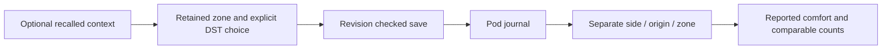

# Optional habit context and comfort associations

Approved improvements 09 and 11 extend the existing revision-checked journal.
Owner-authenticated REST/tRPC, per-side serialization and atomic journal/feedback
transactions are unchanged. No journal field is a device command.

## Contract and compatibility

`contextVersion: 1` advertises support. `fields.context` is optional and nullable:
omission by an older client preserves saved details; explicit null removes them.
An older client changing a Boolean habit resets only that habit's incompatible
amount/time. Explicit new statuses must agree with the legacy Boolean. Existing
clients can continue reading and writing their older fields. The new browser
retains its older checkbox flow when the server does not advertise support.

Each habit is Not logged, None or Yes. Amount and last occurrence are optional
only for Yes; blank is unknown, and explicit zero is a recorded quantity. Earlier
unchecked switches are not retrospectively relabeled as explicit None. Caffeine
uses milligrams; exercise uses minutes; alcohol uses US standard drinks (14 grams
of pure alcohol per drink, [NIAAA definition](https://www.niaaa.nih.gov/alcohols-effects-health/what-standard-drink)).
Schema upper bounds guard malformed input, not recommended intake.

Bedtime, last meal and relative stress are optional recollections. Times retain
the entry's original zone, even after Pod-zone changes. Their window is the
previous local calendar day through the end of the wake date; future times and
future wake dates are rejected. DST gaps are invalid. Repeated wall-clock times
require an explicit earlier/later occurrence. Quantity/time drafts survive side
changes and stale-revision conflicts in the open page. Notes and quantitative
context never enter temperature-learning events or provider prompts.

New clients also send `expectedTimeZone`. The server rejects a changed zone before
writing. An unsaved timed draft retains its original clock and blocks Save until
the user explicitly loads the saved entry or chooses to reinterpret the draft in
the new zone. Existing entries always retain their original zone.

## Findings, not prescriptions

The output compares self-reported Too warm check-ins, not sleep duration or
physical body temperature. Cohorts are separate by side, original journal source
and retained zone. Duplicate dates are excluded. Every displayed difference needs
at least five distinct usable dates per group; this is a display threshold, not
statistical proof or a validated sample-size requirement.

Timing comparisons need both a reported bedtime and a logged preceding activity:
last caffeine within six hours, last drink within four, exercise ending within
three, and last meal within two. The comparison is against earlier occurrences
among logged activities, not against no activity. These are declared descriptive
bands, not recommended behavior. Times after bedtime and missing times are excluded.
Amounts compare above versus at/below the within-range median of known amounts;
unknown amounts and unlogged habits are not zero. Ties can leave one group too
small, in which case no difference is shown. Stress compares Higher to Usual/Lower.

Each result exposes both counts, warm counts, excluded entries, the exact group
definition and an absolute percentage-point difference. The thresholds, multiple
exploratory comparisons, retrospective recollection, room conditions, other habits
and routine changes prevent causal conclusions. No finding automatically changes
hardware, qualifies a temperature learner or establishes a sleep improvement.

## Persistence and rollback

The optional object lives in the existing journal record JSON; no database schema
migration is needed. Backups contain this context alongside the journal. Older
Core binaries with strict journal parsing cannot read the extended object, so a
rollback uses the preserved pre-update database (or an explicitly reviewed export
that removes only the new context). Do not erase the current copy or its detailed
records to make an older binary start. Current restore rehearsal and attended Pod
update gates still apply. Native editing/display parity and person-assignment
activation remain separate delivery work.

## Validation

Behavioral tests cover unlogged/none/zero distinctions, bounded units and times,
DST gaps/folds (including a half-hour fold), quarter-hour zones, retained clocks,
old-client edits, conflict/deletion/side isolation, transaction failure, duplicate
and missing cohorts, unavailable comparisons, median ties and source separation.
Browser fixtures use fresh isolated databases and synthetic entries. They cover
clock choices, side drafts, readback, old-client preservation and the existing
uncertain-response/conflict/removal flow. Production build, type checking and
focused lint are required; physical sleep outcomes are not established by them.

### Local verification receipt — 10 November 2026

- Node 24, complete coverage run: **9,144 passed, 19 existing skips**, 657 passed
  test files and one skipped file. The original future-date validation failure was
  repaired. A subsequent unconstrained run, overlapping a production build, timed
  out in four existing CLI cases; the final two-worker coverage run preserved all
  assertions and timeouts and passed. Original failed logs were retained.
- Eight production-browser scenarios passed: detailed logging/readback, comparison
  counts, legacy-server fallback, time-zone race, equal-rate wording, authentication,
  draft/conflict/removal and lost-response recovery. Fresh synthetic databases only.
- Production build, TypeScript and focused changed-source lint passed. The optional
  `scripts/contracts/export-journal-context.ts` exports schema-checked synthetic
  native-client evidence, never private records.
- Fourteen desktop/mobile/light/dark captures were individually inspected. The
  independent finish review approved this extension after neutralizing zero-rate
  wording and verifying explicit clock-zone recovery. Native editing, hosted checks,
  live deployment and sleep outcomes remain separate acceptance states.
