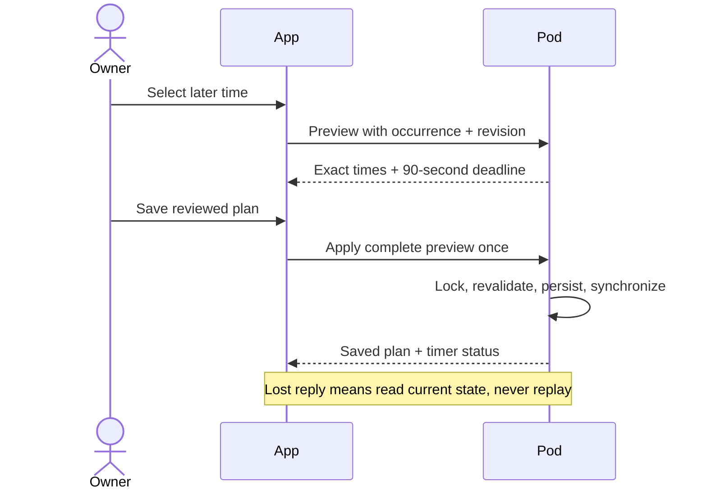

# Review a later wake once

The web wake card now offers **Wake later once**. It reads the actual next Pod
alarm and uses its wake date and Pod timezone, rather than assuming tomorrow has
an enabled alarm. Choose a later time, review the new warming/vibration schedule,
and explicitly save. The weekly alarm rows are never replaced.

## Contract

- `POST /api/v1/alarm/later-preview` (`nextAlarm.previewLater`) reads one consistent
  SQLite snapshot. It requires the displayed occurrence and revision. It cannot
  start the scheduler or mutate an override.
- The preview includes the old plan, exact new warming start/hold end, earliest
  movement-window vibration, scheduled vibration, duration/target and override
  expiry. The preview expires after 90 seconds or at the original warm-up start,
  whichever comes first.
- `POST /api/v1/alarm/later-apply` (`nextAlarm.applyLater`) accepts that whole preview.
  Under the side lock and one immediate transaction, the server checks the clock,
  expiry and current revision and recomputes every displayed field. A stale,
  altered or replayed preview cannot replace the current plan.
- Both endpoints use existing controller authentication and non-cacheable API
  responses. Capabilities advertise their paths. Demo mode has no alarm authority.
- Only a later, unambiguous time on the same wake date is accepted. Skipped/away/
  conflicting/consumed alarms, an already-started warm-up, DST gaps/repeated times
  and a time crossing the following alarm are rejected with recovery guidance.
- Persistence precedes scheduler synchronization. `schedulerUpdated: false` means
  the change was saved but timer registration is not confirmed. A lost response
  requires a read; the client never automatically replays the write.
- The existing one-occurrence override remains responsible for suppressing the
  original event and restoring the weekly routine after its hold. The other side
  and weekly rows are unchanged.

## Scope and remaining coordination

The UI explicitly lists phone alarms, lights, shades and audio as unchanged. An
accepted schedule is not evidence that the mattress warmed or vibrated. Native
parity and an app-owned phone-backup coordinator are next steps; arbitrary Clock
alarms are outside AlarmKit's app-owned alarm contract. Qualified home-device
coordination needs individual receipts and explicit recovery from partial results.
No shared audio or partner arrangement is inferred from occupancy.

## Validation

Focused alarm/temperature-card/router coverage passed 246 tests; server coverage
includes exact preview/application agreement, expiry boundary/clock rollback,
modified evidence, concurrent edits, replay, DST, source timezone and unchanged
weekly rows. React coverage checks explicit review/save, changed input, expiry,
unknown receipts and discarded callbacks after leaving the side. Stale reads do
not claim a changed plan. A successful explicit refresh reconciles lost-save
guidance for the original, proposed or another plan without resending a write.

The production build, repository lint and typecheck pass. Before the final
review-driven UI correction, the full suite passed
9,182 tests with 19 existing skips and no errors at four workers. The initial
unbounded run had six failures in existing subprocess cases and two associated
errors; the four affected files passed 112 tests at two workers before the full
bounded run. Assertions and time limits were unchanged; both receipts remain.

Three new authenticated/browser scenarios pass, including phone/dark and
desktop/light walkthroughs, exact save, expiry, a deliberately lost save reply,
read-back and routine restoration. The older alarm scenarios also pass; one
initial fixture-cleanup DELETE hit ECONNRESET and its unchanged focused rerun
passed. Fourteen corrected full-page captures received an independent **ship**
verdict at the four-finding correction scope: stale/read-back truth, live error
semantics, field association and contrast. All four findings were resolved.
The final component tests and three browser scenarios pass after the correction;
the full suite was not unnecessarily repeated for that UI-only batch. Computed
focus/expiry contrast is 16.21:1 dark and 18.86:1 light. Actual screen-reader speech
and physical operation remain unverified.
Earlier element-cropped captures were rejected during builder inspection.

All testing uses isolated fixture databases. No live Pod, alarm, phone or home
accessory has been changed. Native and cross-device implementation remain pending.
