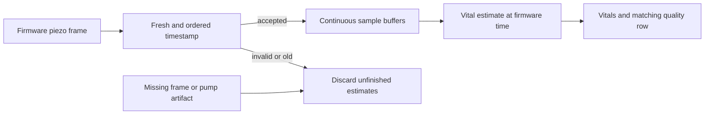

# Live vital timestamp boundary

The live piezo processor now timestamps new estimates with the accepted
firmware `piezo-dual.ts` value. Previously it used the processing clock, so a
delayed frame could produce a current-looking database row. This is a source
freshness fix, not validation of the heart-rate algorithm or sleep outcomes.

## Live behavior

- Require a finite positive firmware timestamp, no later than the Pod clock and
  no more than ten seconds old. Missing, boolean, malformed, future, stale,
  duplicate and reversed timestamps are rejected before samples enter buffers.
- The documented live format carries one second of samples per piezo frame.
  More than 1.5 seconds between source frames, or a regressed monotonic arrival
  clock, starts a new window. Slow processing alone does not discard complete,
  consecutive source frames, provided they remain within the age limit.
- Rejected timestamps, empty channels and pump-gated frames clear unfinished
  HR, breathing and HRV buffers, trackers and presence state. Normal consecutive
  frames retain state. Completed candidates awaiting the other side or a
  database retry keep their original timestamp and existing retry behavior.
- New live run provenance declares `timestampBasis: firmware_event_time_v1`.
  Old `processing_clock` and unknown legacy rows are unchanged. Readers must
  check provenance before combining their time semantics.
- Timestamp failures report degraded module health; valid input and available
  configuration restore health. Fresh input alone does not establish signal
  quality, calibration, occupancy, or the absence of base/vibration artifacts.

## Compatibility and remaining work

This change does not enable personal comfort Active or its sensor-aware option.
The comfort adapter still needs explicit quality, whole-window artifact and
personal-baseline handling. Priming, vibration and base-motion exclusion needs
recorded evidence before those samples can train a personal baseline.

The prospective shadow candidate now uses the same shared frame-admission and
buffer-reset implementation as the live processor. Firmware time drives its
estimates; output timestamps truncate to integer Unix seconds exactly as the
live SQLite writer does. The active reader requires matching
`firmware_event_time_v1` provenance and rejects old processing-clock rows without
advancing its capture cursor. New candidate and active comparison records retain
that basis. Historical receipts and samples remain readable without acquiring a
new clock label.

Recorded arrival time drives the prospective candidate's freshness check and
pump/router timers. It substitutes for the live process's local monotonic clock,
which remains an explicit limitation. The host's saved source-freshness policy
may be stricter and can terminate capture before a frame reaches the candidate.
Cold-start state, context timing, source delivery and clock skew still affect
comparison coverage; equal clock semantics do not prove equal physical input.

Current worker replies declare their clock basis and timestamp-rejection count;
missing, mismatched or impossible receipts fail validation. Retained waveform
replay keeps its existing declared semantics. The shared input boundary is
included in the manifest and Python build identity, so previously qualified
experimental builds do not qualify this changed bundle automatically.

Deployment requires a fresh pinned sensor package and runtime validation. The
working Pod remains on Free Sleep until the separate controller handoff and
attended qualification gates pass. Tests use synthetic fixtures and local
SQLite; they do not count as observed Preview nights or physical qualification.

## Regression coverage

Tests cover the ten-second boundary, event versus arrival time, missing and
malformed timestamps, duplicate/reversed frames, gaps and clock discontinuity,
recovery after stale input and a pump artifact, estimator buffer reset, and
preservation of event time and provenance through a delayed database write.

A production-loop regression runs real runtime binding, pump gating, routing,
canonical SQLite writes and the isolated prospective candidate against the same
synthetic stream. It compares values, quality, flags and integer-second event
timestamps, including delayed arrival, missing/empty frames, stale/future/
duplicate/reversed timestamps, pump interference and a logical-side change.
Protocol tests also cover clock-label preservation, historical receipt
compatibility, rejection accounting and build-identity invalidation.
