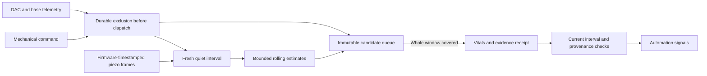

# Mechanical interference and biometric evidence

Priming, wake vibration and base movement can contaminate piezo estimates.
The live processor now requires continuous, fresh mechanical context before
admitting frames and before committing a completed vital estimate. This is an
engineering exclusion policy; it has not been validated as a clinical signal
quality detector or tested on this owner's base/vibration hardware.

## Evidence and limitations

- DAC status reports priming. Base movement is inferred from fresh position
  changes and pending writes. Two base samples are required before stationarity
  can be inferred. Core subscribes to the configured base at hardware startup;
  this does not issue movement commands.
- Firmware does **not** report physical vibration. The alarm flag is inferred
  from application commands. Every alarm dispatch records a conservative
  180-second exclusion plus ten seconds settling, regardless of payload.
  External or undocumented vibration triggers are not proven detectable.
- Missing, unconfigured or disconnected base telemetry is unknown, not an
  assertion that the bed has no base. Such installations withhold new live
  vitals until supported telemetry is available. An explicit, reviewed
  no-base capability is still needed for systems without an adjustable base.
- No hardware calibration, snoring detector or physical Stop qualification is
  implied. The ten-second settling interval and one-second frame-edge margins
  are conservative software defaults that still need hardware measurements.
- Existing raw recordings and historical vitals are not rewritten. Historical
  replay without mechanical context remains exploratory and reports its missing
  context. Prospective firmware-time comparison requires context; missing
  context produces excluded frames rather than invented quiet evidence.

## Persistence and command boundaries

Migration `0032_mechanical_signal_context.sql` adds an observed quiet-span journal
and one current-state record. The controller samples existing DAC/base state
once a second. Only actual telemetry timestamps extend a span; repeatedly
reading cached status does not extend it. The freshness bound is ten seconds.
Restart, a ten-second observer gap, clock reversal, unknown state or interference
breaks continuity. Quiet must resume after settling. Failed journal writes
invalidate the in-memory epoch, including failures during emergency cancellation.

DAC recording occurs inside its real command FIFO immediately before socket
write, covering normal and raw command callers. Base recording occurs at its
serialized transport boundary. A start command fails if its exclusion cannot be
recorded. Emergency alarm clear and base Stop remain available; they never
shorten an existing possible-vibration exclusion. Shutdown marks context stopped.
The journal retains at most 20,000 spans and 35 days; readers take at most 64
recent spans. There is one controller writer and read-only Python consumers.
Journal writes use a 25-millisecond SQLite busy timeout and restore the shared
connection's timeout afterward, so contention cannot impose its usual multi-second
wait on emergency cancellation.

## Processing and learning

Any context failure clears unfinished HR, respiration and variability buffers.
Completed candidates retain their values, event timestamp, configuration and
logical/physical side while waiting for coverage. The separate queue holds at
most 16 candidates for at most 120 seconds, including database retries. Expired
or unconfirmed candidates are excluded; they are never retimed to appear fresh.
Shutdown logs pending exclusions instead of forcing unverified writes.

Coverage includes the longest non-null metric window: 30 seconds for HR,
60 seconds for respiration, 300 seconds for window-IBI variability, plus a second
on each edge. This can deliberately withhold early estimates during warm-up.
Each committed row's quality flags contain one immutable
`mechanical_context_v1:<epoch>::<startMs>:<endMs>` receipt. Its processing
run records `mechanicalContext: mechanical-context-v1`.

Automation vitals and the vital-based occupancy upgrade require that receipt,
matching live-run provenance, a fresh row, and coverage in the **current** quiet
interval. Older or unqualified rows remain visible but cannot drive these
signals. This change does not enable the personal learner's Active mode.

Prospective capture carries the same bounded mechanical snapshot into the
isolated Python worker and uses the same frame gate and output queue. The parent
validates mechanical exclusion counts; build fingerprints include the new shared
module. Old engine fingerprints and saved plans are not interchangeable with
this runtime. Retained historical replay is not retroactively certified.

## Validation boundary

Tests exercise the generated migration, stale/future/missing context, clock
reversal, restart and Stop persistence, storage failure, real socket FIFO
dispatch, bounded immutable retries, full-window exclusion, automation
eligibility and production-loop/SQLite/prospective-worker parity.

These are local software checks. Installation, live thermal/base/vibration
qualification and seven actual Preview nights remain separate acceptance gates.
