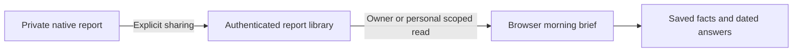

# Morning brief across native and web

This work implements approved item 12. The native brief already has a saved,
encrypted report and grounded follow-up flow. Web integration is in progress.
The authenticated storage service is merged. The explicit native sharing interface
and browser reader are implemented and undergoing release validation. Live
installation and browser question generation remain outstanding.

## Frozen evidence

`src/reports/morning.ts` accepts a version-1 display document containing the
original report, source, provider/model metadata, calculated facts, optional
14-day comparison and up to ten dated follow-up answers. Wire dates are integer
Unix milliseconds; they are not Foundation's default reference-date encoding.
The native transfer adapter must explicitly convert those dates.

The parser bounds the complete UTF-8 document before parsing, rejects duplicate
fact/response identifiers and future or inconsistent report/answer dates, and
rejects extra fields that could be mistaken for an account or sharing claim.
This does not authenticate the report's author or prove its factual accuracy.
Only the authenticated transport may establish the receiving person's identity.

The three highlights use the same calculations and wording as native. They
never extract numbers from generated prose. The comparison explicitly names
recorded sleep minutes; bed presence cannot be substituted for this metric.
Every boundary is noon in the saved source timezone, with real 23/25-hour days
and non-hour offsets. Missing days remain null. Comparing seven-day medians
requires at least four observations in each week and is descriptive, not causal.
Invalid optional chart metadata is withheld while the original facts and report
remain available. A report without three supporting facts gets fewer cards.

## Remaining integration

- Release and verify the explicit native owner sharing action. Finish personal
  Health/report enrollment and sharing; the personal wire protocol and reading
  surface do not make this enrollment complete. Device-local reports and API keys
  are not automatically uploaded.
- Add grounded questions using only the original calculated facts and fresh
  sharing consent. Preserve current provider/model selection and discard late
  answers after cancellation, account changes, revocation or report deletion.
  Apple local generation is not a browser capability and must not silently fall
  back to a cloud service.
- Exercise both legacy owner and personal-account privacy boundaries, chart and
  report rendering, provider errors, offline reading and physical delivery.
- Complete reviewed transfer of the original owner's shared reports during the
  household transition. The storage service currently keeps those namespaces
  separate; it must never make legacy reports visible to a new member by default.

There is no actuator API in this display layer. Reports do not activate comfort
learning, alter an alarm or authorize a household transition.

## Authenticated report library

| Operation | Legacy owner path | Personal path |
| --- | --- | --- |
| List saved report metadata | `GET /api/v1/reports` | `GET /api/v1/me/reports` |
| Read original report and answers | `GET /api/v1/reports/{id}` | `GET /api/v1/me/reports/{id}` |
| Share or append answers | `PUT /api/v1/reports/{id}` | `PUT /api/v1/me/reports/{id}` |
| Withdraw a shared copy | `DELETE /api/v1/reports/{id}` | `DELETE /api/v1/me/reports/{id}` |

The server derives storage scope from installation identity or the authenticated
Pod/household/account/sleeper tuple. A request cannot supply another owner, person,
side or query selector. Personal browser requests also pin the displayed sleeper.
Credentials are rechecked after streamed uploads and immediately before response
delivery; the owner API observes the persistent personal privacy boundary.

A PUT body contains `expectedRevision` (null for a new report) and `document`
(`{version: 1, report: ...}`). IDs are case-normalized UUIDs. Dates are integer
Unix milliseconds. A receipt includes ID, revision, creation/receipt/update clocks
and deletion state. Original text, facts, source, comparison, provider and model
are immutable. An update with the current revision may append dated answers;
identical retries return the existing receipt. A conflicting update changes nothing.

A DELETE body contains `expectedRevision`. It clears the live payload and hashes
while retaining a small tombstone. A delayed upload cannot recreate that ID. A
client may withdraw an unseen ID with a null revision to cancel an in-flight first
upload. A GET of a withdrawn report returns its receipt and a null report, allowing
reconciliation. This withdraws the Pod's shared copy, not the phone's private archive
or existing backup copies. Each scope holds at most 100 live reports and 1,000 total
IDs, including tombstones; full storage is reported without silently evicting data.

Uploads are bounded to 400 KiB, documents to 384 KiB, and interrupted streams close.
Metadata and content are returned with private/no-store headers. Reports are in the
Pod's local configuration database under the app's access controls; host/root and
backup access remain administrative access to that database. No provider credentials
are stored in this table and no report request calls an AI service.

Migration `0070_morning_report_library` only adds the table and its scope/date index.
Drizzle generated its journal and schema snapshot. The native wire fixture is shared
with `FreeSleepKitTests/Fixtures/morning-report-v1.json`; its missing day is explicit
null, and its 14-day interval includes the actual 25-hour daylight-saving day.

## Current validation

The initial parser suite covers DST in both directions, a quarter-hour-offset
timezone, missing/sparse data, impossible observations, retained original prose,
legacy reports, dated follow-ups, identifier conflicts and document size. Storage
and HTTP checks use real migrated SQLite databases and real owner/personal
authentication. They cover conditional writes, cross-person isolation, stale
tabs, revocation while uploading, deletion before delivery, corrupt storage,
resource limits and persisted deletion records. The two initially failing schema
expectations were updated only for the new table; the full suite then passed
9,892 tests with 19 existing skips. A later focused addition checks interruption
without another incoming body chunk and reads the exact native fixture.

The native encoder passes 11 test functions (17 parameterized executions),
including existing report/answer regressions. It does not read a connected phone,
start a network request or change the encrypted archive's existing date encoding.
The browser reader adds focused contract, transport, account-lifetime and prose
tests. Real authenticated browser fixtures cover rendering at 390, 834 and 1440
pixels, chart gaps, source disclosure, withdrawal and unavailable reads, literal
HTML/link handling, and separate personal-account access. Test fixtures are
synthetic and are not evidence of live Pod delivery or sleep improvement.

The browser reader's focused suite passes 85 tests. Its final production build,
focused lint and all 13 browser scenarios pass, including rendered chart-label
size and containment at 390, 834 and 1440 pixels. The independent reviewer returned
`ship` after scoring the one mobile chart typography finding resolved. All 14
final captures were inspected. The extension preserves the incumbent AppShell,
personal workspace palette and design tokens; no design-system file was replaced.

Native explicit sharing is in PR 74. Its complete model/application regression
passes 1,521 tests with nine existing skips; the final five UI tests pass on each
iPhone and iPad simulator. The native reviewer scored its large-text button finding
resolved. Hosted checks, distribution and physical acceptance remain open.

## Browser reader

Sleep → Reports opens the owner library. Tonight includes the compact brief during
the morning. The personal workspace has its own report reader and never falls back
to the owner's library. Both render the same saved highlights, comparison, source
badges, formatted interpretation, actual proposed experiment and dated answers.
A separate experiment appears only when the original report contains exactly one
recognized experiment section; it is never invented or silently truncated.

Report HTML is escaped, links and images remain non-navigable text, and only
supplied recognized facts become expandable source badges. The browser reader
does not load report-specified resources or call an AI provider. New questions
currently run in the iPhone app; updated answers need explicit sharing.

The owner reader verifies the signed-in browser scope and a fresh installation
challenge before and after loading. Personal reads pin Pod, household, account,
sleeper and all three revisions. Both validate bounded replies and saved clocks,
check access periodically, and clear reports when hidden, signed out, revoked,
withdrawn or switched to another account. Failed refreshes do not leave a stale
private report on screen. Browser reports stay in memory, not local storage or a
service-worker cache. This is connected reading; the native encrypted offline
library is a separate feature.

