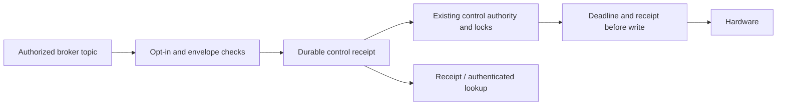

# MQTT command delivery

The bridge defaults to **telemetry only**. Settings displays the effective
command mode. `MQTT_COMMANDS_ENABLED=true` in the protected host environment
opts into command reception on the next bridge start. Configure dedicated
broker credentials and least-privilege topic ACLs first. The HTTP owner key
is not a broker password.

Home Assistant discovery supplies a UUID and 30-second expiry when a user
changes temperature or mode. Telemetry-only discovery omits command topics.
Discovery is republished on reconnect. The bridge uses a clean MQTT session
and does not automatically restore an old command subscription.

## Contract

Publish non-retained, QoS 0 JSON to `<prefix>/<device-id>/cmd/request`:

```json
{
  "requestId": "63a82982-947d-4bf2-80ee-4cbe6824d7d4",
  "issuedAt": 1792965600000,
  "expiresAt": 1792965630000,
  "action": { "kind": "power", "side": "left", "powered": false }
}
```

These timestamps are illustrative and expired. Generate a new UUID and current
epoch-millisecond timestamps for a **new user action**. Maximum lifetime is
60 seconds. Reuse the exact request when reconciling an uncertain result;
changing its ID or deadline would create a new action.

The non-retained receipt is published to
`<prefix>/<device-id>/receipt/<request-id>`. If publication is lost, retrieve
the durable receipt through the authenticated
`GET /api/v1/controls/{requestId}` endpoint. A network acknowledgment does not
establish that the bed moved, heated or vibrated.

Only `temperature`, `power`, `vibration`, and `vibration.clear` actions are
accepted. They reuse the app's control contract, side locks, manual pauses and
hardware guards. Base motion and priming remain in their existing app controls.
The previous `cmd/set-*`, `cmd/clear-alarm` and `cmd/start-priming` payloads are
no longer accepted; update custom automations before opting in.

Retained messages, MQTT redelivery packets, missing packet metadata, malformed
or oversized payloads, future requests and expired requests do not dispatch.
At most eight requests may await completion. A durable receipt is committed
before each transport write, where wall-clock and monotonic deadlines are
checked again after queue waits. Identical IDs are not executed again,
including after restart; changed content under the same ID is rejected.
Interrupted or uncertain writes report `unknown`. A disabled or replaced
bridge cannot accept stale client callbacks.



## Broker access

Give the Pod identity write access only to its availability, state, pump,
receipt and own discovery topics. It needs read access to its `cmd/request`
topic only when control is enabled. A telemetry-only credential needs no
command subscription. Restrict command publishers to that Pod's request topic,
and receipt and biometric readers to intended consumers. With the official
Home Assistant Mosquitto app, preserve the reserved `homeassistant` and `addons`
permissions required by the app. See its
[ACL documentation](https://github.com/home-assistant/addons/blob/master/mosquitto/DOCS.md#access-control-lists-acls).

The command gate does not qualify sensor truth or physical hardware. Telemetry
still needs per-source freshness and capability checks before it drives
external automations. Actual broker ACL provisioning, hardware qualification
and Home Assistant control acceptance are separate integration gates.

## Validation

Tests exercise real migrated SQLite receipts through the MQTT adapter: duplicate
delivery, database reopen, uncertain writes, stale/future commands, queue expiry,
clock rollback, unavailable storage, payload limits and unsupported actions.
Bridge tests cover telemetry-only discovery, opt-in, non-retained receipts,
legacy-topic rejection, packet metadata and replaced-client callbacks. These
tests use synthetic actions; they do not operate a Pod.

The owner's Home Assistant template editor rendered temperature and both power
values successfully, each with a valid UUID and a 30-second timestamp interval.
Only synthetic text was rendered; no MQTT message or hardware command was sent.
The editor was restored afterwards. This confirms template compatibility, not
end-to-end broker delivery or physical acceptance.
