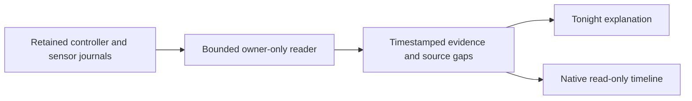

# What happened overnight?

Tonight now opens a read-only explanation for a selected physical zone and wake
date. It combines retained temperature attempts, personal policy decisions,
automation logs, water temperatures and room reports. A physical zone is not a
sleeper identity. Personal-account credentials cannot access owner history.

## Contract

`GET /api/v1/device/night-explanation?side=left&wakeDate=2026-11-10` requires
owner authentication and returns version 1 without cache storage. The equivalent
tRPC query is `device.nightExplanation`. Omit the date to use today's calendar
date in the Pod's configured timezone. The window is noon before that morning
through noon that day, with observation ending at the earlier of now or noon.
Calendar arithmetic preserves 23- and 25-hour DST nights. Future windows and
dates older than 30 days are rejected rather than silently substituted.

Each source has its own availability, read count, discarded-row count, truncation
flag and explanation. A failed journal does not hide the other sources. Reads
are bounded: 1,000 controller attempts; 3,000 policy rows, rule rows and thermal
samples each; 10,000 room rows. The response retains at most 600 events and
2,000 room reports. A generated index supports rule history reads. No hardware,
sensor or automation singleton is initialized by this projection.

## Interpretation

- Controller receipts describe requests and acknowledgments, not felt effects.
- Personal policy Preview, withheld decisions and feedback remain distinct.
- Rule logs do not become command acknowledgments. Current rule names and
  conditions are never substituted for their historical configuration. Rules
  without a recorded side remain explicitly unassigned.
- Only identical adjacent personal decisions within 90 seconds collapse. Their
  count and endpoints are shown; the count is not continuous sensor coverage.
- The chart separates reported water temperature from reported targets while
  powered. Null values, non-increasing clocks and gaps over 90 seconds break
  the line. These are not body-temperature or sleep measurements.
- Room history uses the mapping saved with each report, its original clocks,
  and the latest report per source/revision in each five-minute bin. Cached
  reports remain labelled cached. Values are not interpolated and do not prove
  why the bed changed temperature or who operated a room accessory.
- Home command receipts remain a separate integration workstream.

## Presentation and validation

The disclosure is available in Cards and Stage layouts, including while live
hardware status is connecting. It supports source filters, expandable source
detail and pagination. The client validates response shape, side, requested date
and five-minute generation freshness; a failed refresh withdraws old evidence.

The migrated in-memory reader tests cover real legacy table formats, independent
failure, invalid clocks/values, limits, grouping, source attribution and DST.
Twenty focused unit/component tests passed. Five production browser tests passed,
including owner API, phone/tablet widths, light/dark and enlarged text, layout
switches, filtering, original room clocks and failed refresh. Three existing
personal-account browser cases also passed with the new REST/tRPC rejection
checks. The production build and focused lint passed.

Initial browser runs exposed a missing Stage integration, which was fixed. An
intermediate selector failed after the room report count was added; the test now
targets the summary semantically. These failures are retained in local test logs.
This is software evidence. Deployment, actual overnight journals and physical
bed behavior require a separate live verification.

The independent design review found labels that did not enlarge with text.
Scalable labels and chart margins resolved the finding; the reviewer scored it
resolved with a `ship` verdict. Browser checks now assert computed text scaling
and that every chart label fits its plotting bounds. The rerun passed all five
browser flows. The first full unit run found missing demo/screen test contracts
and the new index snapshot; those were corrected. Its two existing CLI groups
also hit their five-second limits under concurrent load. All affected groups
passed with two workers: 140 tests, unchanged assertions and timeout guards.

The complete clean-checkout regression run then passed **8,977 tests across 645
files**, with 19 existing environment-dependent skips. A previous run overlapped
a Git merge and read an unresolved migration journal; its 26 failed cases are
retained as invalid-run evidence. The final run used the resolved, unchanged tree
throughout, with two workers and the original timeout limits.
