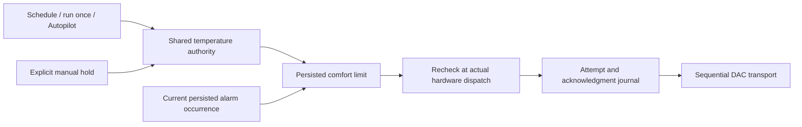

# Automatic comfort range and wake warming

The owner's comfort range bounds **every automatic target whenever the zone is
powered**, including during the day. It is independent of personal learning's
Off/Preview/Active mode. A new installation or upgrade starts with this feature
**disabled**; the displayed 68–72°F draft is not an activated preference.

The web temperature screen has a Comfort limits action in Stage and an editor in
Cards. The owner reviews and saves a per-source range (55–110°F hardware bounds,
no more than 10°F wide). Linked solo zones follow their schedule source. Saving
changes the limits for a powered zone on the next controller reconciliation; it
never starts an off zone or enables personal learning.

## Authority

- Automatic targets outside the range are limited. Status and command receipts
  retain both the requested target and the effective target.
- Explicit manual holds can temporarily exceed the automatic range. Their
  original expiry and the six-hour personal-learning pause remain unchanged.
- A personal learner proposal is never silently resized: if the range excludes
  its reviewed one-degree step, its lease is withdrawn and the bounded baseline
  wins. General automation rules and schedules pass through the shared limit.
- Wake warming can exceed the range only for a matching, currently enabled,
  persisted alarm occurrence. The existing 30-minute lead (or longer configured
  wake window) and 15-minute post-vibration hold are preserved. Edited or skipped
  one-occurrence alarms use the existing effective-alarm contract.
- A forged alarm ID on an Autopilot request has no exception. The exception is
  rechecked after reconnect and at actual FIFO dispatch, including deletion or
  expiry while queued. Alarm occurrence caches are invalidated on clock rollback.
- After a wake span or manual hold expires, the current plan is bounded again.
  With no remaining plan, a leftover out-of-range target is bounded without
  inventing a schedule or powering on an off side.
- Explicit power-on fallback, passive keepalive, guard recovery and short pump
  probes also respect the range. Pump fault, shutdown and hardware duration
  safeguards remain authoritative.
- An unreadable limit withholds automatic writes. It cannot silently become a
  disabled limit. Explicit manual temperature and Stop remain available.

This is a target constraint, not proof of physical water/cover temperature or a
claim of improved sleep. It does not qualify a personal model for Active mode.

## Contract and storage

`GET /api/v1/temperature/comfort-limit?side=left` returns version 1, the physical
side and source side, revision, configuration, and the next wake-warming start.
`PUT` accepts the side, expected source/revision and reviewed configuration.
Owner authentication applies to REST and tRPC. A stale revision or changed source
returns 409 rather than overwriting another device's changes. UI mutations are
not queued offline and ambiguous saves require a fresh read.

Migration 0056 adds `temperature_limits` without replacing schedules, alarms,
comfort history, accounts or calibration. No row means disabled. Corrupt rows
fail closed for automatic writes; reads never rewrite them.

## Validation

- Pure, controller and migrated-database tests cover bounds, manual expiry,
  schedule/power/recovery/relative paths, source assignment, corrupt persistence,
  reconnect/dispatch races, alarm ID spoofing and the exact 06:30 wake boundary.
- Real SQLite journal assertions distinguish requested/effective targets from
  acknowledgment. Pump guard tests exercise the same limits even before the
  passive controller starts.
- Browser acceptance covers authenticated reads/writes, stale saves, invalid
  ranges and responsive Stage-to-editor flows against an isolated database.
- Hardware and physical-temperature acceptance remain pending. Defaults were not
  enabled on the owner's Pod by this implementation. Native validation is recorded
  separately in the iOS repository.
