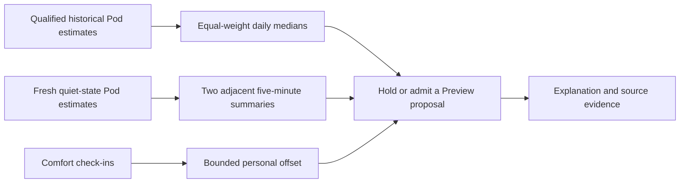

# Personal baseline and sensor-aware Preview

Personal comfort now offers an explicit **Use Pod sensor guard in Preview**
setting. It persists across stopping/starting Preview and remains off unless
selected or imported from the owner's prior configuration. Preview has no
actuator dependency. Active mode remains locked. Optional [bed-entry timing Preview](BED_ENTRY_PREVIEW.md)
can shift proposed temperature phases without changing the bed.

## Evidence and limits

- Core emits approximately one estimate per minute. Each summary requires five
  distinct minute buckets, successive estimates 45–75 seconds apart, and a
  completed five-minute UTC interval. This summarizes discrete estimates; it
  does not claim continuous five-minute measurement or independent HRV windows.
- Every estimate requires one matching quality row and a live processing run
  with firmware event timestamps, logical/physical side identity, numerical
  config hash, shipped manifest hash, and its original mechanical-window receipt.
  Different processing identities and physical channels are not pooled.
- Receipts must be covered by retained quiet spans. The complete summary interval
  must also be quiet. Current summaries and the latest estimate must belong to
  the currently confirmed quiet interval. Unconfigured base telemetry is unknown,
  not evidence that no base exists. Priming, motion, vibration, missing receipts,
  replay rows and legacy observations cannot supply new proof.
- Conservative comparison filters require HR 30–90 bpm, quality score at least
  0.5, and no flags except the receipt or missing non-HR metrics. These are
  engineering eligibility thresholds, not clinical limits or calibrated
  probabilities. Missing/out-of-envelope estimates hold proposals.
- History covers the previous 29 days, excluding the latest 24 hours. A local
  date needs at least twelve complete summaries. The median of daily medians
  gives each qualifying date equal weight. Seven dates are required. This is a
  **baseline data requirement**, separate from the seven attended/reviewed
  Preview nights required before considering activation. It does not establish
  seven nights of sleep, benefit, or accuracy.
- Two adjacent current summaries are compared with the baseline. If both differ
  in the same direction by at least `max(10 bpm, 20% of baseline)`, proposals are
  held. The app makes no diagnosis and does not change temperature or base angle
  in response to an abnormal heart rate.
- Apple Health remains a separate reference source; it never fills missing Pod
  qualification, baseline days, or current readings.

## Runtime and contract

The existing authenticated `/api/v1/comfort` API adds optional `signals` to status
and journal entries. It includes source channel, qualified day/window counts,
baseline reading time, current summary values, observation/expiry times and a
hold explanation. `features.sensorAware` means the Preview adapter exists;
`activation.available` remains false. Old stored events remain readable.

Baseline construction occurs before acquiring the actuator side lock. Reads are
bounded to 1,500 rows per UTC day and yield to other controls between days. A
15-minute window cache retains the original baseline read time; retained spans
are checked again on each evaluation. Cache keys separate processing and source
identity. Current estimates and quiet state are reread after taking the lock.
Missing/corrupt/oversized inputs fail closed. Cached history never creates a
fresh current measurement, and the latest malformed row cannot be replaced
silently with an older good one.

Current evidence expires at the earliest of quiet-state expiry, two minutes
after the latest estimate, or six minutes after the latest complete summary.
Status additionally drops decisions after ten seconds without evaluation. The
UI exposes missing/incomplete evidence rather than inventing a baseline. The
existing manual pause, water, presence, routine, alarm and ownership guards
remain mandatory.

## Validation boundary

Real migrated SQLite tests cover historical/current receipts, insufficient
days, equal daily weighting, gaps and duplicates, source/config changes,
missing and duplicated quality rows, future/stale clocks, deleted quiet spans,
replay/legacy exclusion, and sustained deviations. Runtime/API/component tests
cover opt-in, persisted manual pauses, lock ordering, expiry, journal evidence,
and rejection of Active mode. The production-browser test exercises owner
authentication, persisted consent, honest empty states and desktop/mobile layout
against isolated databases with hardware initialization disabled.

These are software checks. No physical movement, vibration, thermal activation,
overnight qualification or improved sleep outcome is established by this change.
