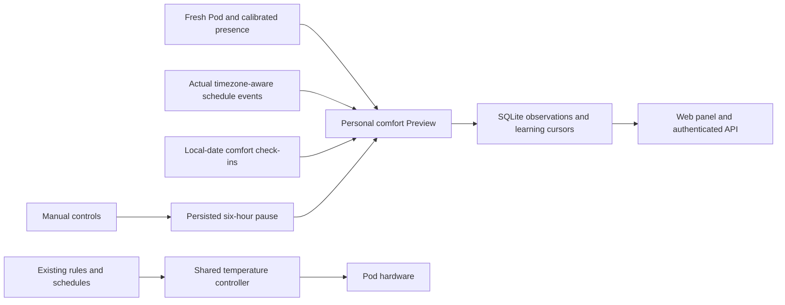

# Personal comfort Preview

This fork now runs a persisted personal comfort **Preview** beside the shared
temperature controller. It defaults Off. Preview has no actuator dependency and
does not submit temperature leases, power, base or vibration commands. Existing
scheduled and manually configured rules retain their own behavior.

## Using it

Autopilot → Personal comfort shows each side's Off/Preview state, limits,
learned offset, last evaluation, persisted manual pause and recent observations.
Select Start Preview deliberately. The initial range is 70–95°F. The panel
distinguishes a proposed temperature from the reported target and its owner.
An unavailable sensor or journal never appears as a successful observation.

Check-ins describe a date in the Pod's configured timezone. Today and the prior
fourteen dates are accepted, with one editable check-in per side/date. The
learner consumes each date once, requires at least three new check-ins, changes
at most one degree per routine session, and bounds the learned offset to ±3°F.
Editing an already-consumed date does not make it new training evidence.

Manual temperature, duration, power, resume, relevant tap gestures, HomeKit
controls and manual priming persist a six-hour personal-comfort pause. Scheduled
power events do not create that pause. If journaling fails, a manual shutdown
still proceeds; the runtime withholds proposals until the missing pause can be
recorded. A restart preserves successfully persisted pauses and learning cursors.

## API

All routes use the existing owner Bearer/browser-session authentication. Inspect
`/api/openapi.json` for complete schemas. Dates below are examples, not evidence
of an observed sleep session.

| Route | Input | Result |
| --- | --- | --- |
| `GET /api/v1/comfort` | Query `side=left` or `right` | State, timestamped decision, recent observations, runtime and unavailable activation gates |
| `POST /api/v1/comfort/configure` | `{side, config: {mode: "off" or "preview", minimumF, maximumF}}` | Persisted configuration and current status |
| `POST /api/v1/comfort/feedback` | `{side, feedback: {date: "2026-10-25", comfort: "warm"}}` | Updated check-in and status; comfort accepts `warm`, `cold` or `comfortable` |

Equivalent tRPC procedures are `comfort.get`, `comfort.configure` and
`comfort.feedback`. `generatedAt`, `evaluatedAt`, pause timestamps and event
observation times use epoch milliseconds. `deviceDate` is the current local
date in `timezone`. Reads never start the service or hardware. Configuration
updates do not erase a pause, learned offset or consumed-feedback cursor.

Capabilities distinguish `personalComfortPreview` from `personalComfort`.
Preview is implemented; active control remains unavailable. An `active` request returns HTTP 412. `followBedtime` is now available in
Off/Preview when `sensorAware` is also true (otherwise HTTP 400). The explicit
`sensorAware` option is now available in Off/Preview; see [personal baseline
evidence](PERSONAL_BASELINE_PREVIEW.md). Existing
saved active settings remain inert and display the qualification gate.

## Input and storage behavior

In a sole-sleeper arrangement, live comfort presence now follows the same logical
sleeper as the Python recording services: either calibrated zone may supply a
person observation. Both zones must be available, from the same fresh frame and
with valid calibration identities before the combined observation is eligible.
An empty reading from one half alone cannot establish absence. Residual movement
cannot fabricate a calibrated entry transition. Physical-zone diagnostics retain
their original measurements; this does not identify a person biometrically.

The combined qualification identity includes both calibration sources and the
logical home side. Changing either source withholds the old qualification. Two
active sleepers continue to use separate per-side observations. This adapter does
not change recorded history, saved routines, temperature bounds or activation
consent. Left/right/middle observations on the actual mattress still need attended
validation; synthetic tests establish routing behavior only.

- Uses the existing scheduler's weekday and DST semantics. A Saturday 22:00
  start does **not** imply a Sunday 07:00 end unless that end event exists.
  Overlapping starts, equal boundaries, missing ends and windows over 26 hours
  are withheld. Schedule edits invalidate the cache within the current minute.
- Requires a fresh DAC report, confirmed water, powered side, calibrated person
  presence, no priming/vibration/base motion, no away state and a known target.
  Unknown base telemetry withholds proposals. An alarm's longer wake window is
  protected as well as the usual thirty-minute warm-up.
- Does not assume the old Free Sleep five-minute vital-window format matches
  Core's processing. The [sensor-aware Preview adapter](PERSONAL_BASELINE_PREVIEW.md)
  now qualifies Core minute estimates and recorded mechanical receipts explicitly.
  [Bed-entry timing Preview](BED_ENTRY_PREVIEW.md) can shift proposed temperature
  phases; snoring-based actuation remains unavailable.
- SQLite migration 0029 adds separate state, feedback and observation tables.
  State and its observation are committed together. Malformed state fails
  closed; it is never silently replaced with defaults.
- Non-overlapping five-second evaluations record changed decisions immediately
  and unchanged decisions at most once a minute. History responses return the
  latest 60 records. Hourly pruning retains thirty days and at most 50,000
  observations per side. Shutdown drains admitted work before database close.
- Observations retain proposals, reported targets, owner and sensor timestamps;
  they do not claim physical success or manufacture completed Preview nights.

## Remaining release gates

This is not deployment or qualification. The physical Pod still runs customized
Free Sleep. The offline importer and corrected idle handoff trial tooling are
implemented separately; see [controller handoff](CONTROLLER_HANDOFF.md).
The legacy `/api/native/v1` adapter has not shipped; native clients use the
authenticated direct version 1 APIs and their capability flags.
Per-night reporting and exact-source owner review are now implemented; see
[Preview night reports](PREVIEW_NIGHT_REPORTS.md). No actual night is inferred
from baseline data, test results or the passage of time.
The shared authority now journals [temperature applications](TEMPERATURE_APPLICATIONS.md),
including uncertain results; Preview still never calls it. Remaining work includes
the active policy admission/application adapter, hardware qualification, seven real
Preview nights with owner review, and bounded activation. A Preview proposal
alone is not evidence of improved sleep or a completed night.

Validation records are software-only: migrated SQLite reopen/rollback, DST and
ambiguous schedules, input freshness and alarm windows, failure recovery,
feedback cursors, manual/scheduled intent, API gates and the web controls.

On 2026-10-25, 564 targeted tests and TypeScript/full ESLint/both Drizzle checks
passed before the browser review. The production build passed with isolated
SQLite databases. Loopback HTTP checks verified missing-key 401, status 200,
Preview save 200, activation 412, future feedback 400, OpenAPI and capability
negotiation. Browser checks verified authenticated access, range saving, a
synthetic local check-in, Off/Preview controls and layouts at desktop and 390px
width. The local server deliberately used CI mode: the UI correctly showed a
stopped Preview service and no evaluated night. No real sleep record or owner
connection key was used. Browser review prompted a small spacing fix and an
additional regression for decisions invalidated by a persisted manual pause.

The final Preview push gate passed 3,124 related tests in 123 files, TypeScript,
full ESLint and both Drizzle checks. One preceding full run had an intermittent
WebSocket authentication failure; its 127-test file and the complete retry
passed without changing authentication behavior. The separate general rules
engine now also enforces [signal validity](AUTOMATION_SIGNAL_VALIDITY.md).
