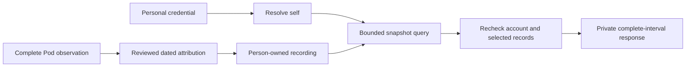

# Private recording history v1

This read-only API exposes the existing person-attributed recording store. It is
separate from the legacy side-selected biometric API. The feature defaults off:
both `SLEEPYPOD_HOUSEHOLD_PREPARATION=1` and `SLEEPYPOD_PERSONAL_HISTORY=1` are
required. The personal session then advertises `capabilities.personalHistory`.
This does not enable Health import, assignment activation or cloud analysis.

The pure shared schemas are in `src/household/historyApiContract.ts`; the frozen
web/native examples are in `src/household/fixtures/personal-history-v1.json`.

## Reads

| Method and route | Result |
|---|---|
| `GET /api/v1/me/sleep?startsAt=…&endsAt=…&kind=presence&limit=30` | `personalHistoryPageSchema` |
| Same, with the exact returned `cursor` | Next page from that snapshot |
| `GET /api/v1/me/sleep/<record UUID>` | `personalHistoryDetailSchema` |

`startsAt` and `endsAt` are canonical decimal UTC milliseconds, with a positive
range of at most 90 days. `kind` is `presence`, `vitals` or `movement`. `limit` is
1–100, default 30. Duplicate, unknown, side, account or sleeper selectors are
rejected. Detail reads accept no query parameters. There is no write operation.

Responses identify Pod, household, account and sleeper; session, household,
assignment and attribution revisions; generation time; and the explicit Pod
source. A client must compare the returned scope with its current personal
session, even after an earlier successful preflight. Never fall back to the
owner/side APIs, silently adopt a response's account, or retain visible private
records after sign-out, revocation or an account/Pod change. Credentials remain
personal; the owner administrative connection key cannot read this namespace.

Native uses the personal Bearer credential. Browser reads require the signed
personal session and `X-Sleepypod-Sleeper-Id` matching the current account.
Cross-origin browser requests are rejected. All output is `private, no-store`.
The controller revalidates authority, feature availability and selected records
before delivering the single response chunk. A concurrent account, assignment,
source or attribution change can abort the body: discard it and refresh after
rechecking the personal session. Partial output is not a usable page.

A missing, foreign, revoked or invalidated record has the same generic 404
response. Invalid query fields return 400; stale cursors/context or disabled
history return 409; invalid credentials return 401. Storage errors return a
generic 503 without database values. Empty records mean **no attributed records
in this query**, never zero sleep or successful live collection.

## Complete intervals and snapshot pagination

Ranges are half-open `[startsAt, endsAt)`. Pages include complete records that
overlap the range. For example, an overnight recording from 23:00 to 07:00 is
included in a query starting at midnight; the original boundaries are retained.
Records are not silently dropped, truncated, proportionally scaled or relabeled.

`intervalSelection: overlap_full_records` is explicit. Do not count the entire
duration as time within a smaller selected period. Presence totals alone do not
locate individual exits; do not invent a proportional distribution of those
gaps. De-duplicate record IDs across overlapping date queries and group complete
nights deliberately. `reportedPresenceSeconds` is bed presence, not confirmed
sleep. Movement is not a sleep stage. Pod HRV keeps its metric label and must not
be treated as equivalent to Watch HRV. None of these records are Apple Health
references or measured identity recognition.

Records are ordered by observation start time descending, then internal sequence.
Signed opaque cursors bind the original person, revisions, filters, page size and
snapshot watermark. Later arrivals wait for refresh. Reusing a cursor for another
person/filter, changing ownership, source invalidation, or restarting the
controller expires it; discard the accumulated pages and start a fresh query.
The API never accepts an arbitrary source dataset ID or a caller-provided owner.

## Ownership and integration limits

Existing `PersonHistoryStore` admission requires an explicit dated attribution
epoch and a complete source observation. Records spanning an assignment change,
unknown owners and overlapping duplicate presence are withheld. Moving sides
does not transfer historical records. Household administration does not grant
the member's records. This API reads that store; it does not create epochs,
silently claim old Left records, import Health data, or start sensor processes.

Continuous source ingestion, explicit legacy claims, person-bound Health
consent/import/export, web/native history screens and the real arrangement
coordinator remain integration work. The new routes do not by themselves make
the two-person release ready. Keep the live flags disabled until the complete
personal recovery and account release gates are satisfied.

Validation uses isolated SQLite databases, credential changes, two accounts,
side transitions and the built server. It does not establish physical identity,
sleep-classification accuracy or live ingestion on the owner's Pod.
