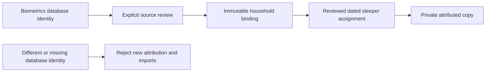

# Personal history source identity

A sleeper assignment must name a particular recording database, not whichever
file happens to occupy a configured path. The source-binding layer now checks
that boundary before either an attribution epoch or a personal observation can
be written.

## Identity and review

- Migration `0033_history_source_identity` adds an initially empty metadata table
  to biometrics.db. Applying a migration does not initialize or bind a source.
- The internal preparation helper creates one random dataset UUID only when that
  table has no row. It refuses malformed existing metadata. It does not read or
  write measurements, schedules, sensor settings, credentials or hardware.
- A backup carries this UUID with the database. Opening that backup at another
  path retains the identity; creating a new database produces another identity.
- An active household owner must review the exact prepared identity. The binding
  in configuration migration `0061_household_history_source` also retains the
  review receipt, reviewer and binding time. Only the exact original review may
  be replayed. There is no automatic rebind or public source-binding endpoint.
- Every epoch append/transition and observation admission verifies the actual
  open source database against the retained household binding. Missing, corrupt,
  future-dated or replaced metadata withdraws those writes. Verification never
  creates a replacement identity or edits the existing binding.
- Previously attributed copies remain private and readable when their original
  database is unavailable. They remain tied to their original epoch and cannot
  be reassigned to a newly joined person by changing a side picker.

## Integration boundary

The production history store receives the real biometrics connection. Account
creation and history reads perform no source preparation or binding. This is an
internal prerequisite for the still-unavailable arrangement activation coordinator;
it does not enable shared-bed activation, claim historic data during signup or
start an automatic importer. Existing capability flags remain unchanged.

## Completed presence import

`PresenceHistoryImporter` reads completed `sleep_records` through the verified
biometrics connection. It is an internal adapter, with no public write endpoint
and no scheduled or startup invocation. A coordinator must explicitly prepare
the source binding and reviewed attribution intervals before using it.

- Each source snapshot is bounded to 100 rows, 256 KiB per interval JSON column
  and 8 MiB of interval JSON per page. A byte limit returns a cursor before the
  unconsumed row. The maximum source ID stays fixed across a scan; new arrivals
  wait for the next scan. Restarting without a cursor rechecks earlier records.
- Timestamps are converted explicitly from source UTC seconds to history UTC
  milliseconds. Only completed, nonfuture intervals up to 24 hours qualify.
  Unsupported, empty or malformed interval data remains unavailable.
- Reported presence is the union of the source's known present intervals, not
  the entire elapsed night or the misleadingly named `sleep_duration_seconds`
  column. Missing gaps are not filled, and presence is not described as sleep.
- The entire recording must fit one reviewed attribution interval. A side-change
  boundary or ambiguous assignment withholds it. A current side selector cannot
  assign an old recording to a new person.
- Each private copy retains a digest covering all source columns and the adapter
  version. Editing interval detail, even without changing total duration,
  invalidates the copy on rescan. Malformed replacements also withdraw existing
  copies. Reverting the source cannot revive or reassign invalidated history.
- A mid-page interruption may leave already committed private copies; replay is
  idempotent. Raw-source retention does not delete those copies. A replaced
  database fails source verification before any admission or invalidation.

This adapter does not import movement or vital rows: their legacy timestamps do
not define complete measurement windows. It also does not infer processing
provenance that `sleep_records` never recorded. Continuous ingestion and reviewed
household activation remain separate integration steps.

Before activating a shared arrangement, the coordinator still needs to bind the
exact approved arrangement, quiesce all command writers durably, publish both
complete weeks atomically and record the observation transition. Source adapters
must retain complete measurement intervals and processing provenance. In
particular, a movement row's timestamp alone does not prove a 60-second interval,
and a vital timestamp alone does not define every contributing sample window.
Those missing intervals must not be invented for personal attribution.

## Validation

The focused migrated-database tests cover restart/backup relocation, exact review
replay, owner authorization, replacement and missing sources, damaged metadata,
future timestamps and preservation of private attributed records. Existing
history and authenticated HTTP tests use actual isolated source bindings.
The combined source-binding and importer suite passed 9,216 tests with 19 existing skips; TypeScript,
ESLint, both Drizzle migration checks and the production build passed. The first
full run correctly detected the two new tables in three schema expectations;
the expected export list and exact table snapshots were reviewed and updated.
The importer has 19 migrated-database regressions, including interruption after
commit, consistent paging, same-total interval edits, malformed replacements,
cross-person ownership, unknown gaps and raw-source retention.
This is source validation, not a live deployment or two-person activation receipt.
