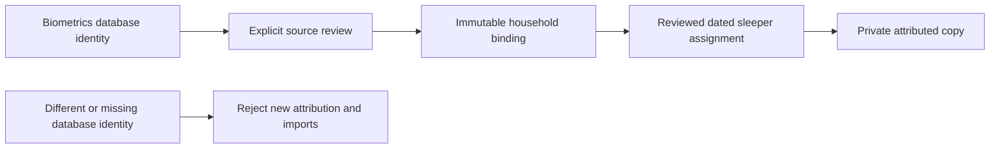
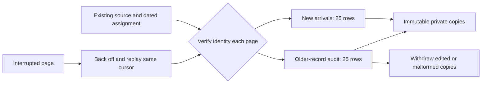

# Personal history source identity

A sleeper assignment must name a particular recording database, not whichever
file happens to occupy a configured path. The source-binding layer now checks
that boundary before either an attribution epoch or a personal observation can
be written.

## Identity and review

- Migration `0033_history_source_identity` adds an initially empty metadata table
  to biometrics.db. Applying a migration does not initialize or bind a source.
- The internal preparation helper creates one random dataset UUID only when that
  table has no row. It refuses malformed existing metadata. It does not read or
  write measurements, schedules, sensor settings, credentials or hardware.
- A backup carries this UUID with the database. Opening that backup at another
  path retains the identity; creating a new database produces another identity.
- An active household owner must review the exact prepared identity. The binding
  in configuration migration `0061_household_history_source` also retains the
  review receipt, reviewer and binding time. Only the exact original review may
  be replayed. There is no automatic rebind or public source-binding endpoint.
- Every epoch append/transition and observation admission verifies the actual
  open source database against the retained household binding. Missing, corrupt,
  future-dated or replaced metadata withdraws those writes. Verification never
  creates a replacement identity or edits the existing binding.
- Previously attributed copies remain private and readable when their original
  database is unavailable. They remain tied to their original epoch and cannot
  be reassigned to a newly joined person by changing a side picker.

## Integration boundary

The production history store receives the real biometrics connection. Account
creation and history reads perform no source preparation or binding. This is an
internal prerequisite for the still-unavailable arrangement activation coordinator;
it does not enable shared-bed activation or claim historic data during signup.
The background importer described below only uses existing reviewed bindings and
attribution intervals. Existing capability flags remain unchanged.

## Completed presence import

`PresenceHistoryImporter` reads completed `sleep_records` through the verified
biometrics connection. It is an internal adapter, with no public write endpoint.
A coordinator must explicitly prepare the source binding and reviewed attribution
intervals before the background worker can use it.

- Each source snapshot is bounded to 100 rows, 256 KiB per interval JSON column
  and 8 MiB of interval JSON per page. A byte limit returns a cursor before the
  unconsumed row. The maximum source ID stays fixed across a scan; new arrivals
  wait for the next scan. Restarting without a cursor rechecks earlier records.
- Timestamps are converted explicitly from source UTC seconds to history UTC
  milliseconds. Only completed, nonfuture intervals up to 24 hours qualify.
  Unsupported, empty or malformed interval data remains unavailable.
- A future-dated row is deferred, not admitted. Existing unchanged copies survive
  a clock rollback; revalidation can still withdraw an actually changed copy
  without admitting a replacement. A clock change alone cannot permanently erase
  a valid night's private copy.
- Reported presence is the union of the source's known present intervals, not
  the entire elapsed night or the misleadingly named `sleep_duration_seconds`
  column. Missing gaps are not filled, and presence is not described as sleep.
- The entire recording must fit one reviewed attribution interval. A side-change
  boundary or ambiguous assignment withholds it. A current side selector cannot
  assign an old recording to a new person.
- Each private copy retains a digest covering all source columns and the adapter
  version. Editing interval detail, even without changing total duration,
  invalidates the copy on rescan. Malformed replacements also withdraw existing
  copies. Reverting the source cannot revive or reassign invalidated history.
- A mid-page interruption may leave already committed private copies; replay is
  idempotent. Raw-source retention does not delete those copies. A replaced
  database fails source verification before any admission or invalidation.

This adapter does not import movement or vital rows: their legacy timestamps do
not define complete measurement windows. It also does not infer processing
provenance that `sleep_records` never recorded. Reviewed household activation
remains a separate integration step.

## Continuous ingestion and revalidation

After migrations, the Node runtime starts one `globalThis`-owned worker. It is
skipped in CI and stops before database shutdown. Both household preparation and
personal history must be enabled, with exactly one existing reviewed source that
has at least one nonrevoked attribution interval. Otherwise it remains idle.
The worker never initializes source metadata, creates a binding, appends an epoch,
changes an account or issues a hardware command.

- The first pass begins five seconds after startup. A successful tick is followed
  by a 30-second delay. At most two 25-row pages run per tick: one for new arrivals
  and one for an audit, each retaining the adapter's interval-byte limits.
- A catch-up pass uses a fixed maximum source ID. Once complete, a fresh tail pass
  starts after that maximum. New arrivals cannot extend an audit indefinitely.
- After the initial catch-up, a complete audit starts 15 minutes after the last
  complete audit. Large audits proceed page by page while new arrivals continue
  on the independent lane. A source edit is withdrawn when its audit page runs,
  not instantaneously; long histories or failures extend that delay.
- A new reviewed older interval is discovered by the next audit. Withheld rows
  are never automatically assigned to the current side or household owner.
- A failed page does not advance its cursor. Backoff grows from one minute to a
  maximum of 15 minutes. Already committed private copies make retries idempotent.
  Source replacement or missing identity blocks imports without repairing or
  rebinding anything. Existing attributed copies remain private and readable.
- Cursors are deliberately in memory: restart replays the source with bounded
  pages. There is no durable checkpoint that can silently skip a partially
  completed import. A target change, disabled runtime or missing review resets
  both lanes. Raw retention does not remove private copies.
- Internal status reports state, last attempt, last successful page, last complete
  audit and bounded failure count. It contains no names, rows, SQL, error messages
  or paths. It is not a claim of physical sensor quality or confirmed sleep.

These are software lifecycle checks. Deployment and a real two-person transition
still need their own acceptance; no live flag or household state was changed.

Before activating a shared arrangement, the coordinator still needs to bind the
exact approved arrangement, quiesce all command writers durably, publish both
complete weeks atomically and record the observation transition. Source adapters
must retain complete measurement intervals and processing provenance. In
particular, a movement row's timestamp alone does not prove a 60-second interval,
and a vital timestamp alone does not define every contributing sample window.
Those missing intervals must not be invented for personal attribution.

## Validation

The focused migrated-database tests cover restart/backup relocation, exact review
replay, owner authorization, replacement and missing sources, damaged metadata,
future timestamps and preservation of private attributed records. Existing
history and authenticated HTTP tests use actual isolated source bindings.
The combined source-binding and importer suite passed 9,216 tests with 19 existing skips; TypeScript,
ESLint, both Drizzle migration checks and the production build passed. The first
full run correctly detected the two new tables in three schema expectations;
the expected export list and exact table snapshots were reviewed and updated.
The importer has 19 migrated-database regressions, including interruption after
commit, consistent paging, same-total interval edits, malformed replacements,
cross-person ownership, unknown gaps and raw-source retention.
This is source validation, not a live deployment or two-person activation receipt.

The continuous worker's final source passed **9,293 tests with 19 existing
skips**, TypeScript, full ESLint and the production build. The household/startup
subset passed 289 tests. New cases exercise real migrated stores, cross-person
access, independent audit/tail progress, retry after partial commit, restart,
source replacement and missing identity, revoked review, raw retention, newly
reviewed older intervals, clock rollback and changed future-dated rows. An early
timer test incorrectly counted an audit page as another timer tick; it now
asserts the actual tick boundary without weakening the two-page budget. The
original failed receipt is retained. Hosted promotion and deployment remain
separate from these local checks.
