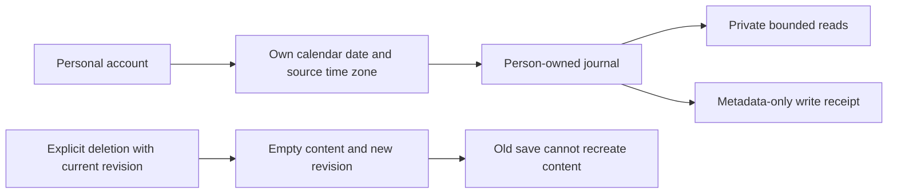

# Person-owned check-ins

New personal check-ins belong to the authenticated sleeper, independently of
their physical bed side. A prepared member can describe their own night before
the household activates assigned sides. This does not claim that the Pod measured
their sleep or that a particular recording belongs to them.

This delivery includes storage, the HTTP contract and a personal web editor.
The editor keeps drafts in memory, distinguishes unsaved changes from saved
entries, and reconciles a lost save response by reading its receipt and the
current entry without resending the write. Closing or changing dates requires
review of any draft; hiding the page clears its private content. Access is
rechecked around requests and while the workspace remains open.

Native editor parity and personal learning enrollment remain separate work.
The feature defaults off; implemented source and browser-fixture checks do not
establish live deployment, feature enablement or physical verification. No
working solo settings or hardware controls are changed by this feature.

## Identity and storage

`household_journal_entries` has one entry per account and local date. Each row
retains the original sleeper identifier and source time zone. Ownership is
resolved from the current personal credential, never from a caller-supplied
account, a current side assignment or an occupancy estimate. Reassigning the bed
does not retarget a note to the new sleeper on that side.

The schema is generated in migration `0069_loving_garia.sql`. No legacy journal,
feedback, comfort state, model, recording or routine is copied or modified. The
personal journal cannot train or activate a model. Future learning must join
explicitly reviewed person-attributed observations with compatible sensor-zone
provenance; the date of a self-report is not sufficient attribution by itself.

## Routes

All routes require a personal credential. Browser requests also pin
`X-Sleepypod-Sleeper-Id` to the current account and retain the existing same-origin
and browser-revision checks. The installation-owner connection key does not grant
access to personal check-ins.

- `GET /api/v1/me/journal?date=2026-11-10` reads one entry or its deletion revision.
- `GET /api/v1/me/journal?from=2026-11-01&through=2026-11-10` reads up to 90
  inclusive calendar dates, newest first, omitting deleted entries.
- `GET /api/v1/me/journal/patterns?from=2026-11-01&through=2026-11-10` compares
  saved personal check-ins within the same bounded range. It returns only
  aggregate comfort/context counts, never notes or individual observations.
- `POST /api/v1/me/journal` saves or deletes one entry with a fresh request UUID,
  expected session/assignment revisions, date, expected entry revision, expected
  source time zone and validated journal fields. `fields: null` deletes content.
- `GET /api/v1/me/journal/requests/<request UUID>` reconciles a lost response.
  Another account or an unknown request receives no receipt.

Every response carries its authenticated identity/revision scope and the explicit
interpretation `personal_self_report_not_sleep_measurement`. Unknown, duplicate,
cross-account and side selectors are rejected. Reads are revalidated as response
bytes are consumed; revocation, browser account switches, disabled capability,
changed content and interrupted requests withdraw queued private output. No read
or reconnect replays a write.

The session capabilities `personalJournal` and `personalJournalPatterns` require both
`SLEEPYPOD_HOUSEHOLD_PREPARATION=1` and `SLEEPYPOD_PERSONAL_JOURNAL=1`. The latter is
off by default and independent of hardware control or arrangement activation.

## Edits, deletion and retry behavior

The saved revision must match before an edit or deletion commits. This prevents
an old editor from overwriting a newer note or recreating deleted content. The
entry and its request receipt share one SQLite transaction. Identical request
replay returns only the original metadata receipt, while a changed payload or
another account cannot reuse that request identifier.

Receipts contain the date, revision, source time zone, result and commit time;
they never store note text, habit fields or a duplicate request body. Deletion
sets the current fields to SQL NULL and retains a new revision. A previous save
receipt may still say that its historical request succeeded; clients must read
the current entry separately before displaying current content. An intentional
new entry after deletion must use the deletion revision and a new request UUID.

This is logical deletion from the current journal, not a claim of secure erasure
from SQLite free pages, WAL files, existing backups or user exports. Historical
learning archives and their original/derived copies have a separate pending
deletion workflow. There is no automatic enrollment of these new notes into
derived models, so this delivery creates no model copies to remove.

## Calendar and evidence boundaries

Existing entries retain their original time zone after travel or a controller
time-zone change. New entries require the current configured zone. Dates must
exist in that zone and cannot be in the future. Detailed habit timestamps must
fall within the preceding day or wake date and not after the controller clock.
Clock rollback cannot update either a saved entry or a deletion tombstone.

The existing detailed habit contract preserves `not_logged`, `none` and `yes`.
Omitting detail during an older-client edit preserves compatible prior detail;
changing a habit clears its incompatible timing. A check-in is a subjective
observation, not a sleep measurement or evidence that a temperature change helped.

## Validation

Real migrated SQLite and HTTP tests cover two-account separation, changed bed
assignment, optimistic concurrency, exact retry, deletion and stale recreation,
receipt privacy, transaction rollback, reopening the database, daylight-saving
dates, a skipped local date, future data, backward clocks, bounded reads,
revocation, browser switches, interrupted uploads and generic corruption errors.
The focused journal, household HTTP and schema run passes 114 tests. The initial
browser-switch fixture omitted the required browser-revision header; it was
corrected and the failed result retained separately. TypeScript, full ESLint,
both generated-migration checks and the production build pass.

The final full source run passes 9,766 tests with 19 existing skips. The four
personal-journal browser scenarios pass on desktop, phone, tablet and enlarged
text, including lost-response reconciliation, saved-versus-unsaved state,
deletion, draft review and hidden-page privacy. The focused state/API run passes
72 tests. Independent rendered review accepted the final unsaved-state and
documentation corrections; hosted validation remains required.

Earlier full runs had five-second shell-fixture timeouts. Isolated repeats and
process profiling reproduced slow successful commands, with no stable improvement
from changing worker pools. Those failed results are retained. The real-process
suites now run sequentially with an integration-specific budget and explicit
child-process deadlines; see [shell integration tests](SHELL_INTEGRATION_TESTS.md).
All 101 shell integration cases pass. Production scripts and behavioral
assertions are unchanged.

No Pod, phone, routine or account was changed during these synthetic source tests.

## Private habit comparisons

The open check-in panel includes an optional **Habits and feeling too warm**
disclosure. Choose a range of at most 90 dates and explicitly compare saved
entries. The response belongs only to the current personal credential; the
installation owner cannot read a partner's journal through this endpoint.

Retained time zones stay in separate groups. Each comparison displays the two
group definitions, usable-date counts, too-warm counts and excluded entries.
A percentage-point difference appears only with at least five distinct saved
dates in **each** group. This is a display threshold, not statistical validation.
Zero is shown as zero; missing context is excluded, never interpreted as no
activity or comfortable sleep. Timing compares only valid logged observations
relative to the reported bedtime. Quantity comparisons split at the median of
logged amounts in the selected range.

These are exploratory associations in self-reported temperature comfort. They
do not establish causation, objective sleep improvement or which setting to use.
Room conditions, season, other habits and routine changes are potential
confounders. Legacy side-owned journals, Watch data and unsaved drafts are not
pooled into these results. Nothing trains a model or changes bed settings.

Results remain in memory while open. Changing the range, saving an entry, closing
the disclosure, hiding the page or losing account access clears them. A failed
comparison preserves an unsaved check-in and offers an explicit retry. Pending
saves block comparison until the current saved result is known. Read delivery
revalidates the account, capability and underlying data before returning bytes.

The added contract, account/HTTP and client-state tests cover separate people,
separate time zones, excluded observations, invalid ranges and counts, queued
response withdrawal, capability loss, late replies and saved-only comparisons.
Rendered verification and hosted checks are recorded separately from source
coverage; these tests do not establish physical or clinical performance.

Comparison validation passes 70 focused tests and six production-browser
scenarios, including a bounded keyboard traversal through native date segments,
phone/tablet/desktop, dark/enlarged text, empty/insufficient/loading/error states
and draft preservation. Production build, TypeScript and lint pass. The
independent reviewer identified exclusion-ordering as the sole material visual
fix, then scored it resolved after the complete capture set was refreshed.
Hosted release, native comparison parity and actual user observations remain
separate work. No statistical or sleep-outcome claim follows from these tests.
