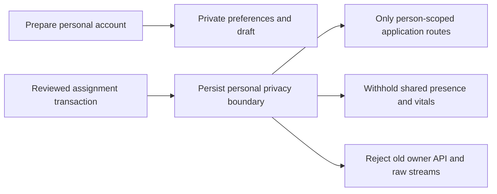

# Persistent personal privacy boundary

This boundary is part of the household integration. It does not activate a second
sleeper, enable any feature flag, change a routine, or deploy to the Pod.

Preparing an account, accepting an invitation, and saving an unassigned private
routine remain separate from changing the operating bed. Luca's existing solo
arrangement therefore continues during preparation.

## When the boundary becomes permanent

SQLite triggers insert a single persistent boundary in the same transaction as
an assigned household, a physical account assignment, assigned history
attribution, or a member's admitted observation. Existing qualifying records are
backfilled during migration. A failed transaction also rolls back its boundary.

The boundary is not keyed to the current mode or an environment flag. Account
revocation, changing sides, returning to solo, and disabling the household flags
do not remove it. Ordinary SQL updates/deletes of the boundary are rejected. An
administrator with filesystem/root access can still replace a database or install
older software; this is an application privacy boundary, not encryption against
the administrator. Restoring an older installation must be reviewed separately.

## Network access

The owner connection key still proves the owner's identity where explicit setup
administration requires it. It no longer grants legacy application data access
after the boundary is present. The proxy and route guards deny old REST/tRPC,
raw records, archive/database downloads, model/diagnostic routes, optional MCP,
and legacy Watch uploads. This deliberately includes old capabilities calls:
old clients need a personal connection, not another owner-key attempt.

An authenticated legacy request receives HTTP 403 with
`code: personal_connection_required` and the relative
`personalWorkspace: /household/index.html` link. Missing/unverifiable privacy
storage returns HTTP 503 (`privacy_unavailable`). A missing credential remains
HTTP 401. Partial household schema without the boundary is unavailable. A
pre-household database with no account tables retains its original owner flow.

The auth-session endpoint includes `personalConnectionRequired` and
`privacyAvailable`. The owner web shell unmounts private children and directs the
user to the isolated personal workspace. Old owner login requests cannot mint a
new broad browser cookie after activation. Personal `/api/v1/household/*` and
`/api/v1/me/*` routes continue using their own revocable account credentials.

Response bodies and raw WebSockets recheck access at delivery boundaries. An
existing stream closes with code 1008 when permission changes. A legacy Health
upload checks while staging and before starting its importer; a one-second
watchdog also interrupts a quiet upload or importer. Each import batch still
passes through the authenticated API. Previously saved batches or delivered
bytes are not undone.

## Home integration

Shared occupancy, heart rate, respiration and HRV become unavailable, with null
values/timestamps and `reason: privacy_required`. A fresh sensor value is not
permission to disclose it to everyone using Apple Home or the MQTT broker.
MQTT rechecks personal topics immediately before publishing, including cached
snapshots. Empty retained-message tombstones still pass so stale retained data
can be withdrawn. The HomeKit occupancy characteristic returns an unavailable
error and sets its fault indicator; it never substitutes an empty-bed value.
Both direct reads and periodic notifications recheck privacy. No broker credentials, accessory identifiers or HomeKit
pairings are changed. Shared climate, water and pump status continue as before.

This version does not add a consent switch or shared-actuator permissions. The
reviewed per-person sharing and common HomeKit/MQTT command policy remain release
gates. Broker subscribers or Apple Home clients may already have stored earlier
observations; the Pod cannot erase those external histories.

## Validation and remaining integration

Behavioral checks cover migrated/backfilled installations, persisted revocation,
mode/flag changes, failed-transaction rollback, missing/corrupt storage, owner
browser switching, in-flight response cancellation, actual WebSocket closure,
Health-upload interruption, cached MQTT redaction and actual HomeKit characteristic
reads/polling after access changes. The tests use temporary
databases and synthetic observations, never the owner's live data.

Two-person activation is still disabled. Its coordinator must lock both sides,
review each person's exact routine, apply dated attribution, quiesce prior
request effects/queues and snoozes, and invalidate incompatible learning and
qualification. A response guard cannot reverse an old mutation that already
committed. Person-bound Health import/history and separately reviewed shared
control consent are also required before release. No endpoint in this change
performs that transition or claims physical validation.
