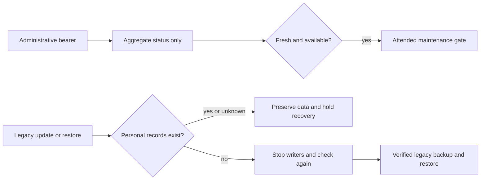

# Maintenance and recovery with personal accounts

The private account release needs an administrative health check that does not
reopen the legacy owner API. It also needs recovery that cannot replace private
records with a pre-account backup. These are separate requirements.

## Administrative status

`GET /api/v1/maintenance/status` (and the framework's read-only `HEAD`) accepts
the provisioned administrative Bearer connection key. It rejects cookies,
browser Origin / Fetch Metadata, personal-device credentials, query selectors,
and non-read methods. The Host allowlist still applies. No other maintenance
path bypasses the legacy privacy check.

The version-one response contains only:

- Protocol identity, response time, controller identity and packaged revision.
- Whole-controller device freshness, thermal readiness and aggregate thermal
  idleness (or unknown).
- Whether the persistent personal privacy boundary is legacy, required or
  unavailable. Unavailable storage cannot assert thermal readiness/idleness.

It does not return account identifiers, names, side measurements, occupancy,
targets, schedules, alarms, preferences, Health data, history, credentials or
private-state hashes. It reads the existing monitor and never starts a service,
polls hardware, changes a target or writes to a database. Authentication is
checked before the read and again before response delivery. Output is private
and uncached; rotating the connection key invalidates pending output.

An idle report means fresh, valid, zero heating countdowns on both zones with
priming off. It does **not** establish an empty bed, stopped vibration, a stationary
base or physical safety to restart. The attended deployment gate still applies.

The deployment observation client prefers this endpoint and verifies its exact
shape, revision and timestamp. Only HTTP 404 permits compatibility fallback to
the old capabilities/device API. Authorization failures, malformed payloads,
storage failures and unknown protocols do not trigger fallback. New-protocol
payloads are projected into the validated maintenance journal fields.

## Current recovery hold

The managed `upgrade.py`, initial handoff and retained-Free-Sleep rollback paths
refuse legacy recovery once any personal household records exist. This includes
unassigned preparation, revoked accounts, personal drafts, attribution epochs
and future populated `household_*` tables. Empty migrated tables and the legacy
browser-scope table alone do not mean that personal accounts exist.

Checks read committed SQLite/WAL state without reading private row values, verify
the required Core tables, and run SQLite's `quick_check`. A missing, incomplete,
unreadable, corrupt or linked database fails closed. Checks run before
service changes and again after writers stop. Upgrade rollback checks both the
current data and proposed backup before replacing files. A concurrent join or
candidate write is preserved; it cannot silently vanish into an older backup.
If that race is detected after services stop, the operation records
`recovery_required`, retains the data and does not start the older controller.
An ordinary manual rollback rejected before stopping leaves the current runtime
in place. No override flag is supplied to erase this boundary.

This conservative hold is **not yet a supported personal-household restore**.
It does not protect against manually running older scripts, replacing the whole
storage directory outside these tools, or root access. Personal runtime flags
must remain disabled on the live Pod until the integrated release is qualified.

## Remaining recovery work

Before personal activation, implement and test an external durable recovery
record, independent of the replaceable database, with an audited compatible
runtime floor. Runtime admission, packaging, startup and restore must enforce
that record. A declaration must come from the target's committed source, not
from a newer packager pointed at an older checkout.

The restore protocol must preserve account/device revocations, identity and
assignment revisions, dated attribution epochs, routine publication receipts,
private preferences/history and pending reconciliation. Test power loss at each
durable boundary and restoration of older backups. Use a reviewed recovery path
that never makes another person's data available through an older owner-key API.

Tests use isolated databases and simulated services. None of this document is
evidence of a Pod restart, a physical test or a personal-account deployment.
