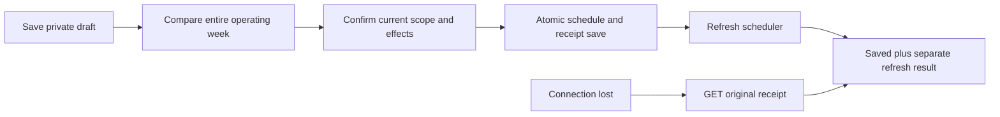

# Personal routine publication API v1

This additive contract separates a person's saved draft from the Pod's operating
week. It is implemented for validation, **not enabled or deployed** on the Pod.
It does not assign a bed side or finish the household release gates. Preparation,
personal runtime and publication must all be enabled explicitly:
`SLEEPYPOD_HOUSEHOLD_PREPARATION=1`, `SLEEPYPOD_PERSONAL_RUNTIME=1` and
`SLEEPYPOD_PERSONAL_ROUTINES=1`. All default off.

Use the personal transport, browser-scope protection, no-store caching and full
person context described in [the control contract](PERSONAL_CONTROL_API_V1.md).
The optional session capability `personalRoutinePublication` must be true before
offering publication. Older clients treat an absent capability as false. The
existing `GET/PUT /api/v1/me/routines` remains `draft_only`, even after a draft has
been published. A later draft save does not update the operating schedule.

| Route | Method | Shape |
|---|---|---|
| `/api/v1/me/routines/review` | GET | `personalRoutineReviewSchema` |
| `/api/v1/me/routines/publish` | POST | `personalRoutinePublishSchema` → `personalRoutineReceiptSchema` |
| `/api/v1/me/routines/publications/{requestId}` | GET | Own receipt, or indistinguishable 404 for absent/another account's receipt |

Schemas: `src/household/routineContract.ts`. Frozen synthetic fixtures:
`src/household/fixtures/personal-routines-v1.json`. They contain no real identity,
credentials or live schedule. The illustrated 69°F edit is an example, not a
change to Luca's 70°F overnight target.

## Review the whole week

The server derives the source side and affected temperature zones from the
authenticated account and current arrangement. The client never sends a side.
An unassigned account or inconsistent/disabled runtime receives 409 before any
live routine is exposed. Solo following affects both thermal zones but scheduled
vibration remains on the source side; do not imply vibration on both sides.

The review includes the full live week, full normalized draft week, Pod timezone,
draft revision, live revision, full control scope and an opaque `reviewRevision`.
The hash binds all of these. Changing a draft, routine, assignment, timezone or
relevant physical configuration invalidates the review. Each change identifies
a night as `create`, `replace` or `remove`; unchanged nights retain their compiled
schedule IDs. A night is named for bedtime: Sunday 22:00 with a 07:00 alarm wakes
on Monday. The routine compiler preserves morning rollover and validates overlaps.

`canPublish` is true only for `reason=ready`. Other reasons:

- `draft_not_prepared`: the new account's revision-one draft is untouched. It
  cannot replace or clear an existing routine. Load the current week into the
  editor explicitly before proposing an edit; never substitute profile defaults.
- `unchanged`: the normalized draft already matches the operating week.
- `calendar_migration_required`: older calendar rows are not owned by the bedtime
  routine editor; resolve that migration separately.
- `publication_disabled`: the server's separate publication gate is off.

Show the before/after comparison for the **entire week**, including removed nights,
temperatures, heating phases, wake days/times, vibration, wake window, snooze,
end action and notes. Preserve fields the editor does not expose; do not silently
reset custom snooze settings. An intentionally cleared week must first be saved
as an empty draft and then reviewed. Merely opening a new account cannot clear it.

## Publish once, then reconcile

After review, retain the exact request before sending. It includes a random UUID,
the complete reviewed scope, the opaque review revision, `issuedAt`, `expiresAt`
and both explicit acknowledgments:

```json
{
  "confirmReplaceLiveWeek": true,
  "acknowledgeCurrentTargetEffect": true
}
```

The window must be positive and at most 60 seconds. The server checks wall time
and elapsed monotonic time again after waiting for the affected side locks.
The UI must explain that saving an operating schedule can affect the current
target. Publication itself does not claim a physical change or trigger a test
alarm. The ordinary scheduler remains the sole owner of scheduled execution.

The server rechecks the exact reviewed week, draft and identity under the side
locks. A single durable SQLite transaction saves the changed schedules and their
receipt. Either both commit or neither commits. Scheduler registration happens
after commit and after releasing the side locks. The receipt separates these:

| Field | Meaning |
|---|---|
| `state=saved` | The operating week and receipt committed to local storage |
| `scheduler=pending` | This process is still refreshing the registered jobs |
| `scheduler=refreshed` | The job manager accepted the refresh; this is not physical proof |
| `scheduler=unconfirmed` | The refresh failed, was interrupted, or its completion was not saved |
| `physicalVerification=unverified` | Network/storage acknowledgment cannot establish actual heating or vibration |

After a timeout, lost response, process restart or sign-in change, GET the original
request ID using the same personal account. Exact POST duplicates also return the
historical receipt without another save or scheduler refresh. A changed payload
under the same UUID returns 409. Every receipt has `replayAllowed=false`.

Do not silently resend, issue a fresh UUID or republish to repair an unconfirmed
result. Keep the saved plan visible with the unconfirmed scheduler warning, read
back the current review, and use a separately qualified controller recovery path.
A restarted job manager rebuilds from persisted rows, but this receipt does not
retroactively claim that its old refresh succeeded. A 404 during an in-flight
request is not proof that nothing happened; retain the unresolved attempt.

Device revocation or a browser switch during refresh withholds the private
response. The committed receipt remains available to another authorized device
of the same account. Another person cannot retrieve it. A later side move does
not replay an old publication onto the new zone. Keep client pending metadata
scoped by Pod, household and sleeper and discard stale view responses after
workspace-generation changes. Never fall back to owner-wide routine endpoints.



## Validation boundary

Real SQLite and HTTP tests cover rollback, stale reviews, disabled/unassigned
accounts, browser switching, revocation, independent fixture sides, receipt
isolation, expired requests, unchanged alarm IDs and failures before/after commit.
The built-route browser test checks the disabled boundary and real GET/POST
exports. Assigned accounts in tests are fixtures, not a shipping side-transfer
workflow. No live alarms, temperatures or assignments are changed by these tests.
