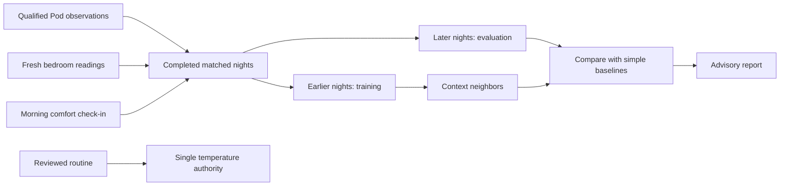

# Personal sleep learning and reliability

## What changed

An overnight routine can override a manually selected temperature when its hold
expires. A starting target is not the entire curve: remove intermediate points
to hold a constant target until wake warming. Keep wake warming outside the
adaptive comfort range. The native editor now explains this and offers an
explicit draft action to remove later phases before reviewing the whole routine.

The night view previously selected the longest recording. It now totals the
union of all recorded intervals, grouping morning fragments with the prior
evening until local noon. Overlaps count once; gaps do not count. This is
**recorded bed time**, not proof of sleep. The native night view now requests
stages for every available recording and includes vitals and Watch comparisons
across those intervals. Stage epochs are clipped to their recording boundaries;
missing segments remain unknown and failed classification requests are reported.
No historical records are rewritten or padded to match an expected duration.

MQTT tests may reuse the saved password only when URL, username and TLS mode
exactly match the saved configuration. A new destination requires an explicitly
entered password. Passwords remain write-only. Live biometric MQTT values require
fresh, calibrated person occupancy as well as existing vital quality checks;
fresh signal estimates from an empty bed are not evidence of a sleeper.

## Research assessment

- [Free Sleep](https://github.com/throwaway31265/free-sleep) contains a local
  controller, schedules and sensor processing. Its documented heart-rate
  evaluation is a small dataset, not evidence that an arbitrary personalized
  thermal controller improves sleep. HR, respiration, sleep staging and thermal
  preference are different estimation problems.
- [SleepyPod Core](https://github.com/sleepypod/core) supports stage rules,
  imported Watch references, experiments and model comparison. Its
  [stage calibration research](https://github.com/sleepypod/core/tree/main/docs/research/sleep-stage-calibration)
  records a small Watch comparison in which personalized rules did not beat the
  defaults. Custom models must beat baselines on later, unseen nights; being
  personalized alone is not evidence of improvement.
- The inspected repositories and preserved stock-file inventory did not reveal
  a documented, reusable Eight Sleep Autopilot weight file. This does not prove
  that no proprietary model exists. We must not label our code as the original
  Eight Sleep model or claim that loading a stage model installs Autopilot.
- Eight Sleep describes its
  [temperature schedule](https://help.eightsleep.com/en_us/what-is-the-temperature-schedule-BkRoPvR66)
  and [Autopilot](https://help.eightsleep.com/en_us/why-does-the-pod-need-autopilot-ByLSWo5Sn)
  as coordinating personalized temperature adjustments. Vendor outcome claims
  do not validate this implementation.
- Apple Health [sleep categories](https://developer.apple.com/documentation/healthkit/hkcategoryvaluesleepanalysis)
  distinguish in-bed and sleep stages. In-bed intervals overlap sleep stages;
  adding them would double-count. Watch SDNN HRV and Pod window-to-window beat
  interval variability are not interchangeable metrics.

Hundreds of Health samples are not necessarily hundreds of nights, and old
Health records generally lack simultaneous Pod water/target and bedroom readings.
Use those records for history, sleep timing and aligned Watch comparisons; do not
invent missing thermal features or use the same night for training and testing.

## Contextual comfort experiment

`context-neighbors-v1` is a small, local, inspectable regression model. It joins
morning warm/comfortable/cold feedback to the preceding night on the same side.
Inputs are actual target temperature, reported water temperature, qualified
bedroom temperature and humidity. Measurements must originate from production
Preview observations with build and hardware identity, fresh device state,
occupied calibrated presence and no mechanical/manual safety exclusions.

One sample is retained per five-minute interval. At least twelve intervals from
one completed session are needed. Multiple sessions for the same date and target
curves varying by more than 2°F are excluded: a single morning label cannot
reliably attribute discomfort to one of several materially different targets.
Sparse research observations expire after 90 days and are separately bounded;
ordinary diagnostic events retain their existing 30-day window.

Warm/comfortable/cold become engineering proxy labels -1/0/+1°F. These are
**requested correction directions**, not measured ideal temperatures. The
20-night minimum is an engineering gate, not a scientifically validated sample
size. The newest quarter (at least five nights) is held out chronologically.
The model uses up to seven nearby contexts and needs at least three neighbors.
It must beat both holding temperature and predicting the training-set average
feedback, by at least 10% and 0.05°F in proxy-label mean absolute error.

The app reports the matched-night counts, validation result and reason for
withholding a suggestion. Missing or unfamiliar conditions produce no proposal.
An eligible suggestion is limited to ±1°F and is **advisory only**. It does not
enter the temperature controller or bypass its activation gates. Validation of
comfort-label prediction does not establish better sleep or medical benefit.

## Model choice and remaining evidence

A local tabular model is appropriate for this small, structured dataset: it is
cheap to evaluate, does not upload health data and can be checked against simple
baselines. An LLM can explain observations and propose reviewable experiments;
it should not infer missing sensor readings or issue actuator commands. Existing
Apple/local and opt-in cloud intelligence remain available. No cloud vendor is
claimed superior without an evaluation using the actual task and data.

Before activation, collect real Preview nights, import authorized Watch history,
verify side/timezone/source alignment, compare on held-out nights, and review
withheld decisions. Keep user-selected targets and wake alarms reliable while
collecting evidence. A successful software test, broker connection or model
fit is not overnight or physical-hardware acceptance.

## Two separate collection requirements

Sleep-stage validation needs Watch stage intervals that overlap the same side's
Pod recordings. A successful Health import, recent Watch heart-rate samples, or
a sleep chart populated by this app does not establish that overlap. Keep
Watch references separate from this app's own Health exports. The direct native
import shows a destination and side review before writing the permitted Watch
samples; importing does not activate a model or change the bed's controls.

The thermal model instead needs matched Pod/room observations and morning
warm/comfortable/cold check-ins. Historical Watch stages alone cannot supply
those temperature measurements or comfort labels. The current contextual model
is advisory even after its holdout gate passes; it is separate from the bounded
feedback learner used by personal comfort's temperature policy.

Personal comfort activation additionally requires the attended observations and
seven source-backed reviewed nights described in
[Owner qualification and thermal activation](COMFORT_OWNER_ACTIVATION.md).
Do not report a running sensor service as proof of fresh measurements, a valid
sleep stage, or a successful physical temperature or wake response.
