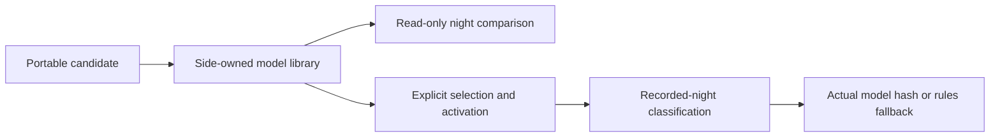

# Personal sleep-stage models

The authenticated Core API can retain portable forest or logistic models trained
off the Pod. Web Settings → Sleep stages and native clients use the same
side-scoped library. This feature labels recorded sleep data; it does not train
models on the Pod or change temperatures, base position, alarms or Autopilot.

## Selection and evidence

An upload saves a candidate without selecting or activating it. Preview evaluates
an uploaded candidate against recorded nights without changing the selection.
“Use this model” explicitly selects and activates that model for one side.
“Use rules only” disables model inference and retains the library. A legacy PUT
of a replacement model selects it with `active: false`, including when the
previous model was active. Deleting the selection retains library history.

Models are deduplicated by canonical content hash, not display version. Full
uploaded metrics remain attached to the artifact. These are uploader claims,
not independently verified scores. The preview response computes agreement only
where Watch stages overlap the Pod epochs. Missing reference data produces no
agreement score. Agreement with a Watch is not clinical accuracy or demonstrated
sleep benefit; do not treat a training score as held-out evaluation.



## Client contract

All routes require the existing bearer token or browser session. Paths below
are relative to `/api`; the same procedures are available under `sleepStages`
in tRPC.

| Method and path | Request | Result |
| --- | --- | --- |
| `GET /sleep-stages/models` | `side` query | Valid candidates with `id`, `modelHash`, metadata, `selected`, `active` |
| `POST /sleep-stages/models` | `{side, model}` | Candidate `id` and `version`; no selection change |
| `PUT /sleep-stages/models/selected` | `{side, id, active}` | Explicit selection; another side's ID returns 404 |
| `GET /sleep-stages/model` | `side` query | Selected document, `uploadedAt`, `modelHash`, `active`; null when unavailable |
| `PUT /sleep-stages/model` | `{side, model}`; model may be null | Replace or clear selection; replacement is inactive |
| `PUT /sleep-stages/model/active` | `{side, active}` | Enable a valid selected model or disable it |
| `POST /sleep-stages/model/preview` | `{side, model?, modelId?, sleepRecordId?, nights?}` | Candidate and rules agreement, night blocks; no write |

Preview accepts an inline candidate or a side-owned library ID, not both. With
neither, it uses the selected document. It accepts up to 30 nights. No matching
Watch epochs yields `agreement: null` and `pooled: null` rather than a fabricated
score. Demo mode exposes an empty library and rejects model mutations/preview.

`biometrics.getSleepStages` adds `stagedBy`:

```json
{
  "engine": "model",
  "version": "uploaded display version",
  "modelHash": "canonical SHA-256",
  "reason": "active_model"
}
```

Rules responses use a null model version/hash, with `rules_selected`,
`no_model_epochs` or `model_evaluation_failed`. This describes the classifier
that produced this response. Existing `stageView` remains the adopted sensor /
rules-profile provenance; it is not replaced by a requested model selection.
Clients must use `stagedBy` to label the actual result, not infer it from settings.

## Validation and migration

Schema migration 0037 adds an empty library and per-side selection table. No
existing night, rule, routine or biometric profile is replaced. The shipped
rules numerical source stays unchanged. Model documents and hashes are
revalidated after reading storage and before inference; corrupt models are
unavailable, and failed/no-epoch inference falls back to rules.

The portable format supports the four-column `challenger` and ten-column
`podNative` feature contracts, fixed five-minute epochs and four stage classes.
The JSON budget is 4 MiB, with bounded trees, feature dimensions, self-test
vectors and metadata. Feature windows are limited to 48 hours. Partial trailing
epochs and epochs without heart-rate samples are omitted. Smoothing and
transition constraints never bridge missing epochs. Outlier limits come from
the adopted rules profile. A complete-night normalization makes this a
retrospective classifier, not an instantaneous sleep-state sensor.

Self-test vectors and the shared numerical fixture check format/converter
compatibility. They do not qualify a personal model or prove better sleep.
Hardware qualification, real held-out nights and the seven-night comfort Preview
remain separate deployment gates.
