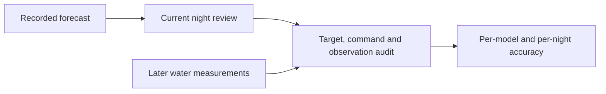

# Prospective water forecast evaluation

The Autopilot water-response area can compare saved predictions with later
measurements. This is a read-only audit of **holding the target**. The proposed
alternative remains unapplied, with no measured outcome attributed to it.

The audit requires a completed, currently reviewed night whose report and sensor,
routine and room configuration match the original prediction. It uses the
original forecast without refitting it. Changes or withdrawals of the source
review remove that night from the next audit.

For each retained prediction, both actual 15- and 30-minute water readings must
be present within 45 seconds of their intended time. The origin must match a
measured reading within 15 seconds and 0.5°F. Water observations must span the
whole interval with gaps no larger than 90 seconds; quiet occupied room contexts
must cover it without a gap larger than 330 seconds. Power loss, changed targets,
missing water, unstable room conditions, manual changes and unresolved commands
exclude the comparison. Only acknowledged same-target keepalives are permitted.
These checks establish recorded evidence, not continuous physical observation.

Each model and configuration is reported separately. Error and empirical range
coverage are averaged within each reviewed night, then equally across nights.
Overlapping five-minute predictions are explicitly not counted as independent
nights. A persistence baseline predicts that water stays at its original measured
temperature. Missing outcomes never become zero error. Pending and excluded
comparisons, with exclusion reasons, remain visible.

`GET /api/v1/comfort/predictive/outcomes?side=left` requires controller
authentication, accepts only the side and uses no-store responses. It shares the
existing isolated read-only worker, ten-second deadline and single-process budget.
The scan bounds records, bytes, command counts and water rows, and fails without
presenting partial favorable statistics if integrity or read budgets fail.
No model is fitted, approval recorded, routine written or target sent.

Better water prediction is not proof of improved comfort, sleep stages or sleep
duration. This audit cannot qualify a target-changing controller: prospective
experiments with actual commanded changes, comfort outcomes, reviewed activation
and attended hardware qualification remain separate requirements.
